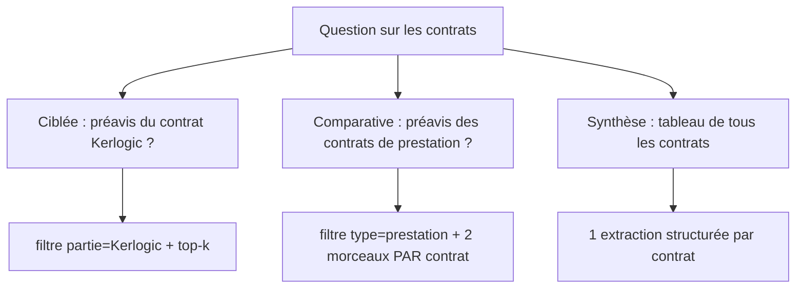

# Contrats et architecture

> [!NOTE]
> Dans cette leçon, vous allez voir ce qui rend les contrats difficiles pour un RAG naïf, classer les questions qu'on leur pose et générer les 5 contrats fictifs du lab.

## Anatomie d'un contrat

```text title="contrats/CT-2025-040-licence-logiciel.txt (début)"
CONTRAT DE LICENCE DE LOGICIEL
Référence : CT-2025-040
Type : licence
Parties : Atelier Nova ; Kerlogic
Date de signature : 2025-09-01

Article 1 – Objet
1.1 Kerlogic concède à Atelier Nova une licence d'utilisation non exclusive du logiciel ...
Article 2 – Durée
2.1 La licence est concédée pour un (1) an à compter du 1er septembre 2025, renouvelable ...
```

Trois couches d'information, trois traitements :

| Couche | Exemple | Traitement dans le lab |
| --- | --- | --- |
| En-tête (métadonnées) | type `licence`, partie `Kerlogic`, date | colonnes SQLite, filtres `WHERE`, ajoutées au contexte |
| Articles | « Article 4 – Résiliation » | un morceau par article : l'unité de sens |
| Clauses | « 4.1 Chaque partie peut… » | jamais coupées : un article trop long est divisé **entre** deux clauses |

Une **métadonnée** est une information **sur** le document (qui, quoi, quand), par opposition à son contenu. Elle ne se « cherche » pas par similarité : elle se **filtre**, exactement comme une colonne en SQL.

## Les trois familles de questions



1. **Ciblée** : un contrat, un fait. Le danger est de répondre avec la clause **d'un autre contrat** : tous ont un article « Résiliation ».
2. **Comparative** : plusieurs contrats, le même fait. Un top-4 global risque de ramener 3 morceaux du même contrat et d'en oublier un.
3. **Synthèse** : tous les contrats, plusieurs faits. Ce n'est plus de la recherche : on lit chaque contrat entier (ils sont courts) et on extrait des champs.

```quiz
question: "Pourquoi un top-k global est-il risqué pour « Compare les préavis des contrats de prestation » ?"
options:
  - "Parce que la similarité cosinus ne marche pas sur les contrats"
  - "Parce que les k meilleurs morceaux peuvent tous venir du même contrat, et en oublier un autre"
  - "Parce que les contrats de prestation sont trop longs"
answer: 1
explanation: "Le top-k classe des morceaux, pas des contrats. Pour une comparaison, il faut garantir au moins un morceau par contrat concerné : c'est le paramètre par_contrat."
```

```quiz
question: "La partie « Kerlogic » est-elle mieux traitée par un filtre ou par la similarité ?"
options:
  - "Par un filtre : c'est une métadonnée exacte, la similarité pourrait ramener un autre contrat qui ressemble"
  - "Par la similarité : elle comprend les synonymes"
  - "Ni l'un ni l'autre"
answer: 0
explanation: "Une contrainte exacte (cette partie, ce type, après telle date) doit être exacte. On filtre d'abord, puis on classe par similarité à l'intérieur du sous-ensemble."
```

## Le corpus fictif

[make_contracts.py](../files/make_contracts.py) décrit chaque contrat en données Python et l'écrit en texte :

```python title="files/make_contracts.py (extrait)"
    {"fichier": "CT-2025-040-licence-logiciel.txt", "titre": "CONTRAT DE LICENCE DE LOGICIEL",
     "ref": "CT-2025-040", "type": "licence", "date": "2025-09-01",
     "parties": ["Atelier Nova", "Kerlogic"],
     "articles": [
         ("Objet", ["Kerlogic concède à Atelier Nova une licence d'utilisation ..."]),
         ("Durée", ["La licence est concédée pour un (1) an ..."]),
         ...
```

Le contrat de maintenance a volontairement un article « Niveaux de service » de 5 clauses, plus long que la limite de 500 caractères : il servira à tester le découpage entre clauses.

> [!WARNING]
> Ici les contrats sont du texte propre. Les vrais contrats sont des PDF, parfois scannés, avec des numérotations irrégulières (« Art. 4 », « ARTICLE QUATRE »). Le parseur sera la partie la plus fragile : testez-le sur un échantillon réel avant de l'industrialiser.

## Exercice : écrire les questions de référence

Pour chacune des trois familles, écrivez une question sur ce corpus et indiquez ce qu'une bonne réponse doit contenir (contrat et preuve textuelle).

<details>
<summary>Voir la solution</summary>

| Famille | Question | Attendu |
| --- | --- | --- |
| ciblée | « Quel tribunal est compétent pour le contrat de licence ? » | CT-2025-040, « tribunal de commerce de Rennes » |
| comparative | « Compare les préavis de résiliation des contrats de prestation. » | CT-2025-014 « trois (3) mois » et CT-2025-022 « un (1) mois » |
| synthèse | « Tableau durée / préavis / montant de tous les contrats » | une ligne par contrat (5 lignes) |

C'est exactement le format de [golden.json](../files/golden.json) : une **preuve** (sous-chaîne exacte) par contrat attendu. Elle permet de mesurer le rappel quelle que soit la façon de découper.

</details>

## Résultat obtenu

Exécution réelle du 2026-10-15 :

```text
$ python make_contracts.py
écrit contrats/CT-2024-031-location-entrepot.txt
écrit contrats/CT-2025-014-maintenance-logiciel.txt
écrit contrats/CT-2025-022-nettoyage-locaux.txt
écrit contrats/CT-2025-040-licence-logiciel.txt
écrit contrats/CT-2025-041-accord-confidentialite.txt
```

## Je sais faire

- [ ] Distinguer métadonnées, articles et clauses dans un contrat
- [ ] Classer une question en ciblée, comparative ou synthèse
- [ ] Choisir entre filtre et similarité pour une contrainte donnée
