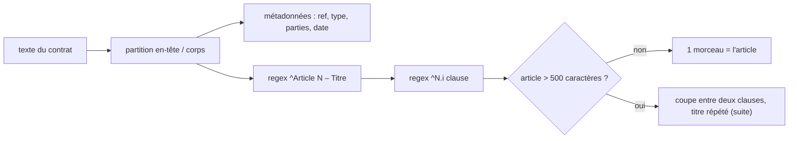

# Découper par structure

> [!NOTE]
> Dans cette leçon, vous allez écrire le parseur de contrats, le découpage par article (qui ne coupe jamais une clause), un découpage par taille pour comparer, et l'index SQLite qui garde les métadonnées à côté des vecteurs.



## 1. Le parseur

```python title="files/contrats_rag.py"
ARTICLE = re.compile(r"^Article (\d+) – (.+)$", re.M)


def parse_contract(text: str) -> dict:
    """En-tête « Clé : valeur » puis articles « Article N – Titre » et clauses « N.i texte »."""
    head, _, body = text.partition("\n\n")
    lines = head.splitlines()
    meta = dict(l.split(" : ", 1) for l in lines[1:] if " : " in l)
    contrat = {"titre": lines[0], "ref": meta["Référence"], "type": meta["Type"],
               "parties": meta["Parties"].split(" ; "), "date": meta["Date de signature"], "articles": []}
    heads = list(ARTICLE.finditer(body))
    for h, nxt in zip(heads, heads[1:] + [None]):
        block = body[h.end():nxt.start() if nxt else len(body)]
        clauses = re.findall(r"^(\d+\.\d+) (.+)$", block, re.M)
        contrat["articles"].append({"num": int(h.group(1)), "titre": h.group(2), "clauses": clauses})
    return contrat
```

Le drapeau `re.M` (multiligne) fait correspondre `^` et `$` au début et à la fin de **chaque ligne**. Chaque article va de son titre jusqu'au titre suivant.

## 2. Un morceau par article, jamais de clause coupée

```python title="files/contrats_rag.py"
def chunk_structure(contrat: dict, max_chars: int = 500) -> list[dict]:
    chunks = []
    for a in contrat["articles"]:
        head = f"Article {a['num']} – {a['titre']}"
        group = []
        for num, txt in a["clauses"]:
            line = f"{num} {txt}"
            if group and len(head) + sum(len(g) + 1 for g in group) + len(line) > max_chars:
                chunks.append({"article": a["num"], "titre_article": a["titre"], "text": "\n".join([head] + group)})
                group, head = [], f"Article {a['num']} – {a['titre']} (suite)"
            group.append(line)
        chunks.append({"article": a["num"], "titre_article": a["titre"], "text": "\n".join([head] + group)})
    return chunks
```

Chaque morceau **commence par le titre de l'article**, même la suite : un morceau qui ne contient que « 4.5 Les pénalités sont plafonnées à 15 % » serait ambigu (quelles pénalités ?).

Le découpage par taille, gardé pour la comparaison, est une fenêtre glissante qui ignore tout :

```python title="files/contrats_rag.py"
def chunk_taille(text: str, size: int = 400, overlap: int = 60) -> list[dict]:
    step = size - overlap
    return [{"article": None, "titre_article": None, "text": text[i:i + size]}
            for i in range(0, max(len(text) - overlap, 1), step)]
```

Voici ce qu'il produit réellement sur le contrat de maintenance (extrait de l'index du 2026-10-15) :

```text
[… 4.3 Si le délai de prise en charge d'une anomalie bloquante est dépassé plus de deux fois
dans un mois, une pénalité de 5 % de la redevance mensuelle est appliqu]
[s, une pénalité de 5 % de la redevance mensuelle est appliquée. … Article 5 – Résiliation
5.1 Chaque partie peut résilier le contrat par lettre recommandée avec un préavis]
[t résilier le contrat par lettre recommandée avec un préavis de trois (3) mois. …]
```

La clause de préavis est coupée au milieu : « avec un préavis » dans un morceau, « de trois (3) mois » dans le suivant. Le découpage par structure donne au contraire :

```text
Article 4 – Niveaux de service
4.1 Une anomalie bloquante est prise en charge en moins de quatre (4) heures ouvrées ...
4.2 Une anomalie mineure est corrigée dans la version suivante, au plus tard sous trente (30) jours.
4.3 Si le délai de prise en charge d'une anomalie bloquante est dépassé plus de deux fois ...
---
Article 4 – Niveaux de service (suite)
4.4 Un rapport mensuel présente le nombre d'anomalies ouvertes, corrigées et en attente ...
4.5 Les pénalités sont plafonnées à 15 % de la redevance mensuelle ...
```

```quiz
question: "Pourquoi répéter « Article 4 – Niveaux de service (suite) » en tête du second morceau ?"
options:
  - "Pour atteindre la taille maximale"
  - "Pour que le morceau reste compréhensible seul, à la recherche comme dans le contexte du modèle"
  - "Parce que SQLite l'exige"
answer: 1
explanation: "Un morceau est lu hors de son document : par l'embedding (qui doit savoir qu'il s'agit de niveaux de service) et par le modèle (qui doit pouvoir citer l'article). Le titre répété coûte quelques caractères."
```

## 3. L'index : métadonnées en colonnes

```python title="files/contrats_rag.py (schéma)"
CREATE TABLE IF NOT EXISTS contrats (
    ref TEXT PRIMARY KEY, fichier TEXT, type TEXT, titre TEXT,
    parties TEXT, date TEXT, sha256 TEXT, texte TEXT);
CREATE TABLE IF NOT EXISTS chunks (
    id INTEGER PRIMARY KEY, ref TEXT, strategie TEXT, article INTEGER,
    titre_article TEXT, text TEXT, vec BLOB);
```

- Les dates sont au format `AAAA-MM-JJ` : comparer deux chaînes revient à comparer deux dates, donc `date >= '2025-05-01'` fonctionne sans conversion.
- Chaque morceau est embeddé avec un **titre contextuel** : `title: CT-2025-014 CONTRAT DE PRESTATION DE SERVICES (Atelier Nova, DataPlume SAS) | text: …`. Les deux stratégies reçoivent le même titre, pour une comparaison loyale.
- Le texte complet du contrat est gardé dans `contrats.texte` : il servira au tableau récapitulatif.

```quiz
question: "Pourquoi stocker les deux stratégies de découpage dans la même table avec une colonne strategie ?"
options:
  - "Pour comparer leur rappel sur les mêmes questions avec le même code de recherche"
  - "Parce que les embeddings des deux stratégies sont identiques"
  - "Pour doubler la précision"
answer: 0
explanation: "En production on n'en garderait qu'une. Ici, la colonne permet de mesurer l'effet du découpage seul : même modèle, mêmes titres, mêmes questions, seul le découpage change."
```

## Exercice : tolérer « Art. 4 »

Certains contrats écrivent `Art. 4 - Résiliation` (abréviation, tiret simple). Adaptez l'expression régulière `ARTICLE` pour accepter les deux formes.

<details>
<summary>Voir la solution</summary>

```python title="files/contrats_rag.py"
ARTICLE = re.compile(r"^(?:Article|Art\.)\s+(\d+)\s*[–-]\s*(.+)$", re.M | re.I)
```

`(?:…)` est un groupe non capturant : les numéros de groupe 1 et 2 ne changent pas, le reste du parseur fonctionne tel quel. Ajoutez un cas dans `test_contrats.py` avec un contrat écrit dans ce format avant de modifier le parseur : c'est la partie la plus fragile du lab.

</details>

## Résultat obtenu

Indexation réelle du 2026-10-15 :

```text
$ python contrats_rag.py index contrats
{'indexes': 5, 'inchanges': 0, 'morceaux_structure': 32, 'morceaux_taille': 18}
```

32 morceaux par structure (31 articles, dont un coupé en deux) contre 18 par taille : les morceaux structurels sont plus petits et plus nombreux, mais chacun a un sens complet.

## Je sais faire

- [ ] Analyser un document structuré avec des expressions régulières multilignes
- [ ] Découper par unité de sens sans couper une clause, en répétant le titre
- [ ] Stocker des métadonnées filtrables à côté des vecteurs
