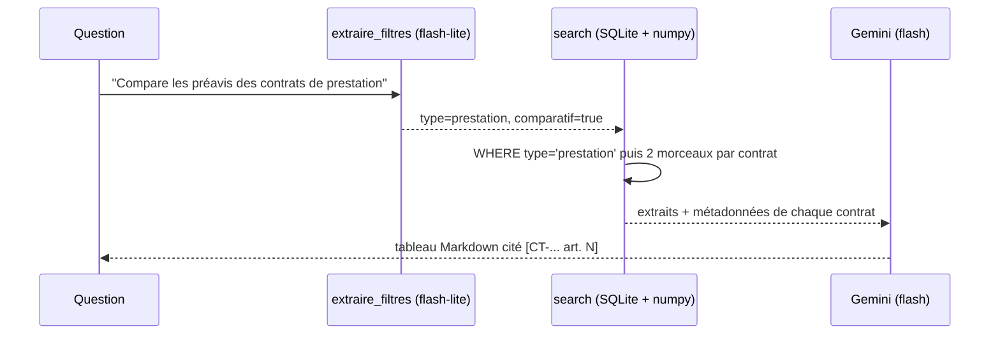

# Filtres, comparaisons et tableau

> [!NOTE]
> Dans cette leçon, vous allez faire extraire par Gemini les filtres d'une question (sortie structurée), filtrer en SQL avant de classer, garantir un résultat par contrat pour les comparaisons, mettre les métadonnées dans le contexte et produire le tableau récapitulatif.



## 1. Extraire les filtres : la sortie structurée

Plutôt que des règles fragiles, on demande au modèle de remplir un **schéma** : c'est la technique dite *self-query*. Avec `response_schema`, Gemini renvoie un JSON conforme au modèle pydantic, déjà converti en objet Python (`r.parsed`).

```python title="files/contrats_rag.py"
class Filtres(BaseModel):
    type: Optional[str] = None
    partie: Optional[str] = None
    apres: Optional[str] = None
    avant: Optional[str] = None
    comparatif: bool = False


def generate_json(prompt, schema, model=FAST_MODEL):
    from google.genai import types
    cfg = types.GenerateContentConfig(response_mime_type="application/json", response_schema=schema)
    return retry(lambda: client().models.generate_content(model=model, contents=prompt, config=cfg)).parsed


def extraire_filtres(db, question, generate_json_fn=generate_json) -> dict:
    v = valeurs_connues(db)       # types et parties réellement présents en base
    f = generate_json_fn(FILTRES_PROMPT.format(question=question, **v), Filtres)
    f = f if isinstance(f, dict) else f.model_dump()
    if f.get("type") not in v["types"]:  # garde-fou : jamais de valeur inventée dans un filtre de type
        f["type"] = None
    return f
```

Le prompt liste les valeurs **connues** (lues en base) et demande de recopier tel quel un nom de société inconnu : « Orbitel » donne un filtre qui ne correspond à aucun contrat, donc un refus **sans appel de génération**.

> [!TIP]
> L'extraction de filtres est une tâche simple : elle tourne sur `gemini-3.5-flash-lite` (variable `FAST_MODEL`), moins cher et plus rapide que le modèle de réponse.

## 2. Filtrer puis classer, un résultat par contrat

```python title="files/contrats_rag.py (extrait de search)"
    for col, op, key in [("c.type", "=", "type"), ("c.parties", "LIKE", "partie"),
                         ("c.date", ">=", "apres"), ("c.date", "<=", "avant")]:
        if f.get(key):
            sql += f" AND {col} {op} ?"
            args.append(f"%{f[key]}%" if op == "LIKE" else f[key])
    rows = db.execute(sql, args).fetchall()
    ...
    if par_contrat:
        pris, best = {}, []
        for i in order:                       # du meilleur score au moins bon
            if pris.get(rows[i][0], 0) < par_contrat:
                pris[rows[i][0]] = pris.get(rows[i][0], 0) + 1
                best.append(i)
```

Les valeurs passent toujours par des `?` (requête paramétrée), jamais par une f-string : la question vient de l'utilisateur et le filtre du modèle, aucun des deux n'est digne de confiance. Seuls les noms de colonnes, écrits en dur, sont insérés dans le SQL.

| Paramètre | Question ciblée | Question comparative |
| --- | --- | --- |
| filtres | partie, type ou date | type ou date, rarement partie |
| sélection | top-4 global | `par_contrat=2` : 2 meilleurs morceaux de **chaque** contrat filtré |
| sortie | 1 à 3 phrases citées | tableau Markdown, une ligne par contrat |

```quiz
question: "Pourquoi filtrer en SQL AVANT de calculer les similarités, plutôt qu'après ?"
options:
  - "Pour que les k résultats viennent tous du sous-ensemble voulu, au lieu d'être éliminés après coup (et d'en avoir moins de k)"
  - "Parce que numpy ne sait pas filtrer"
  - "Ça ne change rien"
answer: 0
explanation: "Filtrer après un top-k peut tout éliminer : si les 4 meilleurs morceaux viennent d'autres contrats, il ne reste rien. Filtrer avant garantit k candidats pertinents (le pré-filtrage)."
```

## 3. Le bogue des métadonnées absentes du contexte

Première exécution réelle : la question « Combien de temps dure l'obligation de confidentialité de l'accord avec DataPlume ? » a été **refusée**, alors que le bon morceau était en tête avec un score de 0,814. Le contexte ressemblait à ceci :

```text
[CT-2025-041 art. 3] Article 3 – Durée
3.1 Les obligations de confidentialité s'appliquent pendant cinq (5) ans à compter de la signature.
```

Rien ne dit au modèle que CT-2025-041 est un accord **avec DataPlume** : il a refusé, à juste titre. Les métadonnées servaient aux filtres mais n'étaient pas **montrées**. Correction :

```python title="files/contrats_rag.py"
def contexte(hits):
    """Les métadonnées vont AUSSI dans le contexte : sans elles, le modèle ne sait pas quel contrat il lit."""
    return "\n\n".join(f"[{h['ref']} art. {h['article']}] (contrat de {h['type']} entre {h['parties']}, "
                       f"signé le {h['date']})\n{h['text']}" for h in hits)
```

Les faux refus sont passés de 0,25 à 0 (leçon suivante).

```quiz
question: "Le bon morceau est récupéré (rappel = 1) mais le modèle refuse de répondre. Quelle cause est la plus probable ici ?"
options:
  - "Le seuil de similarité est trop haut"
  - "Le contexte ne contient pas une information nécessaire pour relier le morceau à la question (ici, la partie du contrat)"
  - "Le modèle d'embedding est mauvais"
answer: 1
explanation: "Un modèle prudent refuse quand il ne peut pas vérifier un élément de la question. La recherche a bien fonctionné ; c'est le contexte fourni à la génération qui était incomplet."
```

## 4. Le tableau récapitulatif

Pour une synthèse de **tous** les contrats, on ne cherche plus : on lit chaque contrat entier (ils font moins de 2 000 caractères) et on extrait des champs avec un second schéma.

```python title="files/contrats_rag.py"
class Recap(BaseModel):
    duree: str
    preavis_resiliation: str
    montant: str
    juridiction: str


def tableau(db, generate_json_fn=generate_json) -> str:
    ...
    for ref, type_, parties, date, texte in db.execute(
            "SELECT ref, type, parties, date, texte FROM contrats ORDER BY date"):
        r = generate_json_fn(RECAP_PROMPT.format(texte=texte), Recap)
        ...
```

Les colonnes Type, Partie et Date viennent de la base (exactes), les autres du modèle : on ne demande au modèle que ce qui n'est pas déjà connu.

## Exercice : filtrer par date

Écrivez l'appel à `search` qui renvoie les morceaux « Résiliation » des contrats signés en 2025 uniquement, sans passer par le modèle.

<details>
<summary>Voir la solution</summary>

```python title="python"
import contrats_rag as cr
db = cr.connect()
hits = cr.search(db, "préavis de résiliation", filtres={"apres": "2025-01-01", "avant": "2025-12-31"},
                 par_contrat=1)
for h in hits:
    print(h["ref"], h["article"], h["titre_article"])
```

`par_contrat=1` garantit un morceau par contrat de 2025 (4 contrats). Le bail de 2024 est exclu par le filtre, quel que soit son score. Pour l'accord de confidentialité, qui n'a pas d'article « Résiliation », le meilleur morceau sera un autre article : c'est au modèle de dire « non précisé ».

</details>

## Résultat obtenu

Exécution réelle du 2026-10-15 (après correction du contexte) :

```text
$ python contrats_rag.py tableau
| Contrat | Type | Partie | Signé le | Durée | Préavis | Montant | Juridiction |
| --- | --- | --- | --- | --- | --- | --- | --- |
| CT-2024-031 | location | SCI Les Tilleuls | 2024-06-03 | neuf ans | six mois | 3 200 euros par mois | tribunal judiciaire de Nantes |
| CT-2025-041 | confidentialite | DataPlume SAS | 2025-02-10 | 5 ans | non précisé | non précisé | Tribunal de commerce de Lyon |
| CT-2025-014 | prestation | DataPlume SAS | 2025-03-12 | vingt-quatre (24) mois | trois (3) mois | 4 800 euros hors taxes par mois | tribunal de commerce de Lyon |
| CT-2025-022 | prestation | Clairéclat Services | 2025-05-20 | 12 mois | 1 mois | 1 150 euros HT par mois | Tribunal de commerce de Lyon |
| CT-2025-040 | licence | Kerlogic | 2025-09-01 | 1 an | 60 jours | 15 000 euros par an | tribunal de commerce de Rennes |
```

> [!WARNING]
> Les valeurs sont justes mais pas **normalisées** (« neuf ans », « 12 mois », « 1 an »). Pour trier ou calculer, demandez des champs typés (`duree_mois: int`) dans le schéma, et vérifiez-les : une extraction reste une sortie de modèle.

## Je sais faire

- [ ] Extraire des filtres d'une question avec une sortie structurée pydantic
- [ ] Pré-filtrer en SQL paramétré avant le classement par similarité
- [ ] Garantir au moins un morceau par contrat pour une comparaison
- [ ] Mettre les métadonnées dans le contexte, pas seulement dans les filtres
