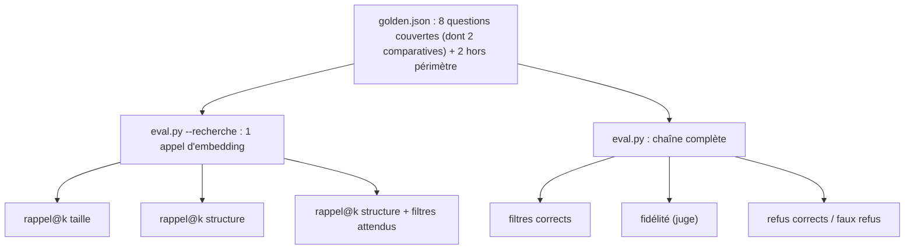

# Évaluer et exploiter

> [!NOTE]
> Dans cette leçon, vous allez tester le RAG de contrats sans clé, mesurer l'effet du découpage (taille contre structure) et des filtres, puis évaluer la chaîne complète : filtres corrects, fidélité, refus corrects et faux refus.



## 1. Les tests sans clé

[test_contrats.py](../files/test_contrats.py) couvre le parseur, la coupe entre clauses, les filtres SQL, la garantie « un par contrat », le garde-fou des types inventés, le refus sans contrat, le tableau et les métriques. Par exemple :

```python title="files/test_contrats.py (extrait)"
def test_chunk_structure_coupe_entre_les_clauses():
    c = cr.parse_contract(make_contracts.render(make_contracts.CONTRATS[1]))
    chunks = [ch for ch in cr.chunk_structure(c) if ch["article"] == 4]
    assert len(chunks) >= 2 and chunks[1]["text"].startswith("Article 4 – Niveaux de service (suite)")
    for ch in chunks:  # chaque ligne après le titre est une clause entière
        assert all(l[:3] in {"4.1", "4.2", "4.3", "4.4", "4.5"} for l in ch["text"].splitlines()[1:])
```

## 2. Un rappel indépendant du découpage

Comment comparer deux découpages dont les morceaux n'ont rien en commun ? En définissant le « bon passage » par une **preuve** : une sous-chaîne exacte qui doit apparaître dans un morceau **du bon contrat**.

```python title="files/eval.py"
def recall(hits, attendu):
    """Un passage attendu est trouvé si un morceau du BON contrat contient la preuve."""
    return sum(any(h["ref"] == a["ref"] and a["preuve"] in h["text"] for h in hits)
               for a in attendu) / len(attendu)
```

Ainsi, un morceau par taille coupé entre « avec un préavis » et « de trois (3) mois » ne compte pas : la preuve n'est entière nulle part.

```quiz
question: "Pourquoi exiger que la preuve soit dans un morceau du BON contrat ?"
options:
  - "Parce que plusieurs contrats contiennent les mêmes formules (« trois (3) mois », « tribunal de commerce de Lyon »)"
  - "Pour accélérer le calcul"
  - "Ce n'est pas nécessaire"
answer: 0
explanation: "« trois (3) ans » ou « tribunal de commerce de Lyon » apparaissent dans plusieurs contrats. Sans la condition sur la référence, un morceau du mauvais contrat serait compté comme un succès."
```

## Résultat obtenu

Exécutions réelles du 2026-10-15 (`gemini-embedding-2` en 768 dimensions, `gemini-3.5-flash` pour les réponses, `gemini-3.5-flash-lite` pour les filtres et le juge) :

```text
$ python -m pytest -v
... 10 passed in 1.11s

$ K=1 python eval.py --recherche
{"rappel@1 taille": 0.875, "rappel@1 structure": 0.875, "rappel@1 structure+filtres attendus": 1.0}
$ K=2 python eval.py --recherche
{"rappel@2 taille": 0.938, "rappel@2 structure": 1.0, "rappel@2 structure+filtres attendus": 1.0}
$ python eval.py --recherche
{"rappel@4 taille": 0.938, "rappel@4 structure": 1.0, "rappel@4 structure+filtres attendus": 1.0}
```

| Mesure (8 questions couvertes) | k = 1 | k = 2 | k = 4 |
| --- | --- | --- | --- |
| découpage par taille | 0,875 | 0,938 | 0,938 |
| découpage par structure | 0,875 | 1,0 | 1,0 |
| structure + filtres | 1,0 | 1,0 | 1,0 |

Puis la chaîne complète, avant et après la correction du contexte (leçon précédente) :

```text
avant : {"filtres_corrects": 0.9, "rappel@4 pipeline": 1.0, "fidelite": 1.0, "refus_corrects": 1.0, "faux_refus": 0.25}
après : {"filtres_corrects": 0.9, "rappel@4 pipeline": 1.0, "fidelite": 1.0, "refus_corrects": 1.0, "faux_refus": 0.0}
```

```text
[ok   ] Quel est le préavis de résiliation du contrat avec Kerlogic ?  filtres={'partie': 'Kerlogic'}
        Le préavis pour s'opposer au renouvellement du contrat avec Kerlogic est de soixante (60) jours
        avant la date anniversaire [CT-2025-040 art. 4].
[ok   ] Compare les préavis de résiliation des contrats de prestation.  filtres={'type': 'prestation', 'comparatif': True}
        | Contrat | Co-contractant | Préavis de résiliation |
        | **CT-2025-014** | DataPlume SAS | • Préavis de trois (3) mois par lettre recommandée [CT-2025-014 art. 5]. ... |
        | **CT-2025-022** | Clairéclat Services | • Préavis d'un (1) mois, par lettre recommandée ou par courriel ... [CT-2025-022 art. 4]. |
[REFUS] Quel est le montant du contrat avec la société Orbitel ?  filtres={'partie': 'Orbitel'}
        Je ne sais pas : aucun contrat ne correspond (...).
[REFUS] Le contrat de licence contient-il une clause de non-concurrence ?  filtres={'type': 'licence'}
        Je ne sais pas
```

Comment lire ces chiffres :

- **Le découpage par structure gagne dès k = 2** ; l'écart est petit parce que le corpus l'est (5 contrats). Sur des centaines de contrats aux formules répétitives, les **filtres** sont ce qui fait la différence : ils sont les seuls à 1,0 dès k = 1.
- Pour les deux questions comparatives, la variante « filtres » utilise `par_contrat=2` et renvoie donc plus de k morceaux : elle est avantagée, c'est voulu (c'est le comportement de la chaîne réelle).
- **Filtres corrects = 0,9** : la seule « erreur » est `type=prestation` ajouté pour la question sur DataPlume et l'anomalie bloquante. Le filtre est juste (le contrat de maintenance est une prestation), c'est l'étiquette de référence qui était plus vague. Une métrique automatique se relit toujours.

> [!WARNING]
> Une question hors périmètre (« non-concurrence ») est refusée par le modèle, l'autre (« Orbitel ») par le filtre, sans appel de génération. Avec seulement 2 questions de ce type, refus corrects = 1,0 n'est qu'un indice. Ajoutez des pièges réalistes : une clause présente dans un contrat mais pas dans celui demandé.

## 3. Exploiter

| Situation | Que faire |
| --- | --- |
| un nouveau contrat arrive | le déposer dans `contrats/` puis `python contrats_rag.py index contrats` (empreinte SHA-256 : seuls les nouveaux ou modifiés sont traités) |
| un avenant modifie un article | indexer l'avenant comme contrat lié (`ref` parent en métadonnée) et le signaler dans le contexte |
| un format de contrat inconnu | `parse_contract` lève `KeyError` sur l'en-tête : corrigez le parseur et ajoutez un test |
| tableau pour la direction | `python contrats_rag.py tableau > recap.md`, à faire relire par un juriste |

> [!TIP]
> Supprimez la stratégie `taille` en production : elle double les appels d'embedding pour rien. Elle n'existe que pour la mesure de ce lab.

```quiz
question: "La métrique filtres_corrects baisse après un changement de prompt, mais le rappel et la fidélité restent à 1,0. Que faire ?"
options:
  - "Annuler immédiatement le changement"
  - "Lire les questions concernées : le nouveau filtre peut être plus précis que l'étiquette de référence, ou réellement faux"
  - "Ignorer la métrique"
answer: 1
explanation: "Les métriques intermédiaires servent à diagnostiquer. Si le résultat final ne bouge pas, regardez les cas : c'est peut-être la référence qu'il faut corriger, comme pour la question DataPlume."
```

## Exercice : une question piège

Ajoutez à `golden.json` une question hors périmètre qui piège le filtre par type : la réponse existe dans **un autre** contrat que celui demandé.

<details>
<summary>Voir la solution</summary>

```json title="files/golden.json (ajout)"
{"question": "Quelle est la durée de confidentialité prévue dans le contrat de licence ?",
 "filtres": {"type": "licence", "partie": null}, "attendu": []}
```

Le contrat de licence (CT-2025-040) n'a **pas** d'article de confidentialité, mais deux autres contrats en ont un (« trois (3) ans » et « cinq (5) ans »). Un système sans filtre risquerait de répondre avec l'un d'eux. Avec le filtre `type=licence`, seuls les morceaux de la licence sont proposés et le modèle doit répondre « Je ne sais pas ».

</details>

## Je sais faire

- [ ] Définir un rappel par preuve textuelle pour comparer des découpages différents
- [ ] Mesurer séparément l'effet du découpage et celui des filtres
- [ ] Interpréter une baisse de métrique intermédiaire en relisant les cas
- [ ] Maintenir l'index quand les contrats évoluent
