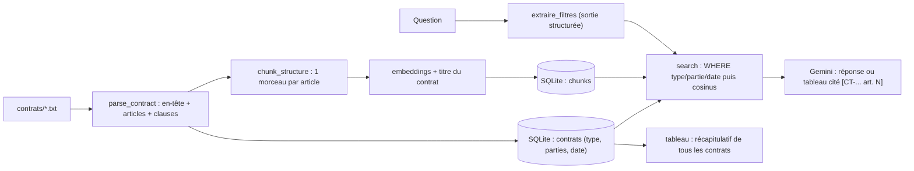

Un contrat n'est pas un texte comme les autres : il est **structuré** (articles, clauses numérotées), il a une **identité** (référence, type, parties, date de signature) et les questions qu'on lui pose sont souvent **comparatives** (« quels préavis dans nos contrats de prestation ? »). Un RAG qui découpe tous les 500 caractères et ignore cette identité se trompe de contrat ou coupe une clause en deux.

Ce lab travaille sur 5 contrats **fictifs** d'Atelier Nova (location d'entrepôt, maintenance logicielle, nettoyage, licence, accord de confidentialité).

## Ce que vous allez construire

## Pour qui ?

- Vous avez fait les labs [1](../01-rag-pdf-local-sqlite/index.md) et [2](../02-faq-support-citations-et-refus/index.md), ou vous avez déjà écrit un RAG simple.
- Vous travaillez sur des documents structurés (contrats, politiques, normes, cahiers des charges).

## Prérequis

- Python 3.10+, une clé d'API Gemini dans `.env` (voir [.env.example](./files/.env.example)).
- `pip install -r requirements.txt` ([requirements.txt](./files/requirements.txt)) : google-genai, numpy, pydantic.

## Programme

| Module | Leçon | Ce que vous faites | Fichiers |
| --- | --- | --- | --- |
| 1. Le cas d'usage | Contrats et architecture | structure d'un contrat, questions types, corpus fictif | `make_contracts.py` |
| 2. Construire | Découper par structure | parseur, articles et clauses, comparaison avec un découpage par taille | `contrats_rag.py` |
| 2. Construire | Filtres, comparaisons et tableau | self-query, filtres SQL, un résultat par contrat, métadonnées dans le contexte, récapitulatif | `contrats_rag.py` |
| 3. Évaluer | Évaluer et exploiter | tests sans clé, rappel taille vs structure, filtres corrects, fidélité, refus | `eval.py`, `golden.json`, `test_contrats.py` |

## En local ou sur GCP ?

| | Ce lab | Sur Google Cloud |
| --- | --- | --- |
| Contrats | fichiers texte | PDF dans Cloud Storage, extraits par Document AI |
| Métadonnées et filtres | colonnes SQLite + `WHERE` | métadonnées de Vertex AI Search ou filtres de Vector Search |
| Tableau récapitulatif | sortie structurée Gemini | idem, résultat écrit dans BigQuery |

Code complet : [contrats_rag.py](./files/contrats_rag.py), [eval.py](./files/eval.py), [test_contrats.py](./files/test_contrats.py), [make_contracts.py](./files/make_contracts.py).
