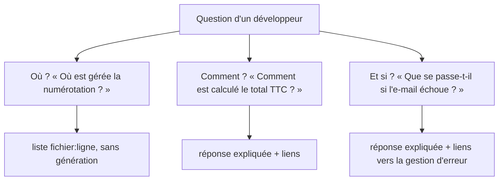

# Questions sur du code

> [!NOTE]
> Dans cette leçon, vous allez voir pourquoi le code demande un RAG différent de celui des documents, classer les questions des développeurs et générer le projet fictif facturo.

## Le code n'est pas de la prose

| Particularité | Conséquence pour le RAG |
| --- | --- |
| unités nettes : fonctions, classes, méthodes | on découpe sur ces frontières, pas tous les N caractères |
| position exacte (fichier, ligne) | chaque morceau garde `path`, `start`, `end` pour produire des liens |
| identifiants (`planifier_relances`, `REMISE_MAX_PCT`) | une recherche **par mots** (BM25) complète la recherche par sens |
| questions en français, code en anglais ou en « franglais » | la recherche vectorielle fait le pont entre « relances » et `niveau_relance` |
| accents absents du code (`numerotation.py`) | il faut normaliser les accents pour la recherche par mots |

## Trois familles de questions



La première famille est la plus fréquente et la moins chère : on n'a souvent pas besoin d'une phrase, juste des **emplacements** à ouvrir. Le lab propose donc la commande `ou`, qui ne fait **aucun** appel de génération.

```quiz
question: "Pourquoi la commande « ou » ne fait-elle pas appel au modèle de génération ?"
options:
  - "Parce que le modèle ne sait pas lire du code"
  - "Parce qu'une liste d'emplacements classés suffit souvent, et qu'elle coûte un seul embedding de question"
  - "Parce que l'API l'interdit"
answer: 1
explanation: "Le développeur veut ouvrir le bon fichier. La recherche donne directement fichier:ligne : c'est plus rapide, quasi gratuit, et il n'y a rien à halluciner."
```

## Le projet fictif facturo

[make_project.py](../files/make_project.py) écrit 16 fichiers dans `projet_demo/facturo/` : modèles de données, TVA, numérotation, remises, export, e-mail, relances, paiements, devises, stockage SQLite, authentification, journaux, API et ligne de commande.

```python title="projet_demo/facturo/relances.py (généré)"
"""Relances des factures impayées."""
from datetime import date, timedelta

PALIERS_RELANCE = [7, 15, 30]  # jours de retard déclenchant une relance


def factures_en_retard(factures, aujourd_hui: date, delai_jours: int = 30) -> list:
    """Factures non payées dont l'échéance (émission + délai) est dépassée."""
    return [f for f in factures
            if not f.payee and f.date_emission + timedelta(days=delai_jours) < aujourd_hui]
```

Le projet est **exécutable** : le test `test_le_projet_fictif_a_16_fichiers_valides` compile chaque fichier. Un RAG sur du code faux apprendrait de mauvaises habitudes au lecteur.

```bash title="terminal"
pip install -r requirements.txt
cp .env.example .env            # votre clé dans .env
python make_project.py          # écrit projet_demo/facturo/*.py
```

```quiz
question: "Quelles questions un bon jeu de référence pour du code doit-il contenir ?"
options:
  - "Uniquement des questions dont la réponse est un nom de fonction"
  - "Des « où ? », des « comment ? », des « et si ? », et des questions sur des fonctionnalités absentes"
  - "Uniquement des questions faciles"
answer: 1
explanation: "Les trois familles exercent la recherche différemment, et les fonctionnalités absentes (OAuth, QR codes dans facturo) vérifient que l'assistant sait dire « Je ne sais pas » au lieu d'inventer un fichier."
```

## Exercice : écrire deux questions pièges

Écrivez deux questions sur facturo dont la réponse **n'est pas** dans le code, mais qui ressemblent à des choses présentes.

<details>
<summary>Voir la solution</summary>

| Question piège | Ce qui ressemble | Pourquoi ce n'est pas couvert |
| --- | --- | --- |
| « Où est gérée la connexion avec un compte Google (OAuth) ? » | `auth.py` (mots de passe, jetons de session) | aucun fournisseur d'identité externe |
| « Comment le projet génère-t-il les QR codes de paiement ? » | `paiements.py`, `pdf_export.py` | pas de QR code |

Ce sont les deux questions hors périmètre de [golden.json](../files/golden.json). La première est la plus dangereuse : un modèle peu prudent répondrait « dans `facturo/auth.py` », ce qui est plausible et faux.

</details>

## Résultat obtenu

Exécution réelle du 2026-10-15 :

```text
$ python make_project.py
écrit projet_demo/facturo/__init__.py
écrit projet_demo/facturo/config.py
...
écrit projet_demo/facturo/api.py
écrit projet_demo/facturo/cli.py
$ python -c "from facturo.relances import planifier_relances ..."   # depuis projet_demo/
FAC-2025-0001 FAC-2025-0002 24.0
[('FAC-2025-0001', 2)]
```

Une facture de 2 × 10 € HT donne bien 24,00 € TTC, et une facture émise le 1er mars 2025 est au niveau de relance 2 le 20 avril (20 jours de retard après le délai de 30 jours).

> [!TIP]
> Testez votre RAG sur un projet que vous connaissez par cœur avant de le lâcher sur un projet inconnu : vous verrez immédiatement les mauvaises réponses.

## Je sais faire

- [ ] Expliquer ce qui distingue un RAG sur code d'un RAG sur documents
- [ ] Classer une question en « où ? », « comment ? », « et si ? »
- [ ] Préparer un projet de test exécutable et des questions pièges
