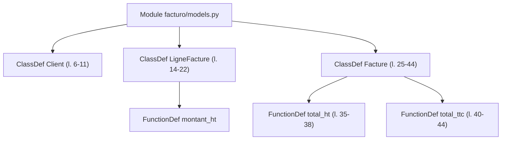

# Découper avec ast

> [!NOTE]
> Dans cette leçon, vous allez découper le code Python avec le module `ast` de la bibliothèque standard : un morceau par fonction, méthode, classe et constante, avec ses lignes exactes, puis l'indexer de façon incrémentale.

## L'arbre syntaxique

`ast.parse(source)` transforme le code en **arbre syntaxique abstrait** (AST) : chaque fonction, classe ou affectation devient un nœud qui connaît sa ligne de début (`lineno`) et de fin (`end_lineno`). Pas besoin d'expressions régulières fragiles pour trouver où finit une fonction.



## Le découpeur

```python title="files/code_rag.py"
def chunk_python(path: str, source: str) -> list[dict]:
    tree = ast.parse(source)
    module_doc = (ast.get_docstring(tree) or "").split("\n")[0]
    lines = source.splitlines()
    seg = lambda a, b: "\n".join(lines[a - 1:b])
    chunks = []

    def add(kind, name, node, text=None):
        start = min([d.lineno for d in getattr(node, "decorator_list", [])] + [node.lineno])
        chunks.append({"path": path, "kind": kind, "name": name, "start": start, "end": node.end_lineno,
                       "text": text or seg(start, node.end_lineno), "module_doc": module_doc})

    for node in tree.body:
        if isinstance(node, (ast.FunctionDef, ast.AsyncFunctionDef)):
            add("fonction", node.name, node)
        elif isinstance(node, ast.ClassDef):
            methods = [n for n in node.body if isinstance(n, (ast.FunctionDef, ast.AsyncFunctionDef))]
            resume = [seg(node.lineno, node.lineno)]
            if ast.get_docstring(node):
                resume.append(f'    """{ast.get_docstring(node)}"""')
            resume += [f"    def {m.name}({ast.unparse(m.args)}): ..." for m in methods]
            add("classe", node.name, node, "\n".join(resume))
            for m in methods:
                add("methode", f"{node.name}.{m.name}", m)
        elif isinstance(node, (ast.Assign, ast.AnnAssign)):
            ...  # constantes de module : TAUX_TVA, REMISE_MAX_PCT, PALIERS_RELANCE
    return chunks
```

| Type de morceau | Contenu | Pourquoi |
| --- | --- | --- |
| `fonction` | code complet, décorateurs compris | l'unité naturelle d'une question « comment ? » |
| `methode` | code complet, nom qualifié `Facture.total_ttc` | une classe entière serait trop longue et trop vague |
| `classe` | en-tête + docstring + **signatures** des méthodes | vue d'ensemble : « que sait faire `DepotFactures` ? » |
| `constante` | l'affectation de module | « où est défini le taux réduit ? » pointe sur `TAUX_TVA` |

> [!TIP]
> Les **décorateurs** (`@functools.cache`, `@app.get(...)`) sont souvent l'information la plus utile d'une fonction web. `start` part du premier décorateur : le test `test_decorateur_inclus_dans_le_morceau` le vérifie.

```quiz
question: "Pourquoi le morceau « classe » ne contient-il que les signatures des méthodes ?"
options:
  - "Pour éviter de dupliquer le code des méthodes, qui ont déjà leur propre morceau, tout en gardant une vue d'ensemble"
  - "Parce que ast ne sait pas lire le corps des méthodes"
  - "Pour réduire la précision"
answer: 0
explanation: "Chaque méthode est déjà un morceau. Répéter leur code dans la classe doublerait le texte et diluerait l'embedding ; les signatures suffisent à décrire ce que fait la classe."
```

## La docstring du module : un titre, pas un morceau

Une première version créait aussi un morceau par docstring de module (« Relances des factures impayées. »). Mesuré sur les questions de référence, c'était **nuisible** : ces textes courts et génériques se plaçaient en tête et poussaient les vraies fonctions hors du top-k (rappel@3 de la recherche hybride : 0,85 avec, 1,0 sans). Elle sert désormais de **contexte** dans le titre d'embedding de chaque morceau :

```python title="files/code_rag.py"
def titre(c) -> str:
    """Titre d'embedding : fichier, rôle du module (1re ligne de sa docstring), type et nom."""
    return f"{c['path']} ({c['module_doc']}) {c['kind']} {c['name']}"
```

Exemple : `title: facturo/tva.py (Taux et calcul de la TVA.) fonction calcul_tva | text: def calcul_tva(...)`.

## Index incrémental

Même principe qu'au lab 1 : une table `files(path, sha256)`, et seuls les fichiers dont l'empreinte change sont redécoupés et réembeddés. Les fichiers supprimés disparaissent de l'index. Les chemins sont **relatifs** à la racine du projet (`facturo/tva.py`), pour que les liens restent valables quel que soit l'emplacement du dépôt.

```quiz
question: "Un développeur renomme une fonction dans facturo/tva.py. Que recalcule index_folder ?"
options:
  - "Tout le projet"
  - "Uniquement les morceaux de facturo/tva.py, dont l'empreinte a changé"
  - "Rien : les noms de fonctions ne sont pas indexés"
answer: 1
explanation: "Le SHA-256 de tva.py change, ses morceaux sont supprimés puis recréés. Les 15 autres fichiers sont inchangés : aucun appel d'API pour eux."
```

## Exercice : les fonctions imbriquées

`chunk_python` ne parcourt que `tree.body` (le premier niveau) et le corps des classes. Une fonction définie **à l'intérieur** d'une autre fonction n'a pas de morceau propre. Est-ce un problème ? Comment l'ajouter si besoin ?

<details>
<summary>Voir la solution</summary>

En général ce n'est pas un problème : la fonction imbriquée est déjà **dans le texte** de sa fonction parente, donc retrouvable. Si vous voulez quand même un morceau dédié (fonctions internes très longues), parcourez l'arbre avec `ast.walk` :

```python title="files/code_rag.py (variante)"
for parent in ast.walk(tree):
    if isinstance(parent, (ast.FunctionDef, ast.AsyncFunctionDef)):
        for child in parent.body:
            if isinstance(child, (ast.FunctionDef, ast.AsyncFunctionDef)):
                add("fonction_interne", f"{parent.name}.<locals>.{child.name}", child)
```

`<locals>` reprend la convention de Python pour les noms qualifiés (`__qualname__`). Mesurez avant de garder : plus de morceaux n'est pas forcément mieux, comme l'a montré la docstring de module.

</details>

## Résultat obtenu

Indexation réelle du 2026-10-15, puis réindexation sans modification :

```text
$ python code_rag.py index projet_demo
{'fichiers_indexes': 16, 'inchanges': 0, 'supprimes': 0, 'morceaux': 44}
$ python code_rag.py index projet_demo
{'fichiers_indexes': 0, 'inchanges': 16, 'supprimes': 0, 'morceaux': 0}
```

44 morceaux pour 16 fichiers (la version avec un morceau par docstring de module en comptait 60).

## Je sais faire

- [ ] Parcourir un AST Python et récupérer les lignes exactes de chaque nœud
- [ ] Choisir le contenu d'un morceau selon son type (fonction, méthode, classe, constante)
- [ ] Utiliser un contexte (docstring de module) dans le titre d'embedding plutôt qu'en morceau séparé
