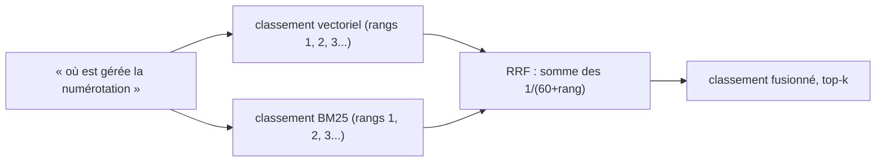

# Recherche hybride et liens vérifiés

> [!NOTE]
> Dans cette leçon, vous allez combiner recherche vectorielle et BM25 par fusion de rangs, écrire la commande « où est géré X ? », puis faire répondre Gemini avec des citations `fichier:ligne` que le code vérifie et transforme en liens.

## 1. Deux recherches complémentaires

| | Vectorielle (embeddings) | BM25 (mots) |
| --- | --- | --- |
| trouve | le **sens** : « relances des impayés » → `factures_en_retard` | les **mots exacts** : `PALIERS_RELANCE`, `FACTURO_DELAI` |
| rate | un identifiant rare que le modèle ne « comprend » pas | une question formulée sans les mots du code |
| coût | 1 appel d'embedding par question | rien (calcul local) |

**BM25** est l'algorithme classique des moteurs de recherche : il note un morceau selon les mots de la question qu'il contient, en donnant plus de poids aux mots rares. Pour qu'il marche sur du code, il faut découper les identifiants et retirer les accents :

```python title="files/code_rag.py"
def tokens(text: str) -> list[str]:
    """Mots du code ET de la question : snake_case et CamelCase découpés, minuscules, SANS accents
    (le code écrit « numerotation », la question « numérotation »)."""
    text = unicodedata.normalize("NFKD", text).encode("ascii", "ignore").decode()
    words = re.findall(r"[A-Za-z]+", re.sub(r"([a-z])([A-Z])", r"\1 \2", text))
    return [w.lower() for w in words if len(w) > 2]
```

`tokens("planifier_relances DepotFactures")` donne `["planifier", "relances", "depot", "factures"]`.

## 2. La fusion de rangs (RRF)

Les scores cosinus (entre -1 et 1) et BM25 (sans borne) ne se comparent pas. La **Reciprocal Rank Fusion** ignore les scores et n'utilise que les **rangs** : chaque morceau reçoit $\sum 1/(60 + \text{rang})$ sur les deux classements.



```python title="files/code_rag.py (extrait de search)"
    fused = {}
    for order in ranks:                  # un classement par méthode
        for r, i in enumerate(order):
            fused[int(i)] = fused.get(int(i), 0) + 1 / (60 + r + 1)
    best = sorted(fused, key=fused.get, reverse=True)[:k]
```

La constante 60 vient de l'article original (Cormack et al., 2009) : elle atténue l'écart entre le 1er et le 2e rang, pour qu'un morceau bien classé par **les deux** méthodes passe devant un morceau premier dans une seule.

```quiz
question: "Pourquoi fusionner des rangs plutôt qu'additionner les scores cosinus et BM25 ?"
options:
  - "Parce que les deux scores n'ont pas la même échelle : il faudrait les normaliser et régler un poids"
  - "Parce que les rangs sont plus précis que les scores"
  - "Parce que BM25 ne produit pas de score"
answer: 0
explanation: "Un score BM25 de 8 et un cosinus de 0,7 ne sont pas comparables. RRF contourne le problème : seule la position compte, il n'y a aucun poids à calibrer."
```

## 3. « Où est géré X ? »

```python title="files/code_rag.py"
def ou_est_gere(db, sujet, k=5, embed_fn=embed) -> list[str]:
    """« Où est géré X ? » : une liste d'emplacements, sans appel de génération."""
    return [f"{label(h)}  {h['kind']} {h['name']}" for h in search(db, sujet, k, embed_fn=embed_fn)]
```

## 4. Répondre avec des liens vérifiés

Le contexte donne à chaque extrait un en-tête `--- facturo/tva.py:6-10 (fonction taux_tva)`. Le prompt demande de citer `fichier:ligne`. Puis le code **vérifie** que chaque citation tombe dans un extrait fourni :

```python title="files/code_rag.py"
CITATION = re.compile(r"`?([\w/]+\.py):(\d+)(?:-(\d+))?`?")


def citations_valides(texte, hits) -> bool:
    cites = CITATION.findall(texte)
    if texte.startswith(REFUS):
        return True
    return bool(cites) and all(any(h["path"] == p and h["start"] <= int(a) <= int(b or a) <= h["end"] for h in hits)
                               for p, a, b in cites)
```

Si c'est le cas, `liens()` transforme `facturo/relances.py:18-25` en `[facturo/relances.py:18-25](projet_demo/facturo/relances.py#L18-L25)`, l'ancre `#L18-L25` étant comprise par GitHub et GitLab. Sinon, la réponse est remplacée par un refus.

> [!WARNING]
> Première exécution réelle : le modèle écrivait les citations **entre backticks** et sous forme de **plage** (`` `facturo/relances.py:4-4` ``). L'ancienne expression régulière ne lisait que `fichier:ligne` : la vérification passait, mais les liens produits étaient cassés (``[facturo/relances.py:4](...)-4`` dans un bloc de code). Correction : accepter `:a-b` et les backticks optionnels, et vérifier la plage entière. Testez toujours le post-traitement sur de **vraies** sorties de modèle.

```quiz
question: "Le modèle cite facturo/auth.py:30 alors que l'extrait fourni couvre les lignes 14 à 16. Que fait answer() ?"
options:
  - "Elle affiche la réponse avec un lien vers la ligne 30"
  - "Elle remplace la réponse par « Je ne sais pas (citations non vérifiables) »"
  - "Elle corrige la ligne en 14"
answer: 1
explanation: "Une ligne hors des extraits n'a pas été vue par le modèle pour cette question : il l'a devinée. On refuse plutôt que de donner un lien qui a l'air précis et peut être faux."
```

## Exercice : liens vers votre dépôt

Modifiez l'appel à `liens()` pour pointer vers un dépôt GitHub (`https://github.com/<organisation>/<depot>/blob/main/`) au lieu du dossier local.

<details>
<summary>Voir la solution</summary>

`liens()` prend déjà un paramètre `base` :

```python title="files/code_rag.py (dans answer)"
BASE_LIENS = os.environ.get("BASE_LIENS", "projet_demo")
...
    return {"answer": liens(text, BASE_LIENS) if ok else ..., ...}
```

Avec `BASE_LIENS=https://github.com/mon-orga/facturo/blob/main`, la citation devient `https://github.com/mon-orga/facturo/blob/main/facturo/tva.py#L6-L10`. Utilisez un **identifiant de commit** plutôt que `main` si vous archivez les réponses : les numéros de ligne bougent quand le code change.

</details>

## Résultat obtenu

Exécutions réelles du 2026-10-15 :

```text
$ python code_rag.py ou "où est gérée la numérotation des factures"
facturo/stockage.py:19  methode DepotFactures.dernier_numero
facturo/numerotation.py:4  constante MOTIF
facturo/numerotation.py:7  fonction prochain_numero
facturo/stockage.py:6  classe DepotFactures
facturo/stockage.py:7  methode DepotFactures.__init__
```

Avant la suppression des accents dans `tokens()`, la même commande ne renvoyait **aucun** emplacement de `numerotation.py` : BM25 ne reliait pas « numérotation » à `numerotation`.

```text
$ python eval.py          # extrait : la réponse produite par answer() pour la 1re question
Les relances des factures impayées sont gérées dans le module [facturo/relances.py:7-10](projet_demo/facturo/relances.py#L7-L10)
grâce à la fonction `factures_en_retard` qui identifie les factures dont le délai de paiement est dépassé.
Le niveau de relance est calculé selon les jours de retard définis dans [facturo/relances.py:4](projet_demo/facturo/relances.py#L4)
via la fonction `niveau_relance` située dans [facturo/relances.py:13-15](projet_demo/facturo/relances.py#L13-L15). Enfin, la
fonction `planifier_relances` dans [facturo/relances.py:18-25](projet_demo/facturo/relances.py#L18-L25) établit la liste
des relances à envoyer pour la journée.
```

## Je sais faire

- [ ] Adapter BM25 au code (identifiants découpés, accents retirés)
- [ ] Fusionner deux classements par RRF
- [ ] Vérifier des citations fichier:ligne (plages comprises) et en faire des liens
