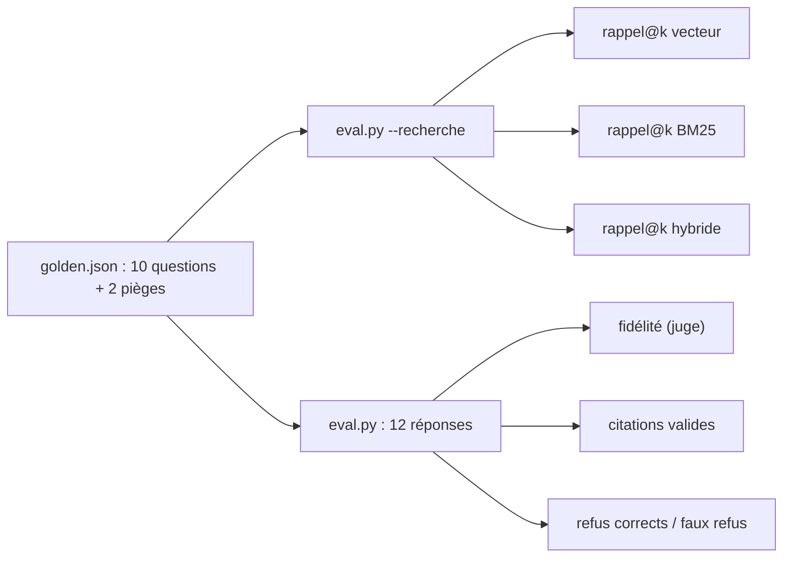

# Évaluer et améliorer

> [!NOTE]
> Dans cette leçon, vous allez tester le RAG sur code sans clé, comparer les trois modes de recherche sur 12 questions de référence, retracer les trois corrections que la mesure a imposées, puis évaluer les réponses : fidélité, citations valides, refus.



## 1. Les tests sans clé

[test_code_rag.py](../files/test_code_rag.py) vérifie le découpage (lignes exactes, décorateurs, constantes), les jetons BM25, l'incrémental, la vérification des citations et les liens :

```python title="files/test_code_rag.py (extrait)"
def test_citations_et_liens():
    hits = [{"path": "facturo/tva.py", "start": 6, "end": 10}]
    assert cr.citations_valides("Voir facturo/tva.py:8.", hits)
    assert not cr.citations_valides("Voir facturo/tva.py:30.", hits)    # hors de l'extrait
    assert not cr.citations_valides("La TVA est calculée.", hits)       # aucune citation
    assert not cr.citations_valides("Voir facturo/tva.py:8-12.", hits)  # la plage déborde
    assert cr.liens("cf. `facturo/tva.py:6-10`") == "cf. [facturo/tva.py:6-10](projet_demo/facturo/tva.py#L6-L10)"
```

## 2. Le rappel quand une question attend plusieurs morceaux

`golden.json` attend `fichier::nom` (par exemple `facturo/relances.py::planifier_relances`). Deux questions attendent **deux** morceaux (relances, remise maximale) : avec k = 1, leur rappel ne peut pas dépasser 0,5. C'est pour cela que rappel@1 plafonne sous 1,0 même avec une recherche parfaite.

```quiz
question: "Sur 10 questions, 8 attendent 1 morceau et 2 en attendent 2. Quel est le rappel@1 maximal possible ?"
options:
  - "1,0"
  - "0,9"
  - "0,8"
answer: 1
explanation: "(8 × 1 + 2 × 0,5) / 10 = 0,9. Connaître le plafond évite de chercher à « corriger » un chiffre qui est déjà au maximum."
```

## 3. Trois corrections, trois mesures

Chaque ligne est une exécution réelle de `eval.py --recherche` (1 appel d'embedding chacune) le 2026-10-15 :

| Version | rappel@1 V / B / H | rappel@3 V / B / H | rappel@5 V / B / H |
| --- | --- | --- | --- |
| a. morceau par docstring de module, accents gardés | 0,75 / 0,35 / 0,55 | 0,90 / 0,65 / 0,85 | 0,95 / 0,75 / 1,0 |
| b. docstring de module en titre, plus en morceau | 0,75 / 0,50 / 0,70 | 0,95 / 0,80 / 1,0 | 1,0 / 0,90 / 1,0 |
| c. b + accents retirés des jetons BM25 | 0,75 / 0,70 / **0,80** | 0,95 / 0,90 / **1,0** | 1,0 / 0,90 / 1,0 |

V = vectoriel, B = BM25, H = hybride (RRF).

- En version **a**, l'hybride était **moins bon** que le vectoriel seul à k = 1 et 3 : BM25 tirait vers le haut des morceaux génériques (docstrings, `cli.py` qui contient le mot « relances »), et la fusion le suivait.
- La version **b** a surtout aidé BM25 et l'hybride.
- La version **c** fait passer BM25 de 0,50 à 0,70 à k = 1 ; l'hybride devient le meilleur mode à tous les k. La troisième correction (citations entre backticks, leçon précédente) concernait les liens, pas le rappel.

> [!WARNING]
> L'hybride n'est pas « toujours meilleur » : il l'est devenu ici **après** avoir rendu BM25 correct sur ce corpus. Si un des deux classements est mauvais, la fusion peut dégrader l'autre. Mesurez chaque mode séparément avant de les fusionner.

## Résultat obtenu

Exécution réelle du 2026-10-15, version finale (`gemini-3.5-flash` pour les réponses, `gemini-3.5-flash-lite` pour le juge, k = 5) :

```text
$ python -m pytest -v
... 10 passed in 1.13s

$ python eval.py
[ok] Où sont gérées les relances des factures impayées ?
[ok] Où est défini le taux de TVA réduit ?
[ok] Comment est calculé le total TTC d'une facture ?
[ok] Comment les numéros de facture sont-ils générés et quand la séquence repart-elle à 1 ?
[ok] Que se passe-t-il si l'envoi d'un e-mail échoue ?
[ok] Quelle est la remise maximale autorisée avec un code promo ?
[ok] Où les mots de passe sont-ils vérifiés et comment ?
[ok] Comment annule-t-on une facture déjà émise ?
[ok] Où est fait le rapprochement entre le relevé bancaire et les factures ?
[ok] Quelle variable d'environnement règle le délai de paiement ?
[REFUS] Où est gérée la connexion avec un compte Google (OAuth) ?
[REFUS] Comment le projet génère-t-il les QR codes de paiement ?
{"rappel@5 vecteur": 1.0, "rappel@5 bm25": 0.9, "rappel@5 hybride": 1.0, "fidelite": 1.0,
 "citations_valides": 1.0, "refus_corrects": 1.0, "faux_refus": 0.0}
```

L'exécution précédente (même code, avant la suppression des accents) avait donné `"fidelite": 0.9` : le juge avait noté NON la réponse sur le total TTC. À la relecture, cette réponse était correcte (« total HT + TVA ligne par ligne, ajustée de la remise, arrondi au centime », ce que fait `Facture.total_ttc`) : c'était un **faux négatif du juge**. Une fidélité à 0,9 sur 10 réponses se relit avant de se croire.

```quiz
question: "Le juge note NON une réponse que vous trouvez juste. Que faire ?"
options:
  - "Supprimer la question du jeu de référence"
  - "Relire la réponse et les extraits ; si le juge se trompe, le noter, et suivre son taux d'erreur sur plusieurs exécutions"
  - "Remplacer le juge par un modèle plus gros sans vérifier"
answer: 1
explanation: "Le juge est un modèle, il fait des erreurs dans les deux sens. On l'évalue lui aussi (quelques verdicts relus à la main), au lieu de lui faire une confiance aveugle ou de cacher les cas gênants."
```

## 4. Exploiter

| Situation | Que faire |
| --- | --- |
| un développeur pousse du code | `python code_rag.py index <racine>` dans la CI : seuls les fichiers modifiés sont réembeddés |
| un fichier ne se parse pas (`SyntaxError`) | le signaler et continuer, plutôt que de bloquer tout l'index (exercice ci-dessous) |
| les numéros de ligne ont bougé | les liens pointent vers la version indexée : réindexez, et utilisez un identifiant de commit dans les liens |
| code confidentiel | l'envoi des morceaux à l'API d'embedding est une sortie de données : vérifiez la politique de l'entreprise |

> [!TIP]
> Ajoutez à `golden.json` chaque question où l'assistant s'est trompé en vrai. Au bout de quelques semaines, le jeu de référence ressemble à vos utilisateurs, et les chiffres deviennent parlants.

## Exercice : survivre à un fichier invalide

Aujourd'hui, un seul fichier avec une erreur de syntaxe fait échouer `index_folder` (`ast.parse` lève `SyntaxError`). Modifiez-le pour ignorer ce fichier, le compter dans `stats["erreurs"]`, et continuer.

<details>
<summary>Voir la solution</summary>

```python title="files/code_rag.py (dans la boucle de index_folder)"
        try:
            chunks = chunk_python(rel, src)
        except SyntaxError as e:
            print(f"ignoré : {rel} ligne {e.lineno} : {e.msg}")
            stats["erreurs"] = stats.get("erreurs", 0) + 1
            continue
```

Le `continue` est placé **avant** la mise à jour de la table `files` : l'empreinte du fichier fautif n'est pas enregistrée, il sera donc retenté à la prochaine indexation, une fois corrigé. Ses anciens morceaux restent dans l'index en attendant, ce qui vaut mieux qu'un trou.

</details>

## Je sais faire

- [ ] Comparer vectoriel, BM25 et hybride sur un même jeu de questions
- [ ] Calculer le plafond d'un rappel@k quand une question attend plusieurs morceaux
- [ ] Relier chaque correction à une mesure, et relire les verdicts du juge
- [ ] Intégrer la réindexation incrémentale dans un flux de développement
