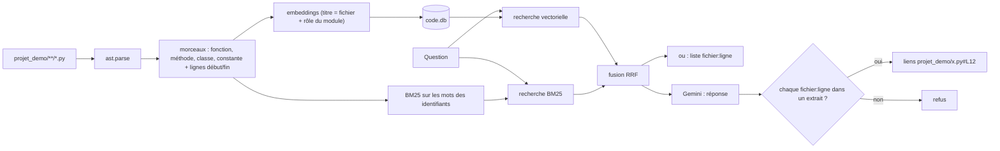

« Où est gérée la relance des impayés ? », « que se passe-t-il si l'envoi d'e-mail échoue ? » : sur un projet que l'on découvre, ces questions coûtent des heures de lecture. Ce lab construit un RAG qui répond **avec des liens `fichier:ligne`** que l'on peut ouvrir, et qui refuse quand le code ne contient pas la réponse.

Le terrain de jeu : **facturo**, un petit projet Python **fictif** de facturation (16 fichiers, généré par un script), avec de vraies fonctions qui s'exécutent.

## Ce que vous allez construire

## Pour qui ?

- Vous avez fait au moins le [lab 1](../01-rag-pdf-local-sqlite/index.md) ; le [lab 3](../03-contrats-chunking-et-metadonnees/index.md) (découpage par structure) est un bon échauffement.
- Vous lisez du Python couramment.

## Prérequis

- Python 3.10+, une clé d'API Gemini dans `.env` (voir [.env.example](./files/.env.example)).
- `pip install -r requirements.txt` ([requirements.txt](./files/requirements.txt)) : google-genai, numpy, rank-bm25.

## Programme

| Module | Leçon | Ce que vous faites | Fichiers |
| --- | --- | --- | --- |
| 1. Le cas d'usage | Questions sur du code | pourquoi le code est particulier, le projet fictif | `make_project.py` |
| 2. Construire | Découper avec ast | fonctions, méthodes, classes, constantes, lignes exactes | `code_rag.py` |
| 2. Construire | Recherche hybride et liens vérifiés | BM25, RRF, « où est géré X », citations vérifiées, liens | `code_rag.py` |
| 3. Évaluer | Évaluer et améliorer | 3 modes de recherche, 3 corrections mesurées, fidélité, refus | `eval.py`, `golden.json`, `test_code_rag.py` |

## En local ou sur GCP ?

| | Ce lab | Sur Google Cloud |
| --- | --- | --- |
| Code | dossier local | dépôt Git, synchronisé par Cloud Build |
| Index | `code.db` SQLite, réindexé par fichier | Vertex AI Vector Search + recherche plein texte |
| Accès | votre poste | Cloud Run derrière IAP, réservé à l'équipe |

Code complet : [code_rag.py](./files/code_rag.py), [eval.py](./files/eval.py), [test_code_rag.py](./files/test_code_rag.py), [make_project.py](./files/make_project.py).
