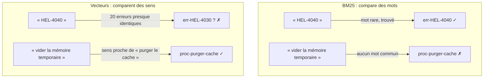
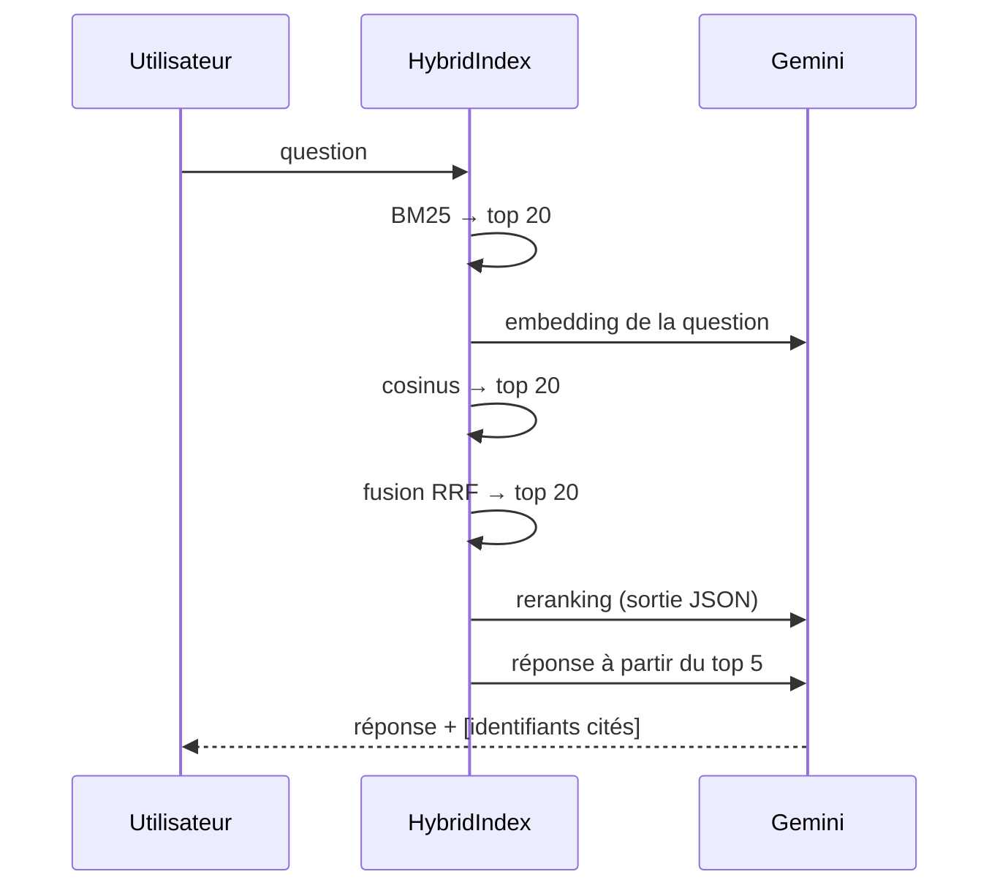

# Pourquoi la recherche hybride

> [!NOTE]
> Dans cette leçon, vous allez identifier les deux grandes familles d'échecs d'une recherche documentaire, comprendre comment la recherche hybride les compense, et générer le corpus de 80 documents du lab.

## Le cas d'usage : la base de connaissances technique

Une équipe support reçoit des questions sur un logiciel. Deux styles de questions coexistent :

| Style | Exemple | Ce qui compte |
| --- | --- | --- |
| **Identifiant** | « J'obtiens HEL-4040, que dois-je faire ? » | le code exact, à la lettre près |
| **Paraphrase** | « Comment vider la mémoire temporaire d'une source qui renvoie des infos dépassées ? » | le **sens** : le document parle de « purger le cache des connecteurs » |
| **Mixte** | « L'import CSV refuse mon jeton, quel code d'erreur ? » | un peu des deux |

Aucune méthode de recherche seule ne gère bien les trois.

## Deux moteurs, deux angles morts

**BM25** (*Best Matching 25*) est l'algorithme de recherche par mots-clés des moteurs classiques (Elasticsearch, Lucene). Il donne un score à chaque document selon les mots de la question qu'il contient, en favorisant les mots **rares** dans le corpus (un code `hel-4040` présent dans un seul document pèse lourd) et en pénalisant les documents très longs.

La **recherche vectorielle** transforme chaque texte en un **embedding**, un vecteur de quelques centaines de nombres qui résume son sens. Deux textes de sens proche ont des vecteurs proches (similarité cosinus élevée), même s'ils ne partagent aucun mot.



> [!TIP]
> Retenez la règle : BM25 est **précis mais littéral**, les vecteurs sont **tolérants mais flous**. La recherche hybride lance les deux et fusionne les classements ; le reranking demande ensuite à un LLM de départager les finalistes.

```quiz
question: "Un utilisateur cherche « paramètre sync.batch_size ». Quel moteur a le plus de chances de placer le bon document en tête, et pourquoi ?"
options:
  - "Les vecteurs, car ils comprennent le sens de « paramètre »"
  - "BM25, car le jeton sync.batch_size est rare et n'apparaît que dans un document"
  - "Aucun des deux, il faut obligatoirement un LLM"
answer: 1
explanation: "Un identifiant exact et rare est le cas idéal pour BM25 : son poids IDF (inverse de la fréquence documentaire) est maximal. Un embedding le place près de tous les autres paramètres de batch."
```

## L'architecture du lab



Coût par question : **1** appel d'embedding, **1** appel de reranking, **1** appel de génération. BM25 et la fusion sont du calcul local, quasi gratuit.

## Un corpus conçu pour piéger

Le script [make_corpus.py](../files/make_corpus.py) génère les 80 documents de façon **déterministe** (pas d'appel au LLM, donc le même corpus pour tout le monde) :

| Famille | Nombre | Piège visé |
| --- | --- | --- |
| Codes d'erreur `HEL-4010` à `HEL-7050` | 20 | textes quasi identiques, seul le code et le module changent |
| Paramètres `export.timeout_s`, `sync.batch_size`… | 20 | même structure, valeurs par défaut différentes |
| Procédures | 20 | vocabulaire métier (« purger », « révoquer ») absent des questions |
| Notes de version, incidents, FAQ | 20 | informations dispersées, parfois 2 documents pertinents |

```python title="files/make_corpus.py"
for mi, (m, label) in enumerate(MODULES):
    for suffix, symptom, cause, fix in SYMPTOMS:
        code = f"HEL-{4 + mi}0{suffix}0"  # ex. HEL-4010, HEL-5020…
        docs.append({"id": f"err-{code}", "title": f"Erreur {code}",
                     "text": f"Erreur {code} pendant {label} : {symptom}. Cause : {cause}. ..."})
```

Les 25 questions de référence sont réparties en 10 « identifiant », 10 « paraphrase » et 5 « mixte », chacune avec la liste de ses documents pertinents :

```bash
cd files
python make_corpus.py      # → corpus.jsonl et questions.json
```

> [!WARNING]
> Un jeu de questions de référence écrit par la même personne que le corpus est **optimiste** : il reflète ce qu'elle imagine. En production, prenez de vraies questions d'utilisateurs (journaux du support, tickets) et faites étiqueter les bons documents par un expert métier.

```quiz
question: "Pourquoi le corpus est-il généré par un script déterministe plutôt que par un LLM ?"
options:
  - "Parce qu'un LLM ne sait pas écrire de documentation technique"
  - "Pour que l'évaluation soit reproductible : même corpus, mêmes questions, mêmes identifiants pertinents"
  - "Parce que les embeddings ne fonctionnent pas sur du texte généré"
answer: 1
explanation: "Une évaluation n'a de valeur que si l'on compare les méthodes sur exactement les mêmes données. Un corpus regénéré à chaque fois changerait les documents pertinents."
```

## Résultat obtenu

Exécution du 2026-10-15 (le script vérifie lui-même qu'il y a 80 identifiants uniques et que chaque document attendu existe) :

```text
$ python make_corpus.py
80 documents, 25 questions
$ head -c 230 corpus.jsonl
{"id": "err-HEL-4010", "title": "Erreur HEL-4010", "text": "Erreur HEL-4010 pendant l'export des rapports : le délai d'attente est dépassé. Cause : le serveur distant ne répond pas avant la limite configurée. ...
```

## Exercice : classer les questions

Sans lancer de code, prédisez pour chaque question quel moteur (BM25 ou vecteurs) trouvera le bon document :

1. « Quelle est la valeur par défaut de archive.parallelism ? »
2. « Est-ce que nos informations peuvent partir aux États-Unis ? » (document : *faq-regions*, « Les données ne quittent pas la région choisie »)
3. « HEL-6010 apparaît chaque nuit, pourquoi ? »

<details>
<summary>Voir la solution</summary>

1. **Les deux** : `archive.parallelism` est un jeton rare (BM25), et la phrase est assez explicite pour les vecteurs. Mesuré : rang 1 pour les deux.
2. **Vecteurs** : aucun mot commun utile (« États-Unis » contre « Amérique du Nord »). Mesuré : BM25 ne le trouve pas, les vecteurs le placent en tête.
3. **BM25** : le code exact. Le mot « nuit » attire même les vecteurs vers l'archivage **nocturne** (`HEL-7010`), un piège sémantique. Mesuré : BM25 rang 1, vecteurs rang 6.

</details>

## Je sais faire

- [ ] Expliquer en une phrase ce que mesure BM25 et ce que mesure un embedding
- [ ] Donner un exemple de question où chaque moteur échoue
- [ ] Décrire les 5 étapes du pipeline hybride et leur coût en appels LLM
- [ ] Générer le corpus et les questions de référence avec `make_corpus.py`
