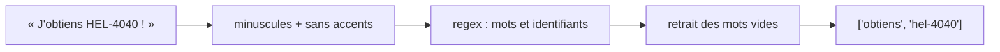

# BM25 et recherche vectorielle

> [!NOTE]
> Dans cette leçon, vous allez écrire les deux moteurs de recherche du lab : un index BM25 avec une tokenisation qui respecte les identifiants, et une recherche vectorielle avec `gemini-embedding-2`. Tout le code est dans [hybrid_rag.py](../files/hybrid_rag.py).

## Étape 1 : une tokenisation qui ne casse pas les codes

BM25 compare des **jetons** (*tokens*), c'est-à-dire des morceaux de texte. La tokenisation naïve `text.split()` garde la ponctuation (`HEL-4040,`), et un découpage sur tout ce qui n'est pas une lettre coupe `HEL-4040` en `hel` + `4040` : le jeton rare disparaît.

```python title="files/hybrid_rag.py"
def tokenize(text: str) -> list[str]:
    """Minuscules, sans accents, en gardant les identifiants entiers (hel-6030, sync.batch_size)."""
    text = unicodedata.normalize("NFKD", text.lower()).encode("ascii", "ignore").decode()
    return [t for t in re.findall(r"[a-z0-9_]+(?:[.-][a-z0-9_]+)*", text) if t not in STOPWORDS]
```

| Entrée | `split()` | Ce `tokenize` |
| --- | --- | --- |
| `Erreur HEL-6030,` | `Erreur`, `HEL-6030,` | `erreur`, `hel-6030` |
| `sync.batch_size` | `sync.batch_size` | `sync.batch_size` |
| `été` | `été` | `ete` |

Les **mots vides** (*stopwords* : « le », « de », « comment »…) sont retirés : ils sont partout et ne discriminent rien.



```quiz
question: "Que se passerait-il pour la question « HEL-4040 » si la tokenisation coupait sur le tiret ?"
options:
  - "Rien, BM25 retrouverait quand même le document"
  - "Les jetons « hel » et « 4040 » ; « hel » est présent dans les 20 codes d'erreur et « 4040 » seul reste rare, le classement devient moins net"
  - "BM25 lèverait une exception"
answer: 1
explanation: "Le jeton « hel » apparaît dans tous les codes : son poids IDF est faible. On perd une partie du signal. Garder l'identifiant entier est la meilleure option ici."
```

## Étape 2 : l'index BM25

La bibliothèque `rank-bm25` fait tout le calcul. On lui donne la liste des documents tokenisés :

```python title="files/hybrid_rag.py"
self.bm25 = BM25Okapi([tokenize(d["text"]) for d in docs])

def bm25_search(bm25: BM25Okapi, query: str, k: int = 20) -> list[int]:
    scores = bm25.get_scores(tokenize(query))
    return [int(i) for i in np.argsort(-scores)[:k] if scores[i] > 0]
```

On ne garde que les documents de score strictement positif : un document qui ne partage aucun jeton avec la question n'a rien à faire dans le classement.

> [!TIP]
> `BM25Okapi` a deux réglages : `k1` (saturation : à partir de combien de répétitions un mot ne compte plus davantage, 1.5 par défaut) et `b` (pénalité de longueur, 0.75 par défaut). Sur des documents courts et homogènes comme ceux-ci, les valeurs par défaut conviennent.

## Étape 3 : les embeddings Gemini

```python title="files/hybrid_rag.py"
def embed(client, texts: list[str]) -> np.ndarray:
    out = []
    for i in range(0, len(texts), 50):
        contents = [types.Content(parts=[types.Part(text=t)]) for t in texts[i:i + 50]]
        r = with_retry(lambda: client.models.embed_content(
            model=EMBED_MODEL, contents=contents,
            config=types.EmbedContentConfig(output_dimensionality=EMBED_DIM)))
        out += [e.values for e in r.embeddings]
    v = np.array(out, dtype=np.float32)
    return v / np.linalg.norm(v, axis=1, keepdims=True)
```

Trois choix à comprendre :

1. **`output_dimensionality=768`** : `gemini-embedding-2` produit 3072 dimensions par défaut ; on en garde 768, soit 4 fois moins de mémoire, largement assez pour 80 documents.
2. **Normalisation** : une fois chaque vecteur ramené à une norme de 1, la similarité cosinus devient un simple produit scalaire `doc_vecs @ q_vec`.
3. **Un `Content` par texte** : voir l'avertissement ci-dessous.

> [!WARNING]
> Avec `gemini-embedding-2`, passer une **liste de chaînes** à `contents` renvoie **un seul** vecteur pour l'ensemble (le modèle est multimodal et traite la liste comme une seule entrée). Vérifié le 2026-10-15 : 2 chaînes → 1 embedding. Pour obtenir un vecteur par texte, passez une liste de `types.Content`, un par texte.

Les embeddings du corpus sont mis en cache dans `.cache/docs-<empreinte>.npy` : l'empreinte change si le modèle, la dimension ou un document change.

```python title="files/hybrid_rag.py"
def vector_search(doc_vecs: np.ndarray, q_vec: np.ndarray, k: int = 20) -> list[int]:
    return [int(i) for i in np.argsort(-(doc_vecs @ q_vec))[:k]]
```

```quiz
question: "Pourquoi normaliser les vecteurs avant de les stocker ?"
options:
  - "Pour réduire leur taille sur le disque"
  - "Pour que le produit scalaire soit égal à la similarité cosinus, calculée en une multiplication de matrice"
  - "Parce que l'API Gemini l'exige"
answer: 1
explanation: "cos(a, b) = a·b / (|a||b|). Si |a| = |b| = 1, il ne reste que a·b : une seule opération matricielle pour comparer la question aux 80 documents."
```

## Résultat obtenu

Comparaison des deux moteurs seuls sur trois questions (exécution du 2026-10-15, 3 premiers identifiants renvoyés) :

```text
HEL-6010 apparaît chaque nuit, pourquoi ?
  bm25   ['err-HEL-6010', 'faq-regions', 'par-sync.timeout_s']
  vector ['err-HEL-7010', 'err-HEL-7030', 'err-HEL-7020']      ← piégé par « nuit » (archivage nocturne)
Comment vider la mémoire temporaire d'une source de données qui renvoie des infos dépassées ?
  bm25   ['err-HEL-4040', 'err-HEL-6040', 'err-HEL-7040']      ← aucun mot utile en commun
  vector ['proc-purger-cache', 'proc-schema-evolution', 'err-HEL-6050']
Peut-on cacher les numéros de sécurité sociale dans les tableaux partagés ?
  bm25   ['err-HEL-4020', 'err-HEL-6020', 'err-HEL-7020']
  vector ['proc-masquage', 'note-3-3-0', 'proc-audit']
```

Chaque moteur réussit là où l'autre échoue : c'est exactement ce que la fusion va exploiter.

## Exercice : tester la tokenisation

Écrivez un test qui vérifie que `tokenize("Le paramètre export.timeout_s vaut 30 !")` renvoie `["parametre", "export.timeout_s", "vaut", "30"]`, puis lancez `pytest -q`.

<details>
<summary>Voir la solution</summary>

```python title="files/test_hybrid_rag.py"
def test_tokenize_parametre():
    assert tokenize("Le paramètre export.timeout_s vaut 30 !") == ["parametre", "export.timeout_s", "vaut", "30"]
```

« Le » est un mot vide, « paramètre » perd son accent, le point dans `export.timeout_s` est conservé parce qu'il est suivi d'un caractère de mot, et « ! » disparaît. Le fichier fourni contient un test du même genre : `test_tokenize_garde_les_identifiants`.

</details>

## Je sais faire

- [ ] Écrire une tokenisation qui préserve les identifiants techniques
- [ ] Construire un index `BM25Okapi` et l'interroger
- [ ] Calculer des embeddings `gemini-embedding-2` réduits à 768 dimensions, un vecteur par texte
- [ ] Faire une recherche cosinus par produit matriciel
