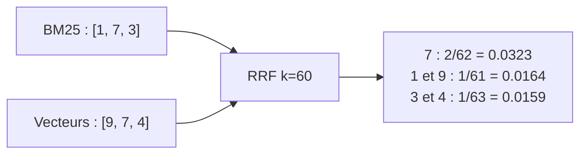

# Fusion RRF et reranking par LLM

> [!NOTE]
> Dans cette leçon, vous allez fusionner les classements BM25 et vectoriel avec la **Reciprocal Rank Fusion** (RRF), puis faire retrier les 20 finalistes par Gemini avec une **sortie structurée** JSON, et enfin générer une réponse qui cite ses sources.

## Pourquoi ne pas additionner les scores ?

Un score BM25 vaut par exemple 7,3 ; une similarité cosinus vaut 0,62. Ces nombres ne sont **pas sur la même échelle** et leur distribution change d'une question à l'autre. Les additionner revient à laisser BM25 écraser les vecteurs (ou l'inverse) selon la question.

La RRF ignore les scores et ne garde que les **rangs** :

$$
\text{RRF}(d) = \sum_{\text{classements } r} \frac{1}{k + \text{rang}_r(d)}
$$

avec $k = 60$, la valeur proposée par Cormack et al. (2009). Un document 1er d'une liste reçoit $1/61 \approx 0{,}0164$ ; 2e de deux listes, il reçoit $2/62 \approx 0{,}0323$ et passe devant. La RRF récompense **l'accord** entre moteurs.

```python title="files/hybrid_rag.py"
def rrf(rankings: list[list[int]], k: int = 60) -> list[int]:
    """Reciprocal Rank Fusion : score(d) = somme des 1 / (k + rang), rang commençant à 1."""
    scores: dict[int, float] = {}
    for ranking in rankings:
        for rank, doc in enumerate(ranking, start=1):
            scores[doc] = scores.get(doc, 0.0) + 1.0 / (k + rank)
    return sorted(scores, key=lambda d: -scores[d])
```



```quiz
question: "Avec k = 60, un document classé 1er par BM25 et absent de la liste vectorielle, face à un document classé 3e dans les deux listes : lequel gagne ?"
options:
  - "Le 1er de BM25 : 1/61 ≈ 0.0164"
  - "Le 3e des deux listes : 2/63 ≈ 0.0317"
  - "Égalité"
answer: 1
explanation: "La RRF favorise les documents sur lesquels les deux moteurs s'accordent. Un grand k aplatit les écarts entre rangs ; un petit k donne plus de poids à la tête de chaque liste."
```

> [!WARNING]
> La RRF a un défaut que l'évaluation va révéler : quand BM25 ne trouve **rien de pertinent**, il renvoie quand même des documents (ceux qui partagent un mot banal comme « données »), et ce bruit vient diluer le bon résultat vectoriel. C'est le rôle du reranking de le corriger.

## Le reranking par LLM

Un **reranker** relit la question et chaque candidat **ensemble**, ce qu'aucun des deux moteurs ne fait : BM25 compte des mots, l'embedding de la question est calculé sans voir les documents. On utilise ici l'approche *listwise* (RankGPT) : un seul appel reçoit les 20 candidats et renvoie leur ordre.

```python title="files/hybrid_rag.py"
class Ranking(BaseModel):
    ids: list[str]

def llm_rerank(client, question, docs, candidates):
    listing = "\n".join(f"[{docs[i]['id']}] {docs[i]['text']}" for i in candidates)
    prompt = (f"Question : {question}\n\nDocuments candidats :\n{listing}\n\n"
              "Classe les identifiants des documents du plus utile au moins utile pour répondre à la question. "
              "Un document qui contient l'identifiant exact cité dans la question (code d'erreur, paramètre) passe devant.")
    r = with_retry(lambda: client.models.generate_content(
        model=MODEL, contents=prompt,
        config=types.GenerateContentConfig(response_mime_type="application/json", response_schema=Ranking,
                                           thinking_config=types.ThinkingConfig(thinking_budget=0))))
    return merge_ranking(r.parsed.ids if r.parsed else [], docs, candidates)
```

| Réglage | Effet |
| --- | --- |
| `response_schema=Ranking` | la réponse est un JSON validé par Pydantic, lu dans `r.parsed` |
| `thinking_budget=0` | désactive le raisonnement interne : plus rapide et moins cher pour une tâche de tri |
| identifiants plutôt que numéros | le modèle recopie des chaînes qu'il voit, moins d'erreurs de décalage |

Le LLM peut **oublier** un candidat, en **inventer** un ou le **répéter**. `merge_ranking` rend le résultat sûr :

```python title="files/hybrid_rag.py"
def merge_ranking(llm_ids, docs, candidates):
    by_id = {docs[i]["id"]: i for i in candidates}
    ranked = list(dict.fromkeys(by_id[x] for x in llm_ids if x in by_id))  # ignore les ids inventés, dédoublonne
    return ranked + [i for i in candidates if i not in ranked]
```

> [!TIP]
> Ne passez au reranker que ce que la fusion a déjà filtré (ici 20 documents courts). Le coût du reranking croît avec le nombre et la longueur des candidats ; c'est l'étape la plus chère du pipeline.

```quiz
question: "Que renvoie merge_ranking(['c', 'zzz', 'c', 'a'], docs, [0, 1, 2]) si docs = [{'id':'a'}, {'id':'b'}, {'id':'c'}] ?"
options:
  - "[2, 0, 1]"
  - "[2, 2, 0]"
  - "Une erreur, car 'zzz' n'existe pas"
answer: 0
explanation: "'zzz' est ignoré, le second 'c' est dédoublonné, et 'b' (oublié par le LLM) est remis à la fin. C'est exactement le test test_merge_ranking_ignore_les_ids_inventes."
```

## La réponse finale

```python title="files/hybrid_rag.py"
hits = index.search(question, "rerank", k=5)
context = "\n".join(f"[{index.docs[i]['id']}] {index.docs[i]['text']}" for i in hits)
prompt = ("Réponds en français, en 3 phrases maximum, uniquement à partir des documents ci-dessous, "
          "et cite l'identifiant entre crochets de chaque document utilisé. Si la réponse n'y est pas, dis-le.\n\n"
          f"{context}\n\nQuestion : {question}")
```

## Résultat obtenu

Exécution réelle du 2026-10-15 avec `gemini-3.5-flash` :

```text
$ python hybrid_rag.py "J'obtiens HEL-4040, que dois-je faire ?"
Réponse  : Pour résoudre l'erreur HEL-4040, vous devez corriger le fichier source, puis relancer avec
l'option --strict désactivée afin de lister les lignes fautives [err-HEL-4040].

$ python hybrid_rag.py "Comment vider la mémoire temporaire d'une source de données qui renvoie des infos dépassées ?"
Réponse  : Lorsque les connecteurs renvoient des données périmées, vous pouvez aller dans Console > Connecteurs,
sélectionner le connecteur concerné puis cliquer sur « Purger le cache » [proc-purger-cache]. Il est également
possible d'exécuter la commande équivalente `helio connector purge <nom>` [proc-purger-cache].
```

La première question est gagnée grâce à BM25, la seconde grâce aux vecteurs : le même pipeline traite les deux.

## Exercice : une RRF pondérée

Ajoutez un paramètre `weights` à `rrf` pour donner plus de poids à un classement (`weights=[0.5, 1.0]` pour diminuer l'influence de BM25), sans casser l'appel existant `rrf([a, b])`.

<details>
<summary>Voir la solution</summary>

```python title="files/hybrid_rag.py"
def rrf(rankings, k=60, weights=None):
    weights = weights or [1.0] * len(rankings)
    scores = {}
    for w, ranking in zip(weights, rankings):
        for rank, doc in enumerate(ranking, start=1):
            scores[doc] = scores.get(doc, 0.0) + w / (k + rank)
    return sorted(scores, key=lambda d: -scores[d])
```

Les tests existants passent toujours (poids de 1 par défaut). Mesurez ensuite l'effet avec `python evaluate.py --no-rerank` : ne gardez la pondération que si le MRR de `hybrid` progresse sur **toutes** les catégories de questions, sinon vous ne faites que l'adapter à ces 25 questions.

</details>

## Je sais faire

- [ ] Expliquer pourquoi on fusionne des rangs plutôt que des scores
- [ ] Calculer à la main un score RRF avec k = 60
- [ ] Obtenir une sortie JSON validée par Pydantic avec `response_schema`
- [ ] Rendre robuste une liste renvoyée par un LLM (ids inventés, oubliés, répétés)
