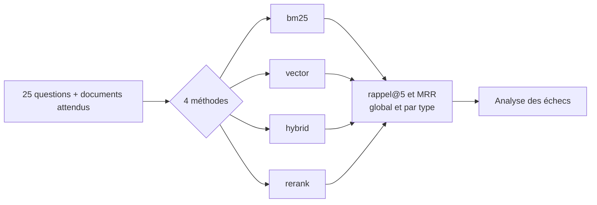
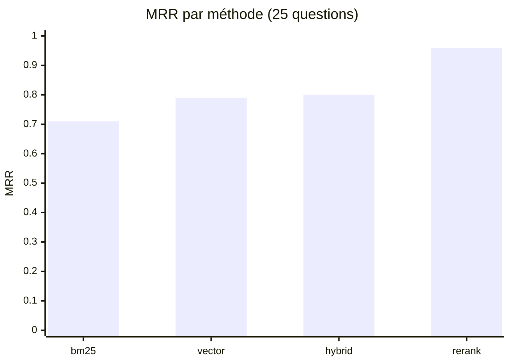

# Mesurer le gain : rappel@5, MRR et analyse d'erreurs

> [!NOTE]
> Dans cette leçon, vous allez exécuter l'évaluation comparative des 4 méthodes sur les 25 questions de référence, lire les chiffres catégorie par catégorie, analyser l'échec restant et décider quoi mettre en production. Code : [evaluate.py](../files/evaluate.py), tests : [test_hybrid_rag.py](../files/test_hybrid_rag.py).

## Deux métriques de recherche

| Métrique | Définition | Ce qu'elle dit |
| --- | --- | --- |
| **Rappel@5** (*recall@5*) | part des documents pertinents présents dans les 5 premiers résultats | « le LLM aura-t-il l'information sous les yeux ? » |
| **MRR** (*Mean Reciprocal Rank*) | moyenne de $1/\text{rang}$ du premier document pertinent (0 s'il est hors du top 10) | « le bon document est-il **en tête** ? » |

Exemple : pertinent au rang 1 → 1 ; au rang 3 → 0,33 ; absent → 0. Une question qui a deux documents pertinents dont un seul est trouvé obtient un rappel@5 de 0,5.

```python title="files/evaluate.py"
def recall_at_k(ranked_ids, relevant, k=5):
    return len(set(ranked_ids[:k]) & set(relevant)) / len(relevant)

def reciprocal_rank(ranked_ids, relevant, k=10):
    for rank, doc_id in enumerate(ranked_ids[:k], start=1):
        if doc_id in relevant:
            return 1.0 / rank
    return 0.0
```



```quiz
question: "Une méthode a un rappel@5 de 0.96 mais un MRR de 0.60. Qu'en conclure ?"
options:
  - "Elle trouve presque toujours le bon document, mais rarement en première position"
  - "Elle ne trouve presque jamais le bon document"
  - "Les deux métriques sont incohérentes, il y a un bug"
answer: 0
explanation: "Le rappel@5 regarde si le document est dans le top 5, le MRR à quel rang. Pour un RAG qui envoie 5 passages, le rappel@5 compte le plus ; pour un moteur qui affiche un seul résultat, c'est le MRR."
```

## Lancer l'évaluation

```bash
cd files
pytest -q                 # 8 tests sans clé, sans réseau
python evaluate.py        # 2 appels d'embedding + 25 appels de reranking, ≈ 50 s
```

Les 25 embeddings de questions sont calculés **en un seul appel**, puis réutilisés par les méthodes `vector`, `hybrid` et `rerank` : on compare les méthodes, pas le hasard de deux appels.

## Résultat obtenu

Exécution réelle du 2026-10-15 (`gemini-embedding-2` en 768 dimensions, reranking par `gemini-3.5-flash`) :

```text
$ python evaluate.py
| Méthode | Rappel@5 | MRR | Rappel@5 identifiant | paraphrase | mixte |
|---|---|---|---|---|---|
| bm25 | 0.72 | 0.71 | 1.00 | 0.35 | 0.90 |
| vector | 0.82 | 0.79 | 0.80 | 0.85 | 0.80 |
| hybrid | 0.88 | 0.80 | 1.00 | 0.75 | 0.90 |
| rerank | 0.96 | 0.96 | 1.00 | 0.90 | 1.00 |

Échecs au rang 1 de la meilleure méthode :
- Comment revenir à l'état d'hier après une fausse manipulation ?  attendu=['proc-restauration']
  obtenu=['proc-diagnostic', 'proc-purger-cache', 'proc-rotation-jetons']
```



## Lire les chiffres

1. **BM25 est parfait sur les identifiants (1.00) et s'effondre sur les paraphrases (0.35).** Les vecteurs font l'inverse : 0.85 en paraphrase, mais seulement 0.80 sur les identifiants, car les 20 codes d'erreur se ressemblent (sur « J'obtiens HEL-4040 », les vecteurs renvoient `HEL-4010`, `HEL-4020`, `HEL-4030` avant le bon).
2. **L'hybride RRF gagne en rappel (0.88) mais à peine en MRR (0.80).** Sur les paraphrases, BM25 injecte du bruit qui fait reculer le bon document vectoriel : pour « Peut-on cacher les numéros de sécurité sociale… », le bon document passe du rang 1 (vecteurs) au rang 5 (hybride).
3. **Le reranking corrige ce bruit** : 0.96 de rappel et de MRR. Le LLM lit question et documents ensemble.

> [!WARNING]
> 25 questions, c'est peu : une seule question qui change de rang fait bouger le MRR de 0,04. Le reranking n'est pas déterministe à 100 % non plus ; relancez l'évaluation 2 ou 3 fois avant de conclure à un gain de quelques centièmes. Ici, l'écart de 0,16 de MRR entre `hybrid` et `rerank` est nettement au-dessus de ce bruit.

## L'échec restant

« Comment revenir à l'état d'hier après une fausse manipulation ? » attend `proc-restauration` (« Restaurer une sauvegarde… »). Il n'entre même pas dans les 20 candidats transmis au reranker : les vecteurs le classent **28e** (ils préfèrent l'incident de doublons `inc-2026-04`), BM25 ne trouve aucun mot commun. Le reranker ne peut pas remonter un document qu'on ne lui a pas transmis : c'est un échec de **rappel**, pas de classement.

| Piste | Coût | Effet attendu |
| --- | --- | --- |
| Augmenter les candidats (top 30 au lieu de 20) | +50 % de jetons au reranking | aide si le document est au rang 21-30 |
| **Réécrire la question** avec un LLM (« restaurer une sauvegarde ») avant la recherche | +1 appel | cible ce cas précis |
| Enrichir les documents de questions types à l'indexation | indexation plus chère, une seule fois | aide toutes les paraphrases |

```quiz
question: "Le reranking a fait passer le MRR de 0.80 à 0.96. Que coûte-t-il en production ?"
options:
  - "Rien, il est calculé localement"
  - "Un appel LLM par question, soit environ 2 secondes de latence et des jetons d'entrée pour 20 documents"
  - "Un nouvel embedding de tout le corpus à chaque question"
answer: 1
explanation: "L'évaluation de 25 questions a pris environ 50 s au total : la quasi-totalité est due aux 25 appels de reranking. C'est le prix du gain ; on peut le réduire avec un modèle plus léger (gemini-3.5-flash-lite) ou moins de candidats, à condition de remesurer."
```

## Exploiter en production

- [ ] Garder `evaluate.py` comme **test de non-régression** : tout changement (modèle, tokenisation, `k` de RRF) doit maintenir ou améliorer les chiffres.
- [ ] Journaliser pour chaque question les identifiants renvoyés par BM25, les vecteurs et le reranker : c'est ce qui a permis l'analyse ci-dessus.
- [ ] Mettre en cache les embeddings du corpus (déjà fait dans `.cache/`) et ne recalculer que les documents modifiés.
- [ ] Prévoir un mode dégradé : si l'appel de reranking échoue, renvoyer l'ordre `hybrid` (0.88 de rappel) plutôt qu'une erreur.

## Exercice : un reranker plus léger

Mesurez le compromis qualité / coût avec `gemini-3.5-flash-lite` comme reranker, sans toucher au code.

<details>
<summary>Voir la solution</summary>

Le nom du modèle vient de la variable d'environnement `MODEL` :

```bash
MODEL=gemini-3.5-flash-lite python evaluate.py
```

Comparez la ligne `rerank` à celle du tableau ci-dessus et la durée totale (`time python evaluate.py`). Les embeddings du corpus sont relus depuis `.cache/`, donc seuls 1 appel d'embedding et 25 appels de reranking sont faits. Si le MRR reste dans le bruit (± 0,04) et que la latence baisse, le modèle léger est un bon choix pour ce corpus.

</details>

## Je sais faire

- [ ] Calculer un rappel@5 et un MRR à la main sur un exemple
- [ ] Lancer une évaluation comparative reproductible (mêmes embeddings de questions pour toutes les méthodes)
- [ ] Lire un tableau par catégorie de questions et expliquer chaque écart
- [ ] Distinguer un échec de **rappel** (document jamais candidat) d'un échec de **classement**
- [ ] Chiffrer le coût du reranking et prévoir un mode dégradé
