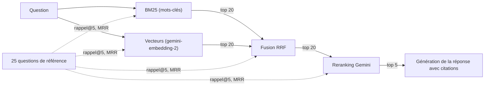

Un RAG (*Retrieval-Augmented Generation* : on **cherche** des passages dans vos documents, puis on demande au LLM de **répondre à partir d'eux**) ne vaut que ce que vaut sa recherche. Si le bon document n'est pas dans les 5 passages envoyés au modèle, la meilleure invite du monde n'y changera rien.

Ce lab part d'un constat que tout le monde rencontre en production : la recherche vectorielle comprend les **paraphrases** mais confond les **identifiants** (`HEL-6030` et `HEL-6020` se ressemblent beaucoup pour un embedding), tandis que la recherche par mots-clés fait exactement l'inverse. On combine les deux, on retrie avec Gemini, et surtout **on mesure**.

## Pour qui ?

- Vous avez déjà construit un RAG vectoriel simple (embeddings + similarité cosinus).
- Vous êtes à l'aise en Python (fonctions, listes, NumPy de base).
- Vous voulez des chiffres pour décider, pas des impressions.

## Ce que vous construisez

Un moteur de recherche documentaire sur la documentation fictive d'« Hélio », une plateforme d'intégration de données imaginaire : **80 documents** (codes d'erreur, paramètres, procédures, notes de version, incidents) et **25 questions de référence** dont on connaît les bons documents.

## Le résultat, en un tableau

Mesuré le 2026-10-15 avec `python evaluate.py` (détails dans la leçon 4) :

| Méthode | Rappel@5 | MRR |
| --- | --- | --- |
| BM25 seul | 0.72 | 0.71 |
| Vecteurs seuls | 0.82 | 0.79 |
| Hybride RRF | 0.88 | 0.80 |
| Hybride + reranking Gemini | **0.96** | **0.96** |

## Prérequis

- Python 3.10 ou plus récent.
- Une clé d'API Gemini créée dans Google AI Studio (le lab entier consomme une trentaine d'appels), placée dans `GOOGLE_API_KEY` ou dans un fichier `.env` copié depuis [.env.example](./files/.env.example).
- `pip install -r requirements.txt` ([requirements.txt](./files/requirements.txt)).

## Programme

| Module | Leçon | Ce que vous faites |
| --- | --- | --- |
| 1. Cas d'usage et architecture | [Pourquoi la recherche hybride](./01-cas-d-usage-et-architecture/01-pourquoi-la-recherche-hybride.md) | comprendre les deux familles d'échecs, générer le corpus |
| 2. Construire pas à pas | [BM25 et recherche vectorielle](./02-construire-pas-a-pas/01-bm25-et-recherche-vectorielle.md) | tokeniser, indexer, interroger les deux moteurs |
| | [Fusion RRF et reranking par LLM](./02-construire-pas-a-pas/02-fusion-rrf-et-reranking-llm.md) | fusionner les classements, retrier avec une sortie structurée |
| 3. Évaluer et exploiter | [Mesurer le gain](./03-evaluer-et-exploiter/01-mesurer-le-gain.md) | rappel@5, MRR, analyse d'erreurs, coût et latence |

## En local ou sur GCP ?

| | En local (ce lab) | Sur Google Cloud |
| --- | --- | --- |
| Index | BM25 et matrice NumPy en mémoire | Vertex AI Search ou AlloyDB/pgvector + recherche plein texte |
| Modèles | API Gemini avec clé d'API | Vertex AI (`gemini-2.5-flash` en europe-west1), identité de service |
| Taille raisonnable | quelques milliers de documents | millions de documents |
| Reranking | appel Gemini maison | Vertex AI Ranking API (service managé) |

Le code du lab est complet dans [files/](./files/make_corpus.py) : [make_corpus.py](./files/make_corpus.py), [hybrid_rag.py](./files/hybrid_rag.py), [evaluate.py](./files/evaluate.py) et [test_hybrid_rag.py](./files/test_hybrid_rag.py).
