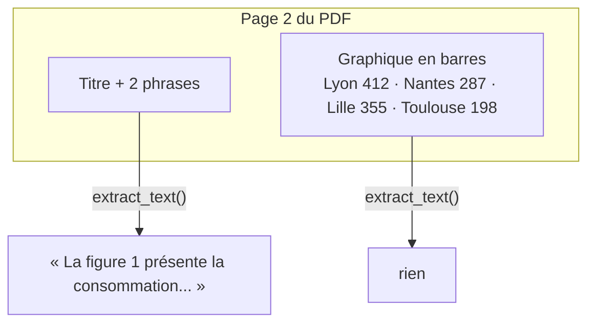

# Quand le texte ne suffit pas

> [!NOTE]
> Dans cette leçon, vous allez générer le PDF fictif du lab, constater ce qu'un extracteur de texte en retient (et ce qu'il perd), puis choisir entre les trois grandes architectures de RAG multimodal.

## Le cas d'usage

Une analyste reçoit chaque trimestre le rapport d'exploitation des entrepôts. Elle veut interroger le document en langage naturel : « quel site consomme le plus ? », « quel mois a-t-on raté l'objectif de disponibilité ? », « que trouve-t-on entre la passerelle et la base de données ? ». Toutes ces réponses sont **dans des figures**.

| Type de contenu | Exemple dans le rapport | Lu par `extract_text()` ? |
| --- | --- | --- |
| Paragraphes | « Le chiffre d'affaires atteint 18,4 millions d'euros » | oui |
| Graphique en barres | consommation par site (412, 287, 355, 198 MWh) | **non** |
| Courbe avec seuil | disponibilité mensuelle, objectif 98,5 % | **non** |
| Schéma | Sondes → Passerelle → Broker MQTT → TimescaleDB → Tableau de bord | **non** |
| Tableau dessiné (image) | coûts de maintenance par équipement | **non** |

> [!TIP]
> Un tableau **tapé** dans un PDF (texte positionné) est en partie récupérable par `extract_text()`, souvent dans le désordre. Un tableau **collé en image** (capture d'écran, export de présentation) ne l'est pas du tout. Dans les vrais documents, on rencontre les deux.

## Générer le document

Le script [make_pdf.py](../files/make_pdf.py) dessine les figures avec **Pillow** (bibliothèque Python de traitement d'images) et assemble le PDF avec **reportlab** (bibliothèque de génération de PDF) :

```python title="files/make_pdf.py"
("2. Consommation énergétique",
 ["La figure 1 présente la consommation électrique de chaque entrepôt sur le trimestre.",
  "Le plan de réduction cible en priorité le site le plus consommateur, où l'isolation des quais sera refaite."],
 bar_chart("Figure 1 - Consommation électrique T3 2026 (MWh)", ["Lyon", "Nantes", "Lille", "Toulouse"],
           [412, 287, 355, 198], "MWh")),
```

Remarquez le piège volontaire : le texte dit « le site le plus consommateur » sans le nommer. Pour répondre à « quel site est visé en priorité ? », il faut **combiner** le texte et la figure.

```bash
cd files
pip install -r requirements.txt
python make_pdf.py        # → rapport_verdalis_t3.pdf (6 pages, 4 figures)
```

```quiz
question: "Pourquoi le rapport du lab est-il généré par un script plutôt que pris sur Internet ?"
options:
  - "Parce que Gemini ne sait pas lire les vrais PDF"
  - "Pour maîtriser exactement ce qui est dans le texte et ce qui n'est que dans les images, et donc savoir ce que chaque méthode peut trouver"
  - "Pour que le PDF soit plus léger"
answer: 1
explanation: "Une évaluation exige de connaître la bonne réponse et l'endroit où elle se trouve. Le script garantit que 412 MWh n'apparaît nulle part dans le texte : seule une méthode qui lit l'image peut le trouver. Le test test_pdf_genere_texte_et_figures le vérifie."
```

## Ce que voit un RAG texte seul



## Trois architectures possibles

| Architecture | Principe | Avantages | Limites |
| --- | --- | --- | --- |
| **A. Description à l'indexation** (ce lab) | un modèle de vision décrit chaque figure **une fois** ; on indexe le texte de la description | recherche texte classique, explicable, peu coûteuse à l'usage | la description peut omettre un détail |
| **B. Embeddings d'image** | on calcule un embedding de l'image elle-même (`gemini-embedding-2` est multimodal) | pas de description à générer | difficile à déboguer : on ne « lit » pas un vecteur |
| **C. Pages en image** (type ColPali) | chaque page entière est rendue en image et indexée par un modèle spécialisé | robuste à toutes les mises en page | modèles et index spécifiques, plus lourd |

Ce lab implémente **A**, puis ajoute une sécurité : au moment de répondre, on joint **l'image originale** à la question. La description sert à **trouver** la figure ; l'image sert à **répondre**.

```quiz
question: "Dans l'architecture A, à quel moment Gemini regarde-t-il les images ? (plusieurs réponses)"
options:
  - "À l'indexation, une fois par figure, pour produire la description"
  - "À chaque question, pour recalculer toutes les descriptions"
  - "À la réponse, quand une figure fait partie des passages retrouvés, l'image est jointe au contexte"
answer: [0, 2]
explanation: "Les descriptions sont calculées une fois et mises en cache. Ensuite, seules les figures retrouvées sont envoyées au modèle avec la question, pour qu'il lise lui-même la valeur exacte."
```

## Résultat obtenu

Exécution du 2026-10-15 : texte extrait par pypdf et images détectées, page par page.

```text
$ python make_pdf.py
PDF écrit : .../files/rapport_verdalis_t3.pdf
$ python -c "from pypdf import PdfReader
for i, p in enumerate(PdfReader('rapport_verdalis_t3.pdf').pages):
    print(i + 1, repr(p.extract_text()[:120]), [(im.name, im.image.size) for im in p.images])"
1 "1. Synthèse du trimestre\nCe rapport présente l'activité des quatre entrepôts frigorifiques Verdalis..." []
2 '2. Consommation énergétique\nLa figure 1 présente la consommation électrique de chaque entrepôt...' [(... .png, (1000, 620))]
3 '3. Disponibilité des chambres froides\nLa figure 2 montre le taux de disponibilité mensuel...'      [(... .png, (1000, 620))]
4 '4. Architecture de supervision\nLa chaîne de supervision des températures est décrite par la figure 3.' [(... .png, (1000, 620))]
5 "5. Maintenance\nLe tableau 1 récapitule les coûts de maintenance par famille d'équipement..."      [(... .png, (1000, 620))]
6 "6. Perspectives\nAu quatrième trimestre, Verdalis ouvrira un cinquième entrepôt à Rennes..." []
```

Quatre images de 1000 × 620 pixels, et aucune valeur chiffrée des figures dans le texte.

## Exercice : inventorier un vrai document

Prenez un PDF de votre activité (rapport, présentation exportée). Écrivez 5 lignes de Python qui affichent, pour chaque page, le nombre de caractères de texte extrait et le nombre d'images. Quelles pages seraient muettes pour un RAG texte seul ?

<details>
<summary>Voir la solution</summary>

```python
from pypdf import PdfReader
for n, page in enumerate(PdfReader("mon_rapport.pdf").pages, start=1):
    print(n, len(page.extract_text() or ""), "car.", len(page.images), "image(s)")
```

Les pages avec peu de texte et au moins une image sont les candidates. Attention : un PDF **scanné** n'a souvent aucun texte du tout (chaque page est une image) ; il faut alors une reconnaissance de caractères (OCR) ou une approche par page entière (architecture C). Une figure **vectorielle** (dessinée en traits PDF, pas en image) n'apparaît pas dans `page.images` : il faut rendre la page en image pour la décrire.

</details>

## Je sais faire

- [ ] Expliquer pourquoi un RAG texte seul est aveugle aux figures
- [ ] Générer un PDF de test dont je maîtrise le contenu texte et image
- [ ] Comparer les architectures « description », « embedding d'image » et « page en image »
- [ ] Repérer dans un vrai document les pages qu'un extracteur de texte rend muettes
