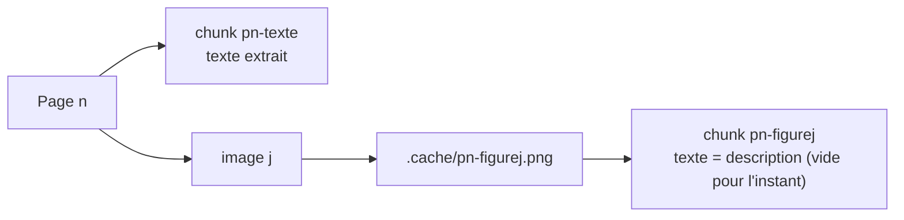

# Extraire et décrire les figures

> [!NOTE]
> Dans cette leçon, vous allez découper le PDF en **chunks** (morceaux indexables) de deux sortes, texte et figure, extraire les images avec pypdf, puis faire écrire par Gemini une description de chaque figure conçue pour la recherche, avec un cache qui évite de payer deux fois. Code : [multimodal_rag.py](../files/multimodal_rag.py).

## Étape 1 : deux sortes de chunks



```python title="files/multimodal_rag.py"
def extract(pdf_path: Path = PDF) -> list[dict]:
    CACHE.mkdir(exist_ok=True)
    chunks = []
    for n, page in enumerate(PdfReader(pdf_path).pages, start=1):
        chunks.append({"id": f"p{n}-texte", "page": n, "kind": "texte", "text": page.extract_text().strip()})
        for j, im in enumerate(page.images, start=1):
            path = CACHE / f"p{n}-figure{j}.png"
            im.image.save(path)
            chunks.append({"id": f"p{n}-figure{j}", "page": n, "kind": "figure", "image": str(path), "text": ""})
    return chunks
```

Chaque chunk garde son **numéro de page** : c'est ce qui permettra de citer la source et, plus tard, de relier une figure au texte qui l'entoure.

> [!TIP]
> Ici, un chunk texte = une page, parce que les pages sont courtes. Sur un vrai rapport, découpez le texte en paragraphes de quelques centaines de mots, mais gardez toujours le champ `page`.

```quiz
question: "Que renvoie page.images pour un graphique dessiné en traits vectoriels PDF (pas une image bitmap) ?"
options:
  - "L'image du graphique, comme pour un PNG"
  - "Rien : ce n'est pas une image intégrée ; il faut rendre la page en image pour la décrire"
  - "Le texte des étiquettes du graphique"
answer: 1
explanation: "page.images ne liste que les images intégrées (XObjects image). Les graphiques exportés en vectoriel par certains outils n'y figurent pas. Dans ce lab, Pillow produit des images bitmap, donc pypdf les retrouve."
```

## Étape 2 : une description faite pour être cherchée

La qualité du RAG multimodal dépend presque entièrement de cette invite. Une description vague (« un graphique montrant des consommations ») est inutile : la question « combien consomme Lyon ? » ne la retrouvera pas, et elle ne contient pas la réponse.

```python title="files/multimodal_rag.py"
DESCRIBE_PROMPT = """Tu prépares l'indexation d'un rapport pour un moteur de recherche.
Décris cette figure en français, en texte brut :
1. son type (graphique en barres, courbe, tableau, schéma…) et son titre exact ;
2. TOUTES les valeurs lisibles, avec leur libellé et leur unité (une ligne par valeur) ;
3. pour un schéma : chaque élément et chaque liaison, dans l'ordre ;
4. en une phrase, ce que la figure permet de conclure (maximum, minimum, seuil dépassé…).
N'invente aucune valeur absente de l'image."""
```

| Consigne | Pourquoi |
| --- | --- |
| titre exact | les questions citent souvent « la figure 2 » ou son sujet |
| toutes les valeurs, une par ligne | rend la valeur **cherchable** et lisible par le modèle de réponse |
| éléments et liaisons d'un schéma | un schéma n'a pas de valeurs : ce sont ses relations qui répondent |
| conclusion (maximum, minimum, seuil) | les questions sont souvent comparatives : « le moins », « sous l'objectif » |
| « n'invente aucune valeur » | limite les hallucinations sur les axes ou les graduations |

## Étape 3 : appeler Gemini avec l'image, et mettre en cache

```python title="files/multimodal_rag.py"
data = Path(c["image"]).read_bytes()
key = hashlib.sha256((MODEL + DESCRIBE_PROMPT).encode() + data).hexdigest()[:16]
if key not in cache:
    r = with_retry(lambda: client.models.generate_content(
        model=MODEL, contents=[types.Part.from_bytes(data=data, mime_type="image/png"), DESCRIBE_PROMPT]))
    cache[key] = r.text.strip()
page_text = next(x["text"] for x in chunks if x["page"] == c["page"] and x["kind"] == "texte")
c["text"] = f"Figure de la page {c['page']} ({page_text.splitlines()[0]}).\n{cache[key]}"
```

Trois détails importants :

1. **`types.Part.from_bytes`** envoie l'image dans la requête elle-même (*inline*). C'est adapté aux petites images ; au-delà d'environ 20 Mo de requête, la documentation Gemini recommande l'API Files.
2. **La clé de cache** combine le modèle, l'invite et les octets de l'image : changer l'invite invalide le cache, ce qui est voulu.
3. **Le titre de la page est préfixé** à la description : la figure hérite du contexte (« 2. Consommation énergétique »).

> [!WARNING]
> La description est **générée** : elle peut contenir une erreur de lecture. C'est pour cela qu'au moment de répondre, on joindra l'image originale (leçon suivante) ; la description sert surtout à **retrouver** la bonne figure.

```quiz
question: "Vous modifiez DESCRIBE_PROMPT pour demander aussi les couleurs. Que se passe-t-il à la prochaine exécution ?"
options:
  - "Rien : les anciennes descriptions sont relues depuis le cache"
  - "Les 4 figures sont redécrites, car la clé de cache dépend de l'invite"
  - "Une erreur, car le cache est corrompu"
answer: 1
explanation: "La clé est le SHA-256 de MODEL + DESCRIBE_PROMPT + octets de l'image. Une nouvelle invite donne de nouvelles clés, donc 4 nouveaux appels. Les anciennes entrées restent dans le fichier mais ne sont plus utilisées."
```

## Résultat obtenu

Description réellement produite par `gemini-3.5-flash` le 2026-10-15 pour la figure 1, telle qu'elle est indexée :

```text
Figure de la page 2 (2. Consommation énergétique).
1. Type et titre exact :
Graphique en barres intitulé « Figure 1 - Consommation électrique T3 2026 (MWh) ».
2. Valeurs :
- Lyon : 412 MWh
- Nantes : 287 MWh
- Lille : 355 MWh
- Toulouse : 198 MWh
3. Pour un schéma :
Non applicable.
4. Conclusion :
Ce graphique permet de conclure que Lyon présente la consommation électrique la plus élevée au T3 2026,
tandis que Toulouse enregistre la plus faible.
```

Et pour le schéma (figure 3), le modèle a bien listé les liaisons : « Flèche allant de "Passerelle LoRaWAN" vers "Broker MQTT" », puis « de "Broker MQTT" vers "Base TimescaleDB" ».

## Exercice : une sortie structurée

Plutôt que du texte libre, demandez une sortie JSON validée par Pydantic avec les champs `type`, `titre`, `valeurs` (liste de `{libelle, valeur, unite}`) et `conclusion`. Quel avantage, quel inconvénient ?

<details>
<summary>Voir la solution</summary>

```python
from pydantic import BaseModel

class Valeur(BaseModel):
    libelle: str
    valeur: str
    unite: str

class Figure(BaseModel):
    type: str
    titre: str
    valeurs: list[Valeur]
    conclusion: str

r = client.models.generate_content(
    model=MODEL, contents=[types.Part.from_bytes(data=data, mime_type="image/png"), DESCRIBE_PROMPT],
    config=types.GenerateContentConfig(response_mime_type="application/json", response_schema=Figure))
fig = r.parsed
text = f"{fig.type} : {fig.titre}\n" + "\n".join(f"- {v.libelle} : {v.valeur} {v.unite}" for v in fig.valeurs)
```

**Avantage** : les valeurs deviennent des données exploitables (export vers un tableur, contrôle automatique d'une valeur). **Inconvénient** : un schéma d'architecture rentre mal dans `valeurs` ; il faudrait un champ `liaisons`. Pour la seule recherche, le texte libre bien cadré suffit, c'est le choix du lab.

</details>

## Je sais faire

- [ ] Découper un PDF en chunks texte et figure qui gardent leur numéro de page
- [ ] Extraire les images d'une page avec pypdf
- [ ] Écrire une invite de description orientée recherche (valeurs, liaisons, conclusion)
- [ ] Envoyer une image à Gemini avec `types.Part.from_bytes`
- [ ] Mettre en cache un appel coûteux avec une clé qui dépend de toutes ses entrées
