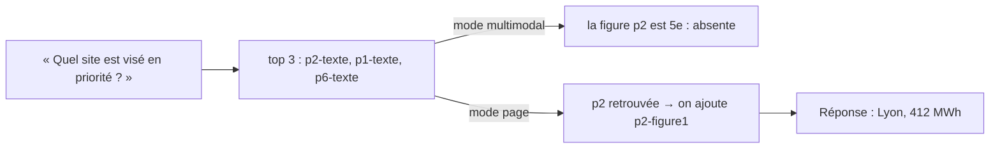

# Indexer et répondre avec l'image

> [!NOTE]
> Dans cette leçon, vous allez indexer chunks texte et descriptions de figures dans un même espace vectoriel, écrire trois modes de recherche (texte seul, multimodal, multimodal avec expansion par page) et construire une requête Gemini qui joint **l'image originale** de chaque figure retrouvée.

## Étape 1 : un seul index pour le texte et les figures

Une fois décrite, une figure est un chunk de texte comme un autre : on calcule son embedding avec le même modèle que les pages.

```python title="files/multimodal_rag.py"
@classmethod
def build(cls, client, pdf_path: Path = PDF):
    chunks = describe_figures(client, extract(pdf_path))
    return cls(chunks, embed(client, [c["text"] for c in chunks]), client)
```

10 chunks (6 pages + 4 figures) → **1 seul** appel d'embedding. Comme dans tout le parcours, on passe un `types.Content` par texte : avec `gemini-embedding-2`, une liste de chaînes brutes donnerait un vecteur unique pour l'ensemble.

> [!TIP]
> `gemini-embedding-2` sait aussi calculer l'embedding d'une **image** directement (architecture B de la leçon 1). On s'en tient ici aux descriptions : on peut les lire, les corriger et comprendre pourquoi une figure est (ou n'est pas) retrouvée.

## Étape 2 : trois modes de recherche

```python title="files/multimodal_rag.py"
def search(self, q_vec, k=3, mode="page"):
    allowed = [i for i, c in enumerate(self.chunks) if mode != "texte" or c["kind"] == "texte"]
    scores = self.vecs[allowed] @ q_vec
    hits = [self.chunks[allowed[i]] for i in np.argsort(-scores)[:k]]
    if mode == "page":
        pages = {h["page"] for h in hits}
        hits += [c for c in self.chunks if c["kind"] == "figure" and c["page"] in pages and c not in hits]
    return hits
```

| Mode | Ce qui est cherché | Ce qui est envoyé au modèle |
| --- | --- | --- |
| `texte` | chunks texte seulement | les 3 meilleurs textes (RAG classique) |
| `multimodal` | textes + descriptions de figures | les 3 meilleurs chunks, image jointe si figure |
| `page` | idem | les 3 meilleurs + **toutes les figures des pages retrouvées** |



Pourquoi l'**expansion par page** ? Parce qu'une question peut ressembler au **texte** d'une page alors que la réponse est dans sa **figure**. « Quel site est visé en priorité par le plan de réduction ? » ressemble mot pour mot au texte de la page 2 (« Le plan de réduction cible en priorité le site le plus consommateur »), pas à la description du graphique. Le texte est retrouvé, la figure non ; l'expansion répare ce lien.

```quiz
question: "Quel est le coût de l'expansion par page ?"
options:
  - "Un appel d'embedding supplémentaire par question"
  - "Aucun appel supplémentaire, mais des images en plus dans le contexte, donc plus de jetons d'entrée"
  - "Une nouvelle description de chaque figure à chaque question"
answer: 1
explanation: "L'expansion est un simple filtre sur les chunks déjà indexés. Elle ajoute des images à la requête de génération : chaque image coûte des jetons d'entrée. Sur un document où chaque page a 10 figures, il faudrait la limiter."
```

## Étape 3 : joindre l'image à la question

```python title="files/multimodal_rag.py"
def build_contents(question: str, hits: list[dict]) -> list:
    parts = ["Réponds en français, en 2 phrases maximum, uniquement à partir des extraits et des images ci-dessous. "
             "Cite l'identifiant entre crochets de chaque extrait utilisé. Si l'information n'y est pas, dis-le."]
    for h in hits:
        parts.append(f"\n[{h['id']}]\n{h['text']}")
        if h["kind"] == "figure":
            parts.append(types.Part.from_bytes(data=Path(h["image"]).read_bytes(), mime_type="image/png"))
    parts.append(f"\nQuestion : {question}")
    return parts
```

`contents` est une liste qui mélange chaînes et `Part` image : Gemini reçoit le texte de chaque extrait **suivi** de l'image correspondante, avec son identifiant. Il peut donc citer `[p2-figure1]` et lire la valeur sur l'image plutôt que de faire confiance à la description.

> [!WARNING]
> « Si l'information n'y est pas, dis-le » est indispensable : sans cette consigne, en mode `texte`, le modèle aurait tendance à **deviner** un site plausible. Avec, il répond honnêtement que le nom n'est pas mentionné, ce qui rend l'évaluation lisible.

```quiz
question: "Pourquoi l'identifiant [p2-figure1] est-il placé juste avant l'image dans contents ?"
options:
  - "Parce que l'API refuse une image sans texte avant"
  - "Pour que le modèle associe l'image à un identifiant qu'il peut citer comme source"
  - "Pour réduire la taille de l'image"
answer: 1
explanation: "Le modèle voit une séquence ordonnée de parties. Mettre l'identifiant et la description juste avant l'image lui permet de citer précisément la figure utilisée, ce qui rend la réponse vérifiable."
```

## Résultat obtenu

Exécution réelle du 2026-10-15, la même question en mode `texte` puis `page` :

```text
$ python multimodal_rag.py "Quel site est visé en priorité par le plan de réduction énergétique, et combien consomme-t-il ?"
[texte] sources=['p2-texte', 'p1-texte', 'p6-texte']
  Le plan de réduction vise en priorité le site le plus consommateur afin d'y refaire l'isolation des quais [p2-texte].
  Cependant, le nom précis de ce site et le chiffre exact de sa consommation ne sont pas mentionnés dans les extraits fournis.
[page] sources=['p2-texte', 'p1-texte', 'p2-figure1']
  Le plan de réduction vise en priorité le site de Lyon, qui est le plus consommateur [p2-texte][p2-figure1].
  Sa consommation électrique s'élève à 412 MWh pour le trimestre [p2-figure1].
```

La réponse combine une phrase du texte (« le site le plus consommateur ») et une lecture de la figure (Lyon, 412 MWh), avec les deux sources citées.

## Exercice : limiter l'expansion

Sur un rapport de 200 pages avec parfois 6 figures par page, l'expansion pourrait joindre 18 images. Modifiez `search` pour n'ajouter, au plus, que les `max_figs=2` figures les mieux classées parmi celles des pages retrouvées.

<details>
<summary>Voir la solution</summary>

```python
if mode == "page":
    pages = {h["page"] for h in hits}
    extra = [i for i, c in enumerate(self.chunks)
             if c["kind"] == "figure" and c["page"] in pages and c not in hits]
    extra.sort(key=lambda i: -float(self.vecs[i] @ q_vec))  # les plus proches de la question d'abord
    hits += [self.chunks[i] for i in extra[:max_figs]]
```

On réutilise le score cosinus déjà disponible : aucune requête en plus. Ajoutez `max_figs: int = 2` à la signature, puis relancez `pytest -q` et `python evaluate.py` pour vérifier que le score du mode `page` ne baisse pas.

</details>

## Je sais faire

- [ ] Indexer texte et descriptions de figures dans un même espace vectoriel
- [ ] Expliquer pourquoi une question peut retrouver le texte d'une page mais pas sa figure
- [ ] Implémenter l'expansion par page et en mesurer le coût
- [ ] Construire une requête Gemini qui mélange texte et images, avec des identifiants citables
