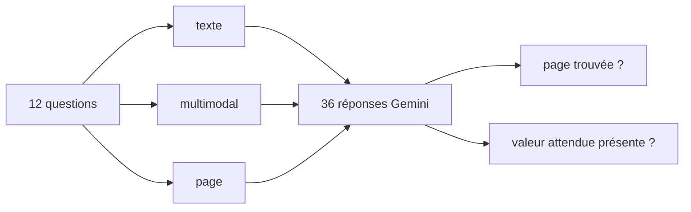

# Texte seul contre multimodal : l'évaluation chiffrée

> [!NOTE]
> Dans cette leçon, vous allez lancer l'évaluation comparative des trois modes sur 12 questions de référence, comprendre pourquoi « page trouvée » ne suffit pas à juger un RAG, analyser les deux échecs du mode multimodal simple, puis chiffrer le coût et préparer l'exploitation. Code : [evaluate.py](../files/evaluate.py), questions : [questions.json](../files/questions.json).

## Le jeu de questions

12 questions, chacune avec la page attendue, la source de la réponse (`figure` ou `texte`) et les valeurs acceptées :

```json title="files/questions.json"
{"question": "Quel était le taux de disponibilité des chambres froides en août ?",
 "expected": ["96,8", "96.8"], "page": 3, "source": "figure"}
```

| Source | Nombre | Exemples |
| --- | --- | --- |
| figure : barres | 3 | consommation de Lyon, site le moins consommateur, site prioritaire (texte + figure) |
| figure : courbe | 3 | mois sous l'objectif, taux d'août, objectif contractuel |
| figure : schéma | 2 | composant entre passerelle et base, base de stockage |
| figure : tableau | 2 | coût des compresseurs, équipement le plus sollicité |
| texte | 2 | chiffre d'affaires, capacité de Rennes (questions témoins) |

Les deux questions **témoins** vérifient que le multimodal ne dégrade pas ce que le texte seul savait déjà faire.

## Deux mesures

```python title="files/evaluate.py"
def norm(s: str) -> str:
    """minuscules, sans accents, sans espaces (y compris insécables), virgule décimale -> point."""
    s = unicodedata.normalize("NFKD", s.lower()).encode("ascii", "ignore").decode()
    return re.sub(r"\s+", "", s).replace(",", ".")

def is_correct(text: str, expected: list[str]) -> bool:
    return any(norm(e) in norm(text) for e in expected)
```

1. **Page trouvée** : un des chunks envoyés au modèle vient de la bonne page.
2. **Réponse exacte** : la réponse contient la valeur attendue. Un contrôle par **inclusion** de chaîne, simple et sans LLM-juge, suffit ici parce que chaque réponse attendue est une valeur précise (un nombre, un nom).



```quiz
question: "La réponse est « 12 000 palettes » (avec une espace fine insécable) et la valeur attendue est « 12000 ». Pourquoi le test passe-t-il ?"
options:
  - "Parce que is_correct ignore les nombres"
  - "Parce que norm supprime tous les espaces, y compris insécables (\\s en Python couvre les espaces Unicode)"
  - "Il ne passe pas"
answer: 1
explanation: "Un modèle peut écrire les milliers avec une espace fine insécable (U+202F). re.sub(r'\\s+', '', s) les retire toutes ; le test test_normalisation_des_reponses le vérifie."
```

## Résultat obtenu

Exécution réelle du 2026-10-15 (`gemini-3.5-flash`, `gemini-embedding-2` en 768 dimensions, 4 descriptions déjà en cache, durée totale environ 2 min 10 s) :

```text
$ python evaluate.py
- Quel entrepôt consomme le moins d'électricité ?
    [texte     ] NON "L'information permettant de déterminer quel entrepôt consomme le moins d'électricité n'est pas présente..."
    [multimodal] NON "L'information indiquant quel entrepôt consomme le moins d'électricité n'est pas présente dans les extraits..."
    [page      ] OK  "L'entrepôt qui consomme le moins d'électricité est celui de Toulouse, avec une consommation de 198 MWh..."
- Quel composant se trouve entre la passerelle LoRaWAN et la base de données dans la supervision ?
    [texte     ] NON "L'information concernant le composant situé entre la passerelle LoRaWAN et la base de données n'est pas..."
    [multimodal] OK  'Le composant situé entre la passerelle LoRaWAN et la base de données TimescaleDB est le Broker MQTT [p4-figure...'
    [page      ] OK  'Le composant situé entre la passerelle LoRaWAN et la base de données TimescaleDB est le Broker MQTT [p4-figure...'
...
| Mode | Page trouvée (top 3) | Réponses exactes | dont questions sur figure (10) |
|---|---|---|---|
| texte | 12/12 | 2/12 | 0/10 |
| multimodal | 12/12 | 10/12 | 8/10 |
| page | 12/12 | 12/12 | 10/10 |
```

## Lire les chiffres

1. **Le texte seul trouve toujours la bonne page (12/12) et ne répond juste que 2 fois sur 12.** La recherche « marche », mais le contenu utile n'a jamais été indexé. Une métrique de recherche seule aurait déclaré ce RAG excellent : il faut **toujours** mesurer la réponse.
2. **Le multimodal simple passe à 8/10 sur les figures.** Les deux échecs concernent la page 2 : « quel entrepôt consomme le moins ? » et « quel site est visé en priorité ? ». Dans les deux cas, la description de la figure n'arrive qu'en 4e ou 5e position, derrière des textes qui parlent d'« entrepôt » et de « plan de réduction ».
3. **L'expansion par page corrige ces deux cas (10/10)** sans casser les questions témoins (2/2).

> [!WARNING]
> 12 questions sur un document de 6 pages : c'est un banc d'essai pédagogique, pas une preuve générale. Les écarts sont ici très nets (0/10 contre 10/10), mais sur vos documents, construisez au moins 30 à 50 questions réelles avant de choisir une architecture, et relancez 2 ou 3 fois : la génération n'est pas strictement déterministe.

```quiz
question: "Un collègue propose de juger le RAG uniquement sur « page trouvée ». Que lui répondez-vous ?"
options:
  - "Bonne idée, c'est la métrique la plus fiable"
  - "Insuffisant : ici le mode texte obtient 12/12 en page trouvée mais 0/10 sur les questions de figure, car le contenu de la figure n'est jamais transmis"
  - "Il faut plutôt mesurer la latence"
answer: 1
explanation: "Une recherche peut retrouver le bon endroit sans transmettre l'information. Mesurez toujours de bout en bout : la réponse contient-elle la bonne valeur ?"
```

## Coût et exploitation

| Poste | Quand | Volume dans ce lab |
| --- | --- | --- |
| Description des figures | une fois à l'indexation (puis cache) | 4 appels avec image |
| Embeddings | indexation + questions | 1 appel pour 10 chunks, 1 pour 12 questions |
| Génération | à chaque question | 1 appel, avec 0 à 2 images jointes |

- [ ] Gardez le cache des descriptions (`.cache/descriptions.json`) et versionnez l'invite : une invite modifiée recalcule tout.
- [ ] Journalisez les sources citées : une réponse sur une figure **sans** `[pN-figureM]` est suspecte.
- [ ] Faites relire par un humain un échantillon de descriptions (valeurs mal lues, axes pris pour des données).
- [ ] Sur des PDF scannés ou à figures vectorielles, rendez chaque page en image avant de la décrire.

## Exercice : ajouter vos propres questions

Ajoutez deux questions à `questions.json` : « Combien d'interventions ont concerné les portes rapides ? » et « Quelle est la part du budget 2027 consacrée à l'efficacité énergétique ? ». Prédisez le résultat de chaque mode avant de lancer `python evaluate.py`.

<details>
<summary>Voir la solution</summary>

```json
{"question": "Combien d'interventions ont concerné les portes rapides ?", "expected": ["31"], "page": 5, "source": "figure"},
{"question": "Quelle est la part du budget 2027 consacrée à l'efficacité énergétique ?", "expected": ["40"], "page": 6, "source": "texte"}
```

Prédiction raisonnable : la première échoue en mode `texte` (la valeur n'est que dans le tableau image) et réussit en `multimodal` et `page` ; la seconde réussit dans les trois modes (40 % est écrit en toutes lettres page 6). Pensez à mettre à jour le compte « dont questions sur figure » : il est calculé automatiquement à partir du champ `source`.

</details>

## Je sais faire

- [ ] Construire un jeu de questions qui distingue réponses dans le texte et dans les figures
- [ ] Mesurer à la fois la recherche (page trouvée) et la réponse (valeur exacte)
- [ ] Normaliser les réponses (accents, virgule décimale, espaces insécables) avant de comparer
- [ ] Expliquer un échec par le rang des chunks et le corriger par l'expansion par page
- [ ] Lister les coûts d'un RAG multimodal à l'indexation et à l'usage
