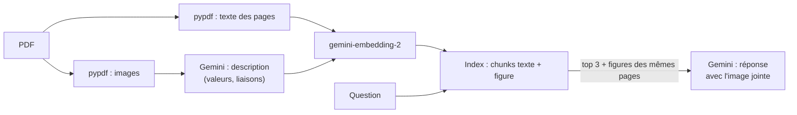

Un rapport d'entreprise, une notice technique ou une étude de marché portent souvent leurs informations les plus importantes **dans les figures** : le graphique des ventes, le tableau des coûts, le schéma d'architecture. Or un RAG classique commence par `extract_text()` : tout ce qui est dessiné disparaît. Le modèle répond alors honnêtement « l'information n'est pas présente », alors qu'elle est là, en gros, au milieu de la page.

Ce lab construit un RAG qui **voit** les figures, et le compare à un RAG texte seul sur le même PDF.

## Pour qui ?

- Vous avez déjà construit un RAG vectoriel (embeddings, similarité cosinus, génération avec contexte).
- Vous êtes à l'aise en Python et avec les appels à l'API Gemini.
- Vous travaillez sur des documents riches : rapports, présentations exportées en PDF, documentation technique.

## Ce que vous construisez

Un rapport trimestriel fictif de 6 pages (entreprise imaginaire « Verdalis », 4 entrepôts frigorifiques) est généré par un script : texte, graphique en barres, courbe avec seuil, schéma d'architecture et tableau dessiné. **Les valeurs chiffrées n'existent que dans les images.**

## Le résultat, en un tableau

Mesuré le 2026-10-15 avec `python evaluate.py` sur 12 questions, dont 10 portent sur une figure (détails dans la leçon 4) :

| Mode | Réponses exactes | dont questions sur figure |
| --- | --- | --- |
| Texte seul | 2/12 | 0/10 |
| Multimodal (descriptions indexées) | 10/12 | 8/10 |
| Multimodal + expansion par page | **12/12** | **10/10** |

## Prérequis

- Python 3.10 ou plus récent, une clé d'API Gemini dans `GOOGLE_API_KEY` (ou dans `.env`, voir [.env.example](./files/.env.example)).
- `pip install -r requirements.txt` ([requirements.txt](./files/requirements.txt)) : `google-genai`, `pypdf`, `reportlab`, `pillow`, `numpy`.
- Facultatif : la police DejaVu (`fonts-dejavu` sous Debian/Ubuntu) pour des accents nets dans les graphiques.

## Programme

| Module | Leçon | Ce que vous faites |
| --- | --- | --- |
| 1. Cas d'usage et architecture | [Quand le texte ne suffit pas](./01-cas-d-usage-et-architecture/01-quand-le-texte-ne-suffit-pas.md) | générer le PDF, constater ce que perd `extract_text()` |
| 2. Construire pas à pas | [Extraire et décrire les figures](./02-construire-pas-a-pas/01-extraire-et-decrire-les-figures.md) | images avec pypdf, descriptions structurées par Gemini, cache |
| | [Indexer et répondre avec l'image](./02-construire-pas-a-pas/02-indexer-et-repondre-avec-l-image.md) | embeddings, trois modes de recherche, image jointe à la question |
| 3. Évaluer et exploiter | [Texte seul contre multimodal](./03-evaluer-et-exploiter/01-texte-seul-contre-multimodal.md) | évaluation chiffrée, analyse des échecs, coûts |

## En local ou sur GCP ?

| | En local (ce lab) | Sur Google Cloud |
| --- | --- | --- |
| Extraction | pypdf, images intégrées au PDF | Document AI (mise en page, tableaux) ou Gemini sur la page entière |
| Description | Gemini via clé d'API | Gemini sur Vertex AI, en lot (batch) pour de gros volumes |
| Index | matrice NumPy en mémoire | Vertex AI Vector Search, AlloyDB/pgvector |
| Images | `.cache/` local | Cloud Storage, référencées par leur URI |

Code complet : [make_pdf.py](./files/make_pdf.py), [multimodal_rag.py](./files/multimodal_rag.py), [evaluate.py](./files/evaluate.py), [questions.json](./files/questions.json), [test_multimodal_rag.py](./files/test_multimodal_rag.py).
