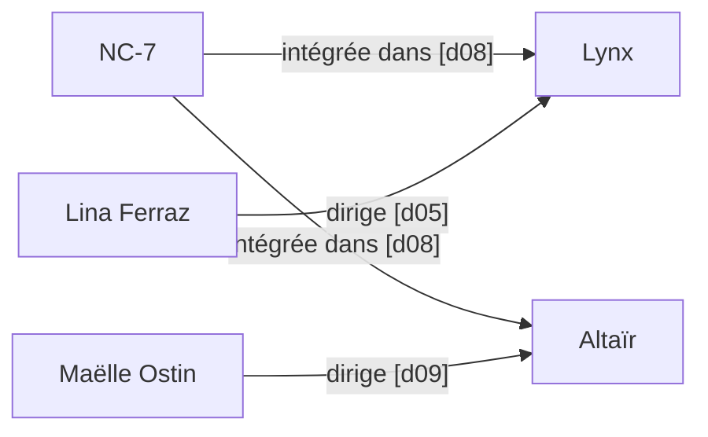
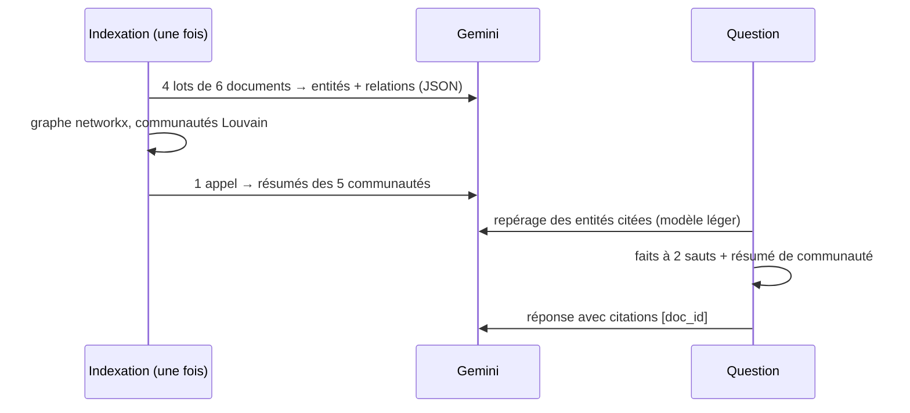

# Les questions relationnelles

> [!NOTE]
> Dans cette leçon, vous allez comprendre pourquoi un RAG vectoriel échoue sur les questions à plusieurs **sauts**, découvrir le corpus fictif du lab et les 15 questions de référence, et situer ce GraphRAG léger par rapport à Microsoft GraphRAG, LightRAG et EdgeQuake.

## Qu'est-ce qu'un saut ?

Un **saut** (*hop*) est le passage d'une entité à une autre par une relation. Une question à 1 saut se répond avec un seul fait ; une question à 3 sauts exige d'enchaîner trois faits, souvent écrits dans trois documents différents.

| Sauts | Question | Faits nécessaires |
| --- | --- | --- |
| 1 | Qui dirige le projet Héron ? | Sofia Brenet dirige Héron [d01] |
| 2 | À quel groupe appartient le fournisseur des capteurs du projet Héron ? | Héron ← capteurs d'Ilex Capteurs [d02] ; Ilex filiale de Pyralis Énergie [d03] |
| 3 | Qui dirige les projets qui intègrent les cartes NC-7 ? | NC-7 dans Lynx et Altaïr [d08] ; Lina Ferraz dirige Lynx [d05] ; Maëlle Ostin dirige Altaïr [d09] |



## Pourquoi le RAG vectoriel échoue

La recherche vectorielle compare l'embedding de la **question** à celui de chaque document. Le document d08 (« les cartes NC-7 sont intégrées dans Lynx et Altaïr ») ressemble beaucoup à la question ; d05 (« Lina Ferraz dirige le projet Lynx… ») beaucoup moins : il ne parle ni de NC-7, ni de cartes. Il n'est donc pas dans le top 4, et le modèle ne peut pas faire le second saut.

> [!WARNING]
> Augmenter `k` (top 10, top 20) aide sur un petit corpus, mais ne passe pas à l'échelle : sur 100 000 documents, les documents du 2e ou 3e saut ne ressemblent toujours pas à la question et se noient parmi des milliers de passages proches. Le graphe, lui, suit les relations quelle que soit la taille du corpus.

```quiz
question: "« À qui rend compte la supérieure de Karim Delaunoy ? » Combien de sauts, et lesquels ?"
options:
  - "1 saut : Karim Delaunoy rend compte à Yasmine Coudray"
  - "2 sauts : Karim Delaunoy → Sofia Brenet (rend compte à), puis Sofia Brenet → Yasmine Coudray (rend compte à)"
  - "3 sauts : il faut aussi passer par le site de Grenoble"
answer: 1
explanation: "d04 dit que Karim rend compte à Sofia Brenet, d13 que Sofia rend compte à Yasmine Coudray : deux faits, dans deux documents différents. C'est ainsi que questions.json la classe (hops: 2)."
```

## Le corpus et les questions

- [corpus.jsonl](../files/corpus.jsonl) : 24 documents courts (1 à 2 phrases). 18 portent les faits utiles, éparpillés : chaque document mentionne 2 ou 3 entités. 6 sont des **distracteurs** (autre banc d'essai, autre retard de livraison, réunions mensuelles) qui ressemblent aux questions sans y répondre.
- [questions.json](../files/questions.json) : 15 questions, 3 à 1 saut, 9 à 2 sauts, 3 à 3 sauts (le nombre de faits à enchaîner), chacune avec les éléments attendus dans la réponse.

```json title="files/questions.json"
{"question": "Qui dirige les projets qui intègrent les cartes NC-7 ?", "expected": ["Lina Ferraz", "Maëlle Ostin"], "hops": 3}
```

Les questions à 1 saut sont des **témoins** : le GraphRAG ne doit pas faire moins bien que le RAG vectoriel là où ce dernier excelle.

## L'architecture du lab



| Famille | Ce qu'elle fait | Ce lab |
| --- | --- | --- |
| **Microsoft GraphRAG** | communautés hiérarchiques, résumés à plusieurs niveaux, recherche « globale » | une seule couche de communautés, résumées en 1 appel |
| **LightRAG** | recherche « locale » (entités) et « globale » (relations), index vectoriel des entités | recherche locale par voisinage, globale par résumés |
| **EdgeQuake** | LightRAG en Rust sur PostgreSQL, plusieurs modes de requête | voir la [fiche EdgeQuake](../../../../01-ia-generative/04-edgequake-graph-rag/index.md) |

```quiz
question: "Qu'apporte un résumé de communauté par rapport aux faits du voisinage ?"
options:
  - "Il remplace l'extraction des relations"
  - "Une vue d'ensemble d'un groupe d'entités très liées, utile quand la question ne cite aucune entité précise"
  - "Il accélère le calcul des embeddings"
answer: 1
explanation: "Le voisinage part des entités citées. Si la question est vague (« quel cabinet a audité un projet et un prestataire ? »), il n'y a pas de point de départ : on se rabat sur les résumés de communautés, c'est la « recherche globale » de Microsoft GraphRAG."
```

## Résultat obtenu

Exécution réelle du 2026-10-15 sur la question à 3 sauts « Par quels intermédiaires Sofia Brenet est-elle liée à Pyralis Énergie ? » :

```text
$ python graphrag.py "Par quels intermédiaires Sofia Brenet est-elle liée à Pyralis Énergie ?"
Graphe : 27 nœuds, 35 arêtes, 5 communautés
[graphe] entités=['sofia brenet', 'pyralis energie']
  Sofia Brenet est liée à Pyralis Énergie en dirigeant le projet Héron [d01], qui s'appuie sur des capteurs de
  particules [d02] fournis par Ilex Capteurs [d02], elle-même filiale de Pyralis Énergie [d03]. ...
[vecteurs] documents=['d03', 'd16', 'd01', 'd04']
  Les documents fournis ne permettent pas d'établir de lien ni de déterminer d'intermédiaires entre Sofia Brenet
  et Pyralis Énergie [d01, d03, d04, d16]. L'information est donc manquante.
```

Le RAG vectoriel avait d01 et d03 sous les yeux, mais pas **d02**, le maillon central : le chemin était coupé.

## Exercice : tracer les chemins à la main

À partir du corpus, écrivez la chaîne de faits (avec les identifiants de documents) qui répond à « Quel prestataire relie le site du projet Lynx à celui du projet Altaïr ? ».

<details>
<summary>Voir la solution</summary>

1. Lynx est installé sur le site de Brest [d05].
2. Altaïr est basé sur le site de Metz [d09].
3. Tessera Logistique assure le transport entre Brest et Metz [d11].

Réponse : **Tessera Logistique**. Trois documents, dont aucun ne contient à la fois « Lynx », « Altaïr » et « Tessera ». C'est exactement le cas où le RAG vectoriel a échoué dans l'évaluation (il a récupéré d05 et d09, mais pas d11).

</details>

## Je sais faire

- [ ] Compter les sauts nécessaires pour répondre à une question
- [ ] Expliquer pourquoi la similarité vectorielle ne retrouve pas les maillons intermédiaires
- [ ] Décrire les étapes d'indexation et de réponse d'un GraphRAG
- [ ] Distinguer recherche locale (voisinage d'entités) et recherche globale (résumés de communautés)
