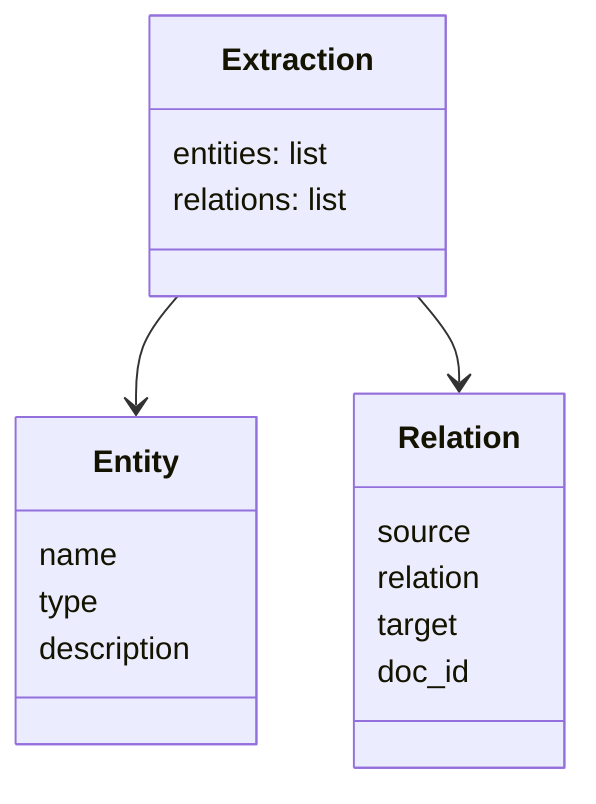

# Extraire entités et relations

> [!NOTE]
> Dans cette leçon, vous allez décrire le graphe attendu avec un schéma Pydantic, faire extraire par Gemini les entités et relations du corpus par lots avec une **sortie structurée**, mettre le résultat en cache, puis fusionner les variantes d'un même nom (**résolution d'entités**). Code : [graphrag.py](../files/graphrag.py).

## Étape 1 : le schéma du graphe

Une **sortie structurée** oblige le modèle à répondre dans un format JSON précis, décrit par un schéma. Avec le SDK `google-genai`, on passe directement une classe Pydantic :

```python title="files/graphrag.py"
class Entity(BaseModel):
    name: str
    type: str          # personne, projet, organisation, site, equipement, composant, incident
    description: str

class Relation(BaseModel):
    source: str
    relation: str
    target: str
    doc_id: str

class Extraction(BaseModel):
    entities: list[Entity]
    relations: list[Relation]
```

Le champ `doc_id` est essentiel : chaque relation garde la trace du document dont elle vient. C'est ce qui permettra de **citer les sources** dans la réponse, et de vérifier une relation douteuse.



## Étape 2 : l'invite d'extraction

```python title="files/graphrag.py"
EXTRACT_PROMPT = """Extrais un graphe de connaissances des documents ci-dessous.
- Entités : personnes, projets, organisations, sites, équipements, composants, incidents.
- Utilise toujours le nom canonique le plus court et complet : « Héron » (pas « le projet Héron »), « Sofia Brenet », « Grenoble ».
- Relations : uniquement celles écrites explicitement, avec un verbe court (dirige, fournit, filiale de, rend compte à,
  partage avec, intègre, situé à, audite, a formé, a réparé, a travaillé avec, transporte entre…).
- doc_id : l'identifiant du document d'où vient la relation.
"""
```

| Consigne | Problème évité |
| --- | --- |
| nom canonique court | « le projet Héron », « Héron » et « projet Heron » deviendraient trois nœuds |
| relations explicites seulement | le modèle « déduit » des liens plausibles mais faux |
| verbes courts d'une liste | des relations comparables d'un lot à l'autre |

```quiz
question: "Pourquoi exiger doc_id dans chaque relation plutôt que dans chaque entité ?"
options:
  - "Parce qu'une entité peut apparaître dans plusieurs documents, alors qu'une relation vient d'une phrase précise"
  - "Parce que Pydantic n'accepte pas plus de trois champs par classe"
  - "Pour réduire le nombre de jetons"
answer: 0
explanation: "Sofia Brenet apparaît dans d01, d04, d10 et d13. La relation « Sofia Brenet dirige Héron » vient de d01 seulement : c'est elle qu'on veut pouvoir citer et vérifier."
```

## Étape 3 : extraire par lots, avec cache

```python title="files/graphrag.py"
def extract(client, docs, batch=6):
    def compute():
        out = {"entities": [], "relations": []}
        for i in range(0, len(docs), batch):
            text = "\n".join(f"[{d['id']}] {d['text']}" for d in docs[i:i + batch])
            r = generate(client, EXTRACT_PROMPT + text, Extraction)
            out["entities"] += [e.model_dump() for e in r.entities]
            out["relations"] += [x.model_dump() for x in r.relations]
        return out
    return cached("extraction", [MODEL, EXTRACT_PROMPT, docs, batch], compute)
```

- **Lots de 6 documents** : 4 appels au lieu de 24. Un lot plus gros coûte moins d'appels, mais le modèle risque d'oublier des relations en fin de lot ; 5 à 10 documents courts est un bon compromis à mesurer.
- **`cached`** enregistre le résultat dans `.cache/extraction-<empreinte>.json` ; l'empreinte dépend du modèle, de l'invite, des documents et de la taille de lot. Relancer `evaluate.py` ne refait pas l'extraction.

> [!TIP]
> Le fichier JSON en cache est votre meilleur outil de débogage : ouvrez-le et lisez les relations. Une erreur d'extraction se voit tout de suite, alors qu'elle est invisible dans un vecteur.

## Étape 4 : la résolution d'entités

Même avec la consigne, les noms varient d'un lot à l'autre. La fonction `node_key` calcule une **clé** commune aux variantes :

```python title="files/graphrag.py"
GENERIC = {"le", "la", "les", "l", "projet", "societe", "groupe", "cabinet", "site", "de", "du", "d"}

def node_key(name: str) -> str:
    s = unicodedata.normalize("NFKD", name.lower()).encode("ascii", "ignore").decode()
    words = re.findall(r"[a-z0-9]+", s)
    while len(words) > 1 and words[0] in GENERIC:
        words = words[1:]
    return " ".join(words)
```

`node_key("le projet Héron") == node_key("Projet Heron") == node_key("Héron") == "heron"` : c'est le premier test de [test_graphrag.py](../files/test_graphrag.py).

> [!WARNING]
> Cette résolution est volontairement naïve. Elle ne sait pas que « S. Brenet » et « Sofia Brenet » sont la même personne, et elle fusionnerait à tort deux homonymes. En production, on ajoute une étape de rapprochement (embeddings des noms et descriptions, puis validation par un LLM ou un humain).

```quiz
question: "Que renvoie node_key pour « la société Ilex Capteurs » et pour « le site de Grenoble » ?"
options:
  - "« ilex capteurs » et « grenoble »"
  - "« societe ilex capteurs » et « site de grenoble »"
  - "« ilex » et « grenoble »"
answer: 0
explanation: "Les mots génériques en tête (la, société, le, site, de) sont retirés un par un tant qu'il reste au moins un mot. « Capteurs » n'est pas en tête, il est conservé."
```

## Résultat obtenu

Extraction réelle du 2026-10-15 (`gemini-3.5-flash`, 4 lots) : 45 entités brutes et 35 relations, fusionnées en 27 nœuds. Extrait du graphe obtenu (tel qu'affiché par le code) :

```text
Sofia Brenet --dirige--> Héron [d01]
Héron --s'appuie sur--> capteurs de particules [d02]
Ilex Capteurs --fournit--> capteurs de particules [d02]
Ilex Capteurs --filiale de--> Pyralis Énergie [d03]
Karim Delaunoy --a formé--> Aurèle Mandin [d15]
Aurèle Mandin --a réparé--> banc d'essai B2 [d14]
NC-7 --intègre--> Lynx [d08]
Nordhaven Composants --fournit--> NC-7 [d07]
```

Deux défauts réels à remarquer : « NC-7 intègre Lynx » est **inversé** (c'est Lynx qui intègre NC-7), et le modèle a créé un nœud intermédiaire « capteurs de particules » entre Héron et Ilex Capteurs, ce qui **ajoute un saut**. On verra leur effet dans l'évaluation.

## Exercice : mesurer la stabilité de l'extraction

Changez la taille de lot à 3 (`extract(client, docs, batch=3)`), relancez, et comparez le nombre d'entités, de relations et de nœuds. Qu'en concluez-vous ?

<details>
<summary>Voir la solution</summary>

```python
from graphrag import *
client, docs = gemini(), load_corpus()
for b in (6, 3):
    data = extract(client, docs, batch=b)
    G = build_graph(data)
    print(b, len(data["entities"]), len(data["relations"]), G.number_of_nodes(), G.number_of_edges())
```

La taille de lot fait partie de l'empreinte du cache : `batch=3` déclenche 8 nouveaux appels, `batch=6` relit le cache. Les chiffres changent d'un réglage à l'autre (et même d'une exécution à l'autre) : l'extraction par LLM n'est pas déterministe. C'est une raison de **figer** le graphe en cache et de le versionner, plutôt que de le recalculer à chaque démarrage.

</details>

## Je sais faire

- [ ] Décrire un graphe de connaissances avec un schéma Pydantic et obtenir un JSON validé
- [ ] Écrire une invite d'extraction qui limite les doublons et les relations inventées
- [ ] Extraire par lots et mettre le résultat en cache avec une empreinte complète
- [ ] Fusionner les variantes d'un même nom et connaître les limites de cette fusion
