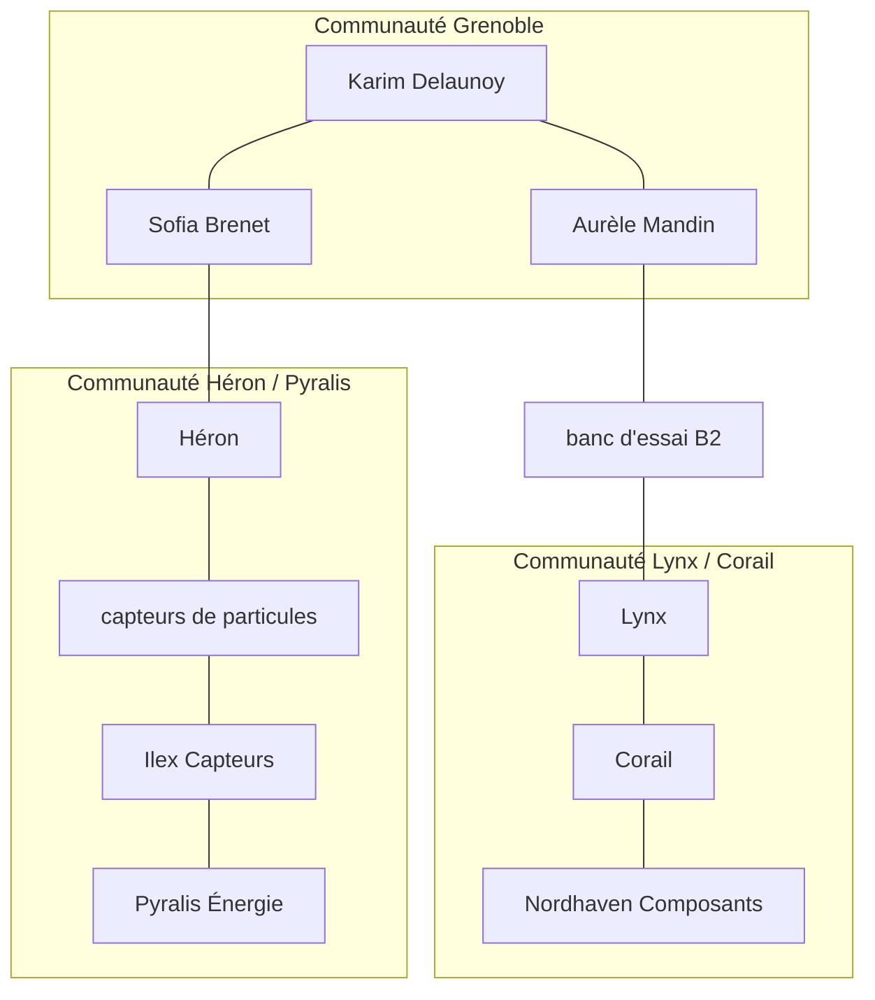

# Graphe, communautés et réponses

> [!NOTE]
> Dans cette leçon, vous allez construire le graphe networkx avec la provenance de chaque relation, détecter des communautés avec l'algorithme de Louvain et les faire résumer, puis répondre : repérer les entités de la question, collecter les faits à 2 sauts, et basculer en recherche globale quand aucune entité n'est reconnue.

## Étape 1 : le graphe

**networkx** est la bibliothèque Python de référence pour manipuler des graphes : des **nœuds** (ici les entités) reliés par des **arêtes** (ici les relations).

```python title="files/graphrag.py"
def build_graph(data: dict) -> nx.Graph:
    G = nx.Graph()
    for e in data["entities"]:
        k = node_key(e["name"])
        if k not in G:
            G.add_node(k, name=e["name"], type=e["type"], descriptions=[])
        G.nodes[k]["descriptions"].append(e["description"])
    for r in data["relations"]:
        a, b = node_key(r["source"]), node_key(r["target"])
        ...
        G.edges[a, b]["facts"].append(f"{G.nodes[a]['name']} --{r['relation']}--> {G.nodes[b]['name']} [{r['doc_id']}]")
    return G
```

Choix importants :

| Choix | Pourquoi |
| --- | --- |
| `nx.Graph` (non orienté) | pour **parcourir** dans les deux sens : de NC-7 vers Lynx comme de Lynx vers NC-7 ; le sens reste écrit dans le fait |
| faits en texte sur l'arête | le LLM lira directement « A --dirige--> B [d01] » |
| plusieurs faits par arête | deux documents peuvent relier les mêmes entités |

## Étape 2 : communautés et résumés

Une **communauté** est un groupe de nœuds plus connectés entre eux qu'avec le reste du graphe. L'algorithme de **Louvain** les trouve en maximisant la **modularité** (une mesure de la densité des liens à l'intérieur des groupes comparée au hasard).

```python title="files/graphrag.py"
def communities(G):
    return [sorted(c) for c in nx.community.louvain_communities(G, seed=42)]
```

`seed=42` rend le découpage reproductible. Les 5 communautés sont ensuite résumées en **un seul** appel (sortie structurée `Summaries`), mis en cache.

> [!WARNING]
> Bug réel rencontré pendant l'écriture du lab : le texte envoyé pour les résumés était construit avec `G.subgraph(c).edges`, dont l'ordre **change d'un processus Python à l'autre** (l'ordre d'itération d'un ensemble de chaînes dépend du hachage aléatoire). L'empreinte du cache changeait donc à chaque exécution et les résumés étaient recalculés. Correction : parcourir `G.edges`, dont l'ordre suit l'insertion.



```quiz
question: "À quoi servent les résumés de communautés dans ce lab ?"
options:
  - "À remplacer les relations du graphe, devenues inutiles"
  - "À donner une vue d'ensemble : ajoutés au contexte de la communauté de chaque entité citée, et seuls disponibles quand la question ne cite aucune entité"
  - "À calculer les embeddings des entités"
answer: 1
explanation: "Le voisinage donne des faits précis ; le résumé donne le contexte du groupe. Quand aucune entité n'est reconnue, on se rabat sur tous les résumés : c'est la recherche globale."
```

## Étape 3 : repérer les entités de la question

```python title="files/graphrag.py"
def link_entities(client, G, question):
    names = sorted(G.nodes[n]["name"] for n in G)
    prompt = (f"Liste des entités connues : {names}\n\nQuestion : {question}\n\n"
              "Renvoie les noms de la liste qui sont cités ou désignés directement dans la question, recopiés à l'identique.")
    r = generate(client, prompt, Mentions, model=LIGHT_MODEL)
    found = [node_key(n) for n in (r.names if r else [])]  # r vaut None si le JSON est invalide
    return [k for k in dict.fromkeys(literal_mentions(G, question) + found) if k in G]
```

Deux mécanismes combinés :

1. **`literal_mentions`**, sans LLM : les nœuds dont la clé apparaît telle quelle dans la question normalisée (« projet Héron » → `heron`). Gratuit et fiable pour les noms exacts.
2. **Un modèle léger** (`gemini-3.5-flash-lite`) pour les désignations moins directes (fautes, formes abrégées).

> [!TIP]
> Les deux viennent d'un échec mesuré : lors d'une exécution, le modèle léger a renvoyé une liste vide pour « Qui dirige le projet Héron ? », et le GraphRAG a échoué sur la question la plus facile. Le filet littéral rend ce cas impossible.

## Étape 4 : contexte local ou global

```python title="files/graphrag.py"
def context(self, seeds):
    if not seeds:  # aucune entité reconnue : « recherche globale » sur tous les résumés de communautés
        return "Résumés de communautés :\n" + "\n".join(self.summaries)
    entities = [f"{self.G.nodes[s]['name']} : {' '.join(self.G.nodes[s]['descriptions'])}" for s in seeds]
    facts = neighborhood_facts(self.G, seeds)          # faits à 2 sauts, les plus proches d'abord, 40 au plus
    ...
```

`neighborhood_facts` calcule la distance de chaque nœud aux entités de départ (`nx.single_source_shortest_path_length` avec `cutoff=2`) et trie les arêtes de la plus proche à la plus lointaine : si la liste est tronquée à 40 faits, ce sont les plus lointains qui tombent.

```quiz
question: "Avec radius=2 depuis « Pyralis Énergie », le fait « Sofia Brenet --dirige--> Héron » est-il dans le contexte ?"
options:
  - "Oui, Héron est à 1 saut de Pyralis"
  - "Non : Pyralis → Ilex (1) → capteurs de particules (2) → Héron (3) → Sofia Brenet (4) ; ce fait est trop loin"
  - "Oui, tous les faits sont toujours inclus"
answer: 1
explanation: "Le nœud intermédiaire « capteurs de particules » créé par l'extraction ajoute un saut. Mais la question « par quels intermédiaires Sofia Brenet est-elle liée à Pyralis ? » cite aussi Sofia Brenet : on part des deux bouts, et les deux voisinages se rejoignent."
```

## Résultat obtenu

Exécution réelle du 2026-10-15 :

```text
$ python graphrag.py
Graphe : 27 nœuds, 35 arêtes, 5 communautés
[graphe] entités=['banc d essai b2']
  Le technicien qui a réparé le banc d'essai B2 est Aurèle Mandin [d14]. Aurèle Mandin a été formé par Karim Delaunoy [d15].
[vecteurs] documents=['d14', 'd15', 'd19', 'd05']
  Le banc d'essai B2 a été réparé par le technicien Aurèle Mandin [d14]. Ce dernier a été formé à la maintenance
  des bancs d'essai par Karim Delaunoy [d15].
```

Ici, les deux méthodes réussissent : d14 et d15 partagent le mot « banc d'essai », donc la recherche vectorielle les retrouve tous les deux. La leçon suivante montre les cas où ce n'est plus vrai.

Résumé réellement produit pour une communauté :

```text
Maëlle Ostin dirige la société Altaïr située à Metz et a également travaillé sur le projet Héron. Le projet Héron
s'appuie sur des capteurs de particules fournis par Ilex Capteurs, une filiale de Pyralis Énergie.
```

Notez l'erreur : Altaïr est un **projet**, pas une société. Un résumé est une génération, il peut se tromper ; c'est pourquoi les faits sourcés restent la base du contexte.

## Exercice : visualiser le voisinage

Écrivez une fonction `to_mermaid(G, seeds, radius=1)` qui renvoie un diagramme Mermaid `flowchart LR` du voisinage des entités données, pour l'afficher dans une page de documentation.

<details>
<summary>Voir la solution</summary>

```python
def to_mermaid(G, seeds, radius=1):
    nodes = set()
    for s in seeds:
        nodes |= set(nx.single_source_shortest_path_length(G, s, cutoff=radius))
    ids = {n: f"n{i}" for i, n in enumerate(sorted(nodes))}
    lines = ["flowchart LR"]
    lines += [f'  {ids[n]}["{G.nodes[n]["name"]}"]' for n in sorted(nodes)]
    lines += [f"  {ids[a]} --- {ids[b]}" for a, b in G.edges if a in nodes and b in nodes]
    return "\n".join(lines)

print(to_mermaid(G, ["nc 7"]))
```

Les identifiants courts `n0`, `n1`… évitent les problèmes d'accents et d'espaces dans les identifiants Mermaid ; le vrai nom est dans le libellé entre guillemets.

</details>

## Je sais faire

- [ ] Construire un graphe networkx dont chaque arête garde ses faits et leurs documents sources
- [ ] Détecter des communautés avec Louvain de façon reproductible
- [ ] Repérer les entités d'une question avec un filet sans LLM
- [ ] Collecter les faits à N sauts, les plus proches d'abord
- [ ] Basculer en recherche globale quand la question ne cite aucune entité
