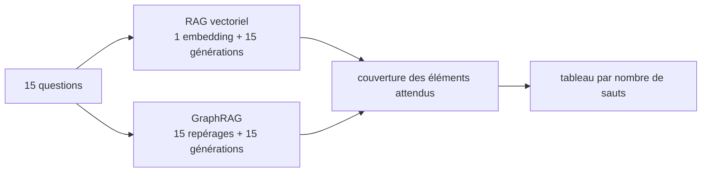
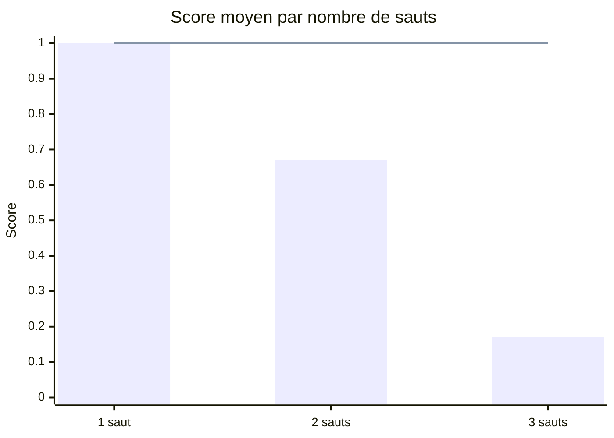

# GraphRAG contre RAG vectoriel : l'évaluation chiffrée

> [!NOTE]
> Dans cette leçon, vous allez comparer le GraphRAG léger à un RAG vectoriel classique sur les 15 questions de référence, lire les résultats par nombre de sauts, retracer les trois corrections apportées pendant la construction, et repérer les limites du score automatique. Code : [evaluate.py](../files/evaluate.py).

## La référence : un RAG vectoriel honnête

```python title="files/graphrag.py"
class VectorRAG:
    def answer(self, question, q_vec=None, k=4):
        hits = [self.docs[i] for i in np.argsort(-(self.vecs @ q_vec))[:k]]
        prompt = ("Documents :\n" + "\n".join(f"[{d['id']}] {d['text']}" for d in hits) + ...)
```

Même modèle de génération (`gemini-3.5-flash`), mêmes consignes (2 phrases, citations, « dis-le si l'information manque »), même jeu de questions. Seule la façon de construire le contexte change : 4 documents les plus proches d'un côté, faits du graphe de l'autre.

## Le score

```python title="files/evaluate.py"
def coverage(text: str, expected: list[str]) -> float:
    return sum(norm(e) in norm(text) for e in expected) / len(expected)
```

Score d'une réponse = part des éléments attendus qu'elle cite (« Lina Ferraz » seule pour une question qui attend aussi « Maëlle Ostin » → 0.5). Une réponse est **complète** si son score vaut 1.



## Résultat obtenu

Exécution réelle du 2026-10-15 (graphe et résumés en cache, durée environ 2 min 45 s) :

```text
$ python evaluate.py
- [2 saut(s)] Quel prestataire relie le site du projet Lynx à celui du projet Altaïr ?  attendu=['Tessera']
    vecteurs 0.00 docs=['d08', 'd05', 'd10', 'd09'] 'Le projet Lynx est basé sur le site de Brest et le projet Altaïr sur le site de Metz [d05, d09]. Cependant, les document'
    graphe   1.00 entités=['lynx', 'altair'] ...
- [3 saut(s)] Qui dirige les projets qui intègrent les cartes NC-7 ?  attendu=['Lina Ferraz', 'Maëlle Ostin']
    vecteurs 0.00 docs=['d08', 'd06', 'd07', 'd21'] 'Les cartes électroniques NC-7 sont intégrées dans les prototypes du projet Lynx et du projet Altaïr [d08]. Cependant, le'
    graphe   1.00 entités=['nc 7'] ...
- [2 saut(s)] Quel cabinet a audité à la fois un projet et un prestataire logistique ?  attendu=['Orvale']
    vecteurs 1.00 docs=['d18', 'd17', 'd11', 'd12'] 'Le cabinet Orvale Conseil a audité à la fois le projet Héron [d17] et le prestataire Tessera Logistique, qui assure le t'
    graphe   1.00 entités=[] "D'après les données fournies, la société Orvale Conseil a audité le prestataire Tessera Logistique, mais aucune relation"
...
| Méthode | Score moyen | 1 saut | 2 sauts | 3 sauts | Réponses complètes |
|---|---|---|---|---|---|
| vecteurs (top 4) | 0.63 | 1.00 | 0.67 | 0.17 | 9/15 |
| graphe | 1.00 | 1.00 | 1.00 | 1.00 | 15/15 |
```



(barres : RAG vectoriel ; ligne : GraphRAG)

```quiz
question: "Une réponse cite « Lina Ferraz » mais pas « Maëlle Ostin » pour une question qui attend les deux. Quel est son score, et compte-t-elle comme réponse complète ?"
options:
  - "Score 0.5, pas complète"
  - "Score 1, complète"
  - "Score 0, pas complète"
answer: 0
explanation: "coverage compte la part des éléments attendus présents : 1 sur 2 = 0.5. Une réponse n'est complète que si son score vaut 1 (test test_score_par_couverture)."
```

## Lire les chiffres

1. **À 1 saut, égalité (1.00).** Quand toute la réponse tient dans un document qui ressemble à la question, le RAG vectoriel suffit.
2. **Plus il y a de sauts, plus le RAG vectoriel décroche** : 0.67 à 2 sauts, 0.17 à 3 sauts. Ses échecs ont tous la même forme : il récupère le premier maillon (« les cartes NC-7 sont intégrées dans Lynx et Altaïr ») et répond honnêtement que la suite manque.
3. **Le GraphRAG tient à tous les niveaux**, parce qu'il suit les relations au lieu de chercher des ressemblances.

> [!WARNING]
> **Le score automatique se trompe une fois en faveur du graphe.** Sur la question Orvale, aucune entité n'est citée, le graphe passe en recherche globale et répond « Orvale Conseil a audité Tessera Logistique, mais aucune relation [ne mentionne de projet] » : il cite bien « Orvale » (score 1) mais rate la moitié de la réponse (le projet Héron). En relisant à la main, le bilan honnête est donc **14/15** pour le graphe contre 9/15. Un score par inclusion de chaînes est rapide et reproductible, mais relisez toujours les réponses, ou ajoutez un LLM-juge pour les cas litigieux.

```quiz
question: "Pourquoi le GraphRAG a-t-il une réponse incomplète sur la question Orvale ?"
options:
  - "Parce que la relation « Orvale Conseil audite Héron » n'a pas été extraite"
  - "Parce que la question ne cite aucune entité : le contexte se limite aux résumés de communautés, et aucun résumé ne mentionne l'audit d'Héron"
  - "Parce que le modèle léger a planté"
answer: 1
explanation: "La relation est bien dans le graphe (« Orvale Conseil --audite--> Héron [d17] »), mais la recherche globale n'utilise que les résumés. Une piste : en l'absence d'entité, ajouter aussi les k documents vectoriels les plus proches (GraphRAG hybride)."
```

## Ce que la mesure a fait corriger

Le chiffre final n'est pas sorti du premier coup. Trois exécutions successives, sur les mêmes questions :

| Version | Score graphe | Échec observé | Correction |
| --- | --- | --- | --- |
| 1 | 0.90 (13/15) | question sans entité → contexte vide, « informations insuffisantes » | recherche globale sur les résumés |
| 2 | 0.93 (14/15) | « Qui dirige le projet Héron ? » : le modèle léger n'a repéré aucune entité | repérage littéral sans LLM en plus du modèle |
| 3 | 1.00 (15/15, 14 en relecture) | — | — |

Entre les versions 1 et 2, on a aussi ajouté au contexte la **description** des entités citées (« Nordhaven Composants : Fournisseur principal du projet Corail. Société fournissant des cartes électroniques NC-7. »). Remarquez au passage une perte d'information de l'extraction : de d07, il ne reste que « Nordhaven Composants --fournit--> NC-7 » ; le **retard** lui-même n'est nulle part dans le graphe. Sur la question du retard, le graphe répond juste en suivant la chaîne d'approvisionnement, pas parce qu'il « sait » qu'il y a un retard (lors d'une exécution intermédiaire, il a d'ailleurs échoué sur cette question).

> [!TIP]
> Chaque correction répond à un échec **lu** dans la sortie de `evaluate.py`, pas à une intuition. Gardez ce réflexe : on n'ajoute une brique au pipeline que si un cas mesuré la justifie.

## Coûts et exploitation

| Poste | GraphRAG léger | RAG vectoriel |
| --- | --- | --- |
| Indexation | 4 appels d'extraction + 1 résumé (+ embeddings si hybride) | 1 appel d'embedding |
| Par question | 1 repérage (modèle léger) + 1 génération | 1 embedding + 1 génération |
| Mise à jour d'un document | réextraire le lot, reconstruire le graphe et les communautés | recalculer 1 embedding |

- [ ] Versionnez le graphe extrait (le JSON du cache) : c'est une donnée, pas un calcul jetable.
- [ ] Faites relire les relations critiques (organigramme, liens capitalistiques) par un expert : une relation inversée comme « NC-7 intègre Lynx » est vite arrivée.
- [ ] Combinez les deux : graphe pour les questions relationnelles, vecteurs pour les questions de contenu ; un routage simple sur la présence d'entités suffit souvent.

## Exercice : un GraphRAG hybride

Modifiez `GraphRAG.context` pour qu'en l'absence d'entité, le contexte contienne les résumés **et** les 4 documents les plus proches (en réutilisant `VectorRAG`). Vérifiez que la question Orvale devient complète.

<details>
<summary>Voir la solution</summary>

```python
class GraphRAG:
    def __init__(self, G, comms, summaries, client=None, vector=None):
        ...
        self.vector = vector                      # un VectorRAG, facultatif

    def context(self, seeds, question=""):
        if not seeds:
            ctx = "Résumés de communautés :\n" + "\n".join(self.summaries)
            if self.vector is not None:
                q_vec = embed(self.client, [question])[0]
                hits = np.argsort(-(self.vector.vecs @ q_vec))[:4]
                ctx += "\n\nDocuments :\n" + "\n".join(
                    f"[{self.vector.docs[i]['id']}] {self.vector.docs[i]['text']}" for i in hits)
            return ctx
        ...
```

Passez `question` depuis `answer`, construisez `GraphRAG(G, comms, summaries, client, vector=VectorRAG.build(client, docs))`, puis relancez `pytest -q` (le test `test_recherche_globale_sans_entite` doit toujours passer) et `python evaluate.py`. Les documents d17 et d18 font partie des 4 plus proches de la question Orvale (voir la ligne `vecteurs` ci-dessus) : la réponse peut citer Héron et Tessera.

</details>

## Je sais faire

- [ ] Comparer deux RAG avec le même modèle, les mêmes consignes et les mêmes questions
- [ ] Lire des résultats par nombre de sauts et expliquer le décrochage du RAG vectoriel
- [ ] Repérer un faux positif du score automatique en relisant les réponses
- [ ] Justifier chaque brique du pipeline par un échec mesuré
- [ ] Chiffrer le coût d'indexation et de mise à jour d'un GraphRAG
