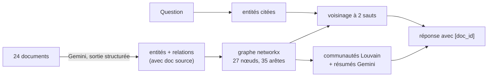

« Qui dirige les projets qui intègrent les cartes NC-7 ? » Pour répondre, il faut lire un document qui dit que les cartes NC-7 sont dans les projets Lynx et Altaïr, **puis** deux autres documents qui disent qui dirige Lynx et qui dirige Altaïr. Un RAG vectoriel classique cherche les passages qui **ressemblent** à la question : il trouve le premier document, rarement les deux autres, et répond « l'information n'est pas présente ».

Un **GraphRAG** (RAG sur graphe de connaissances) extrait d'abord des documents les **entités** (personnes, projets, entreprises…) et les **relations** entre elles (« dirige », « fournit », « filiale de »). Au moment de la question, il part des entités citées et **suit les relations**, de proche en proche. Ce lab en construit une version légère, en Python et networkx, et la compare chiffres à l'appui à un RAG vectoriel.

> [!TIP]
> Pour voir une implémentation complète et prête pour la production du même principe (algorithme LightRAG, en Rust sur PostgreSQL), lisez la fiche [EdgeQuake : un Graph-RAG en Rust](../../../01-ia-generative/04-edgequake-graph-rag/index.md). Ce lab vous fait comprendre ce que de tels outils font sous le capot.

## Pour qui ?

- Vous avez déjà construit un RAG vectoriel et vous savez obtenir une sortie JSON d'un LLM.
- Vous connaissez les bases de Python ; aucune connaissance préalable en théorie des graphes n'est nécessaire.
- Vos questions métier portent sur des **liens** : organigrammes, fournisseurs, dépendances, enquêtes, conformité.

## Ce que vous construisez

Le corpus décrit une organisation **fictive** (projets Héron, Lynx, Corail, Altaïr ; fournisseurs Ilex Capteurs, Nordhaven Composants… ; tous les noms sont inventés).

## Le résultat, en un tableau

Mesuré le 2026-10-15 avec `python evaluate.py` sur 15 questions de 1 à 3 sauts (détails et limites dans la leçon 4) :

| Méthode | Score moyen | 1 saut | 2 sauts | 3 sauts | Réponses complètes |
| --- | --- | --- | --- | --- | --- |
| RAG vectoriel (top 4) | 0.63 | 1.00 | 0.67 | 0.17 | 9/15 |
| GraphRAG léger | **1.00** | 1.00 | 1.00 | 1.00 | **15/15** |

## Prérequis

- Python 3.10 ou plus récent, une clé d'API Gemini dans `GOOGLE_API_KEY` (ou `.env`, voir [.env.example](./files/.env.example)).
- `pip install -r requirements.txt` ([requirements.txt](./files/requirements.txt)) : `google-genai`, `networkx`, `numpy`, `pydantic`.

## Programme

| Module | Leçon | Ce que vous faites |
| --- | --- | --- |
| 1. Cas d'usage et architecture | [Les questions relationnelles](./01-cas-d-usage-et-architecture/01-questions-relationnelles.md) | comprendre les sauts, le corpus, l'architecture |
| 2. Construire pas à pas | [Extraire entités et relations](./02-construire-pas-a-pas/01-extraire-entites-et-relations.md) | schéma Pydantic, extraction par lots, résolution d'entités |
| | [Graphe, communautés et réponses](./02-construire-pas-a-pas/02-graphe-communautes-et-reponses.md) | networkx, Louvain, voisinage, recherche locale et globale |
| 3. Évaluer et exploiter | [GraphRAG contre RAG vectoriel](./03-evaluer-et-exploiter/01-graphrag-contre-rag-vectoriel.md) | évaluation chiffrée, échecs corrigés, coûts, limites |

## En local ou sur GCP ?

| | En local (ce lab) | Sur Google Cloud |
| --- | --- | --- |
| Graphe | networkx en mémoire (quelques milliers de nœuds) | Spanner Graph, ou Neo4j sur GCP |
| Extraction | Gemini via clé d'API, cache JSON | Gemini sur Vertex AI en lot (batch) |
| Vecteurs | NumPy | Vertex AI Vector Search |

Code complet : [graphrag.py](./files/graphrag.py), [evaluate.py](./files/evaluate.py), [corpus.jsonl](./files/corpus.jsonl), [questions.json](./files/questions.json), [test_graphrag.py](./files/test_graphrag.py).
