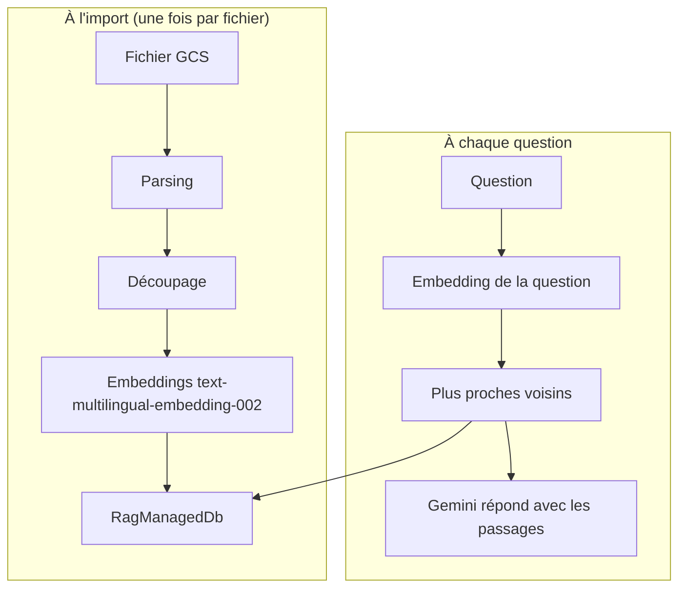

# Le cas d'usage, les briques et la région

> [!NOTE]
> Dans cette leçon, vous allez comprendre ce que RAG Engine fait à votre place, choisir la bonne région (europe-west1 n'est **pas** la bonne, on l'a vérifié) et repérer la ressource qui coûte même quand personne ne pose de question.

## Le besoin

Les salariés de Nimbus Conseil (société fictive) posent sans arrêt les mêmes questions : « combien de jours de télétravail ? », « quel plafond pour un hôtel à Paris ? », « que faire si j'ai cliqué sur un e-mail suspect ? ». Les réponses sont dans 4 documents Markdown ([files/docs/](../files/docs/)). On veut un assistant qui :

1. répond **uniquement** à partir de ces documents ;
2. **cite** le document utilisé ;
3. dit « je ne sais pas » quand l'information n'y est pas.

C'est le **RAG** (*Retrieval-Augmented Generation*, génération augmentée par la recherche) : avant de répondre, on cherche les passages pertinents et on les donne au modèle.

## Ce que RAG Engine fait à votre place

| Étape du RAG | À la main (lab local) | Avec RAG Engine |
|---|---|---|
| Lire les fichiers | `open()`, `pypdf`… | `import_files` depuis GCS, Drive, SharePoint… |
| Découper en morceaux (*chunks*) | votre fonction | `ChunkingConfig(chunk_size, chunk_overlap)` |
| Calculer les **embeddings** (vecteurs qui représentent le sens d'un texte) | appel au modèle d'embedding | fait à l'import, modèle au choix |
| Stocker et chercher les vecteurs | numpy, SQLite… | **RagManagedDb** (une base Spanner gérée par Google) |
| Donner les passages au modèle | construire le prompt | outil `retrieval` de Gemini, ou `retrieval_query` |



## Quelle région ?

La consigne de départ était `europe-west1` (Belgique). On a vérifié la page officielle des régions le 2026-10-15 :

| Région | Statut RAG Engine |
|---|---|
| `europe-west3` (Francfort), `europe-west4` (Pays-Bas) | **GA** (disponibilité générale) |
| `europe-west1` (Belgique) | préversion, **sur liste d'autorisation** uniquement |
| `us-central1`, `us-east4` | GA sur liste d'autorisation |

On utilise donc **`europe-west4`**, pour le corpus **et** pour le modèle `gemini-2.5-flash` (testé dans cette région). Les données restent dans l'Union européenne.

> [!WARNING]
> **La base vectorielle coûte en continu.** En mode « Spanner » (le mode par défaut), RAG Engine crée une instance Spanner dédiée au projet et à la région dès le palier `Basic`, facturée **à l'heure, même sans question**. Le cours voisin l'a chiffrée à un ordre de grandeur de 90 € par mois. Le lab l'allume au début et la remet en `Unprovisioned` (aucune instance) à la fin : leçon 4.

## Les fichiers du lab

| Fichier | Rôle |
|---|---|
| [rag_engine_lab.py](../files/rag_engine_lab.py) | `setup` (bucket, palier, corpus, import), `ask` (recherche + réponse ancrée), `cleanup` |
| [agent.py](../files/agent.py) | agent ADK avec l'outil `VertexAiRagRetrieval` |
| [test_rag_engine_lab.py](../files/test_rag_engine_lab.py) | tests sans clé ni réseau |
| [.env.example](../files/.env.example) | variables (projet factice) à copier en `.env` |

Tout ce que le lab crée commence par **`lab-rag-engine`** : le bucket `lab-rag-engine-<projet>` (avec le label `formation-lab=rag-engine`) et le corpus `lab-rag-engine-corpus`. Le nettoyage s'appuie sur ce préfixe.

```quiz
question: "Pourquoi le lab n'utilise-t-il pas europe-west1 pour RAG Engine ?"
options:
  - "Parce que Gemini n'existe pas en Belgique"
  - "Parce que RAG Engine n'y est qu'en préversion sur liste d'autorisation ; europe-west4 est en disponibilité générale"
  - "Parce que les buckets Cloud Storage n'existent pas en europe-west1"
answer: 1
explanation: "La page des régions de RAG Engine classe europe-west1 en « Allowlist, Preview ». europe-west3 et europe-west4 sont GA, et gemini-2.5-flash répond en europe-west4."
```

```quiz
question: "Quelle ressource de RAG Engine est facturée même quand personne ne pose de question ?"
options:
  - "Le corpus vide"
  - "L'instance Spanner de RagManagedDb, tant que le palier n'est pas Unprovisioned"
  - "Le modèle d'embedding"
answer: 1
explanation: "Les embeddings et Gemini sont facturés à l'usage. L'instance Spanner (palier Basic ou Scaled) est facturée à l'heure tant qu'elle existe, pour toute la région du projet."
```

## Exercice : repérer les étapes

Pour la question « Quel est le plafond d'un repas d'affaires à Lyon ? », listez dans l'ordre ce qui se passe entre la question et la réponse, en nommant la brique Google Cloud de chaque étape.

<details>
<summary>Voir la solution</summary>

1. La question est transformée en vecteur par `text-multilingual-embedding-002` (Vertex AI).
2. RAG Engine cherche dans **RagManagedDb** (Spanner) les morceaux les plus proches : ici le début de `notes-de-frais.md`, qui contient le tableau des plafonds.
3. Les passages sont donnés à **Gemini 2.5 Flash**, qui répond « 28 € par personne » (Lyon est « en région »).
4. La réponse revient avec ses **métadonnées d'ancrage** (`grounding_metadata`) : la liste des morceaux utilisés, donc le nom du fichier.

Rien n'est relu dans le bucket à la question : le bucket ne sert qu'à l'import.

</details>

## Résultat obtenu

Vérification de la région faite le 2026-10-15 : la création d'un corpus en `europe-west4` a d'abord échoué, parce que la base y était coupée. C'est le message que verra tout lecteur dont le palier est `Unprovisioned` :

```text
google.api_core.exceptions.FailedPrecondition: 400 RAG Engine has been unprovisioned.
Please switch to Serverless mode or update the Spanner mode tier via UpdateRagEngineConfig
to Scaling or Basic before creating a RagCorpus.
```

D'où la fonction `set_tier("basic")` du lab (leçon suivante).

## Je sais faire

- [ ] Expliquer ce que RAG Engine automatise (lecture, découpage, embeddings, stockage, recherche)
- [ ] Choisir une région où RAG Engine est GA
- [ ] Identifier la ressource à coût fixe (RagManagedDb) et comment la couper
