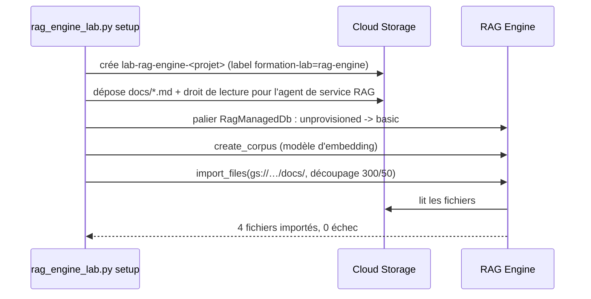

# Bucket, base vectorielle, corpus et découpage

> [!NOTE]
> Dans cette leçon, vous allez créer un bucket temporaire, allumer la base RagManagedDb, créer le corpus et y importer les documents avec un découpage que vous choisissez. C'est la commande `python rag_engine_lab.py setup`.

## Préparer l'environnement

```bash title="terminal"
cd files
python -m venv .venv && source .venv/bin/activate
pip install -r requirements.txt
gcloud auth application-default login
cp .env.example .env      # puis mettez VOTRE identifiant de projet dans GOOGLE_CLOUD_PROJECT
```

Aucune clé d'API : toutes les bibliothèques lisent les identifiants **ADC**.



## 1. Le bucket temporaire

```python title="files/rag_engine_lab.py"
def upload_docs() -> str:
    client = storage.Client(project=PROJECT)
    bucket = client.bucket(BUCKET)
    if not bucket.exists():
        bucket.labels = LABELS                      # {"formation-lab": "rag-engine"}
        bucket.iam_configuration.uniform_bucket_level_access_enabled = True
        bucket = client.create_bucket(bucket, location=LOCATION)
    for f in sorted(DOCS.glob("*.md")):
        bucket.blob(f"docs/{f.name}").upload_from_filename(str(f), content_type="text/markdown")
    # L'agent de service RAG Engine (créé par Google) doit pouvoir lire le bucket.
    number = _project_number()
    policy = bucket.get_iam_policy(requested_policy_version=3)
    policy.bindings.append({"role": "roles/storage.objectViewer",
                            "members": {f"serviceAccount:service-{number}@gcp-sa-vertex-rag.iam.gserviceaccount.com"}})
    bucket.set_iam_policy(policy)
    return f"gs://{BUCKET}/docs/"
```

Un **agent de service** est un compte technique que Google crée dans votre projet pour qu'un service agisse en votre nom. Ce n'est pas *vous* qui lisez le bucket pendant l'import, c'est `service-<numéro>@gcp-sa-vertex-rag…` : on lui donne la lecture **sur ce bucket seulement**.

## 2. Allumer la base vectorielle

```python title="files/rag_engine_lab.py"
def set_tier(tier: str) -> str:
    current = type(rag.get_rag_engine_config(name=_engine_config_name()).rag_managed_db_config.tier).__name__.lower()
    if current != tier:
        cls = {"basic": rag.Basic, "unprovisioned": rag.Unprovisioned}[tier]
        rag.update_rag_engine_config(rag.RagEngineConfig(
            name=_engine_config_name(), rag_managed_db_config=rag.RagManagedDbConfig(tier=cls())))
    return f"{current} -> {tier}"
```

| Palier | Ce qu'il crée | Quand |
|---|---|---|
| `Unprovisioned` | rien ; **efface toutes les données RAG** du projet dans la région | à la fin du lab |
| `Basic` | Spanner 100 unités de traitement | test, petits volumes |
| `Scaled` | Spanner de 1 à 10 nœuds, mise à l'échelle automatique | production |

> [!TIP]
> Il existe aussi un mode **Serverless** (sans Spanner, la doc le présente comme le plus économique pour démarrer). Il crée une collection Vector Search dans votre projet ; on ne l'a pas utilisé ici pour garder un coût entièrement maîtrisé et une suppression simple.

## 3. Le corpus et le découpage

```python title="files/rag_engine_lab.py"
EMBEDDING_MODEL = "publishers/google/models/text-multilingual-embedding-002"

def create_corpus():
    return rag.create_corpus(
        display_name=f"{PREFIX}-corpus",
        backend_config=rag.RagVectorDbConfig(rag_embedding_model_config=rag.RagEmbeddingModelConfig(
            vertex_prediction_endpoint=rag.VertexPredictionEndpoint(publisher_model=EMBEDDING_MODEL))))

def chunking(size: int = CHUNK_SIZE, overlap: int = CHUNK_OVERLAP):
    if not 0 <= overlap < size:
        raise ValueError(f"chunk_overlap ({overlap}) doit être >= 0 et < chunk_size ({size})")
    return rag.TransformationConfig(chunking_config=rag.ChunkingConfig(chunk_size=size, chunk_overlap=overlap))

def import_docs(corpus_name: str, gcs_uri: str):
    return rag.import_files(corpus_name, [gcs_uri], transformation_config=chunking(),
                            max_embedding_requests_per_min=300, timeout=900)
```

- Le **modèle d'embedding se choisit à la création** du corpus et ne change plus : changer de modèle = nouveau corpus.
- `chunk_size` est en **jetons** (*tokens*, des morceaux de mots) ; `chunk_overlap` est la part répétée entre deux morceaux voisins, pour ne pas couper une règle en deux.
- Passer un **dossier** `gs://…/docs/` importe tous ses fichiers.

| Réglage | Effet | Pour quels documents |
|---|---|---|
| petits morceaux (≈ 200-300) | passages précis, plus de morceaux | règles courtes, FAQ (notre cas) |
| gros morceaux (≈ 800-1000) | plus de contexte par passage | procédures longues, contrats |
| chevauchement 10-20 % | évite de couper une phrase utile | presque toujours |

> [!WARNING]
> Le découpage est appliqué **à l'import**. Le changer ensuite ne modifie rien : il faut supprimer les fichiers du corpus et les réimporter (re-calcul des embeddings, donc re-facturation).

```quiz
question: "Vous voulez passer du modèle d'embedding text-multilingual-embedding-002 à un autre. Que faites-vous ?"
options:
  - "update_corpus avec le nouveau modèle"
  - "Créer un nouveau corpus avec le nouveau modèle et réimporter les fichiers"
  - "Rien : RAG Engine recalcule les vecteurs tout seul"
answer: 1
explanation: "Le modèle d'embedding est fixé à la création du corpus : des vecteurs de deux modèles différents ne sont pas comparables."
```

```quiz
question: "Que fait chunking(100, 100) ?"
options:
  - "Il crée des morceaux de 100 jetons qui se recouvrent entièrement"
  - "Il lève ValueError : le chevauchement doit être plus petit que le morceau"
  - "Il désactive le découpage"
answer: 1
explanation: "Un chevauchement égal à la taille ferait avancer le découpage de zéro jeton. La fonction refuse la configuration avant l'appel à l'API (testé dans test_rag_engine_lab.py)."
```

## Exercice : un import plus « gros grain »

Vous ajoutez au corpus un règlement intérieur de 40 pages. Proposez un réglage de découpage différent et la façon de l'appliquer sans toucher aux 4 documents existants.

<details>
<summary>Voir la solution</summary>

Le découpage est un paramètre **de chaque import**, pas du corpus. On peut donc importer le nouveau fichier avec ses propres valeurs :

```python
rag.import_files(corpus.name, ["gs://lab-rag-engine-<projet>/reglement/"],
                 transformation_config=chunking(800, 120))
```

Les 4 documents gardent leurs morceaux de 300 jetons. Gardez une trace des réglages par dossier : si vous réimportez un jour tout le corpus, il faudra réutiliser les mêmes valeurs.

</details>

## Résultat obtenu

Exécution réelle du 2026-10-15 (`europe-west4`, 4 fichiers fictifs ; numéro de projet masqué) :

```text
$ python rag_engine_lab.py setup
palier RagManagedDb : unprovisioned -> basic
corpus créé : projects/<numéro-projet>/locations/europe-west4/ragCorpora/6917529027641081856
import : 4 fichiers, 0 échecs, 114 s
```

Les 114 secondes incluent l'allumage de la base, la création du corpus et l'import.

## Je sais faire

- [ ] Donner à l'agent de service RAG Engine la lecture d'un seul bucket
- [ ] Passer le palier RagManagedDb de `Unprovisioned` à `Basic` et inversement
- [ ] Créer un corpus avec un modèle d'embedding explicite
- [ ] Choisir `chunk_size` et `chunk_overlap` selon le type de document
