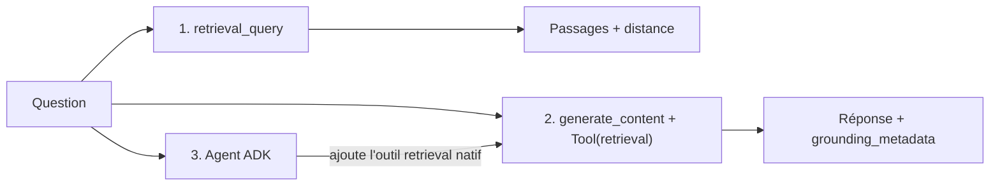

# Recherche, génération ancrée et agent ADK

> [!NOTE]
> Dans cette leçon, vous allez interroger le corpus de trois façons : la **recherche seule** (pour voir ce que RAG Engine trouve), la **génération ancrée** (Gemini lit lui-même le corpus et cite ses sources) et un **agent ADK** équipé de l'outil `VertexAiRagRetrieval`.



## 1. La recherche seule : voir avant de générer

```python title="files/rag_engine_lab.py"
def retrieve(corpus_name: str, question: str, top_k: int = 3) -> list[dict]:
    resp = rag.retrieval_query(
        text=question, rag_resources=[rag.RagResource(rag_corpus=corpus_name)],
        rag_retrieval_config=rag.RagRetrievalConfig(top_k=top_k, filter=rag.Filter(vector_distance_threshold=0.6)))
    return format_contexts(resp)
```

- `top_k` : nombre de passages renvoyés.
- `vector_distance_threshold` : on écarte les passages dont la **distance** (plus elle est petite, plus le passage est proche de la question) dépasse 0,6.

> [!TIP]
> Commencez **toujours** par regarder les passages trouvés. Si le bon passage n'est pas dans le top 3, aucun modèle ne donnera la bonne réponse : c'est le découpage ou la question qu'il faut revoir.

## 2. La génération ancrée

**Ancrer** (*grounding*) une réponse, c'est obliger le modèle à s'appuyer sur des sources et à dire lesquelles. Ici, on ne copie pas les passages dans le prompt : on donne à Gemini un **outil `retrieval`** pointé sur le corpus, et Vertex AI fait la recherche.

```python title="files/rag_engine_lab.py"
rag_tool = types.Tool(retrieval=types.Retrieval(vertex_rag_store=types.VertexRagStore(
    rag_resources=[types.VertexRagStoreRagResource(rag_corpus=corpus_name)],
    rag_retrieval_config=types.RagRetrievalConfig(top_k=4))))
resp = client.models.generate_content(
    model=MODEL, contents=question,
    config=types.GenerateContentConfig(
        tools=[rag_tool], temperature=0,
        system_instruction="Réponds en français, uniquement à partir des documents. "
                           "Si l'information n'y est pas, dis-le."))
```

La réponse porte des `grounding_metadata` : `grounding_chunks` (les morceaux **récupérés**) et `grounding_supports` (quels morceaux **soutiennent** quelle phrase de la réponse). Ce n'est pas la même chose : on l'a vu en testant, la première version du lab citait `onboarding.md` pour une question sur le télétravail, parce qu'il avait été récupéré… puis ignoré.

```python title="files/rag_engine_lab.py"
def cited_sources(gm) -> list[str]:
    chunks = (gm.grounding_chunks or []) if gm else []
    cited = sorted({i for s in (gm.grounding_supports or []) for i in (s.grounding_chunk_indices or [])}) if gm else []
    picked = [chunks[i] for i in cited if i < len(chunks)]
    uris = [ch.retrieved_context.uri for ch in picked if ch.retrieved_context and ch.retrieved_context.uri]
    return list(dict.fromkeys(u.rsplit("/", 1)[-1] for u in uris))
```

| Champ | Contenu | À afficher comme « source » ? |
|---|---|---|
| `grounding_chunks` | tout ce que la recherche a ramené | non |
| `grounding_supports[].grounding_chunk_indices` | les morceaux qui soutiennent une phrase | **oui** |

```quiz
question: "La réponse sur le télétravail liste 3 fichiers dans grounding_chunks mais un seul dans grounding_supports. Lesquels montrer à l'utilisateur ?"
options:
  - "Les 3 : plus il y a de sources, plus c'est fiable"
  - "Celui référencé par grounding_supports : c'est lui qui soutient la réponse"
  - "Aucun : les sources sont réservées au débogage"
answer: 1
explanation: "grounding_chunks contient tout ce qui a été récupéré, même ignoré par le modèle. Citer un document qui n'a pas servi trompe l'utilisateur."
```

## 3. L'agent ADK

ADK fournit l'outil `VertexAiRagRetrieval`. En lisant son code (ADK 2.10, `google/adk/tools/retrieval/vertex_ai_rag_retrieval.py`), on voit qu'avec un modèle Gemini il **n'exécute pas de fonction Python** : il ajoute à la requête le même outil natif `retrieval` que ci-dessus.

```python title="files/agent.py"
recherche_documents = VertexAiRagRetrieval(
    name="recherche_documents",
    description="Cherche dans les documents internes de Nimbus Conseil (RH, frais, sécurité, accueil).",
    rag_corpora=[RAG_CORPUS] if RAG_CORPUS else None,
    similarity_top_k=4,
    vector_distance_threshold=0.6,
)

root_agent = Agent(
    name="assistant_documentaire",
    model=Gemini(model=MODEL, retry_options=types.HttpRetryOptions(attempts=5, initial_delay=2)),
    instruction="Tu es l'assistant documentaire de Nimbus Conseil. ... cite le nom du document. "
                "Si l'information n'y est pas, dis-le.",
    tools=[recherche_documents],
)
```

```bash title="terminal"
export GOOGLE_CLOUD_LOCATION=europe-west4
export RAG_CORPUS=projects/<numéro>/locations/europe-west4/ragCorpora/<id>   # affiché par setup
python agent.py "Je suis arrivé lundi, combien de jours puis-je télétravailler cette semaine ?"
```

> [!WARNING]
> Le `retry_options` n'est pas décoratif : au premier essai, l'agent a reçu un `429 RESOURCE_EXHAUSTED` (quota partagé). Avec 5 essais espacés, la question suivante est passée.

```quiz
question: "Avec un modèle Gemini, qui interroge le corpus quand l'agent utilise VertexAiRagRetrieval ?"
options:
  - "ADK, en appelant rag.retrieval_query dans votre processus Python"
  - "Vertex AI, via l'outil natif retrieval ajouté à la requête du modèle"
  - "Le navigateur de l'utilisateur"
answer: 1
explanation: "process_llm_request ajoute types.Tool(retrieval=...) à la requête quand le modèle est un Gemini. run_async (appel Python) ne sert qu'aux autres modèles."
```

## Exercice : un deuxième corpus

Nimbus Conseil crée un corpus séparé pour les documents clients. Comment donner à l'agent les deux corpus, et que faut-il ajouter à l'instruction ?

<details>
<summary>Voir la solution</summary>

`rag_corpora` est une liste :

```python
VertexAiRagRetrieval(name="recherche_documents", description="Documents internes et clients",
                     rag_corpora=[CORPUS_INTERNE, CORPUS_CLIENTS], similarity_top_k=6)
```

Dans l'instruction : demander d'indiquer si la source est interne ou client, et de ne jamais citer un document client à quelqu'un qui n'y a pas droit. Attention : RAG Engine ne gère pas de droits par utilisateur dans ce montage ; si les deux publics sont différents, faites **deux agents**.

</details>

## Résultat obtenu

Exécutions réelles du 2026-10-15 (`gemini-2.5-flash`, `europe-west4`) :

```text
$ python rag_engine_lab.py ask "Combien de jours de télétravail par semaine et quelle indemnité ?"
  [0.184] politique-teletravail.md : 'Politique de télétravail — Nimbus Conseil (société fictive)\nVersion 3, …'
  [0.336] politique-teletravail.md : 'Équipement\nNimbus Conseil fournit un ordinateur portable, un écran …'
  [0.377] notes-de-frais.md : 'Procédure notes de frais — Nimbus Conseil (société fictive)\n…'
RÉPONSE : Il est possible de télétravailler jusqu'à 3 jours par semaine, dont au plus 2 jours consécutifs.
Une indemnité forfaitaire de 2,50 € par jour télétravaillé est versée, dans la limite de 55 € par mois.
SOURCES : ['politique-teletravail.md']

$ python rag_engine_lab.py ask "Quel est le budget formation annuel par salarié ?"
RÉPONSE : L'information concernant le budget formation annuel par salarié n'est pas disponible dans les documents fournis.

$ python agent.py "Je suis arrivé lundi, combien de jours puis-je télétravailler cette semaine ?"
Vous pouvez télétravailler 1 jour cette semaine, car le télétravail est limité à 1 jour par semaine
pendant les 4 premières semaines d'un nouvel arrivant (politique-teletravail.md).
[sources citées : ['politique-teletravail.md']]
```

## Je sais faire

- [ ] Inspecter les passages et leur distance avec `retrieval_query`
- [ ] Obtenir une réponse ancrée avec l'outil `retrieval` de Gemini
- [ ] Distinguer morceaux récupérés et morceaux cités
- [ ] Brancher un corpus dans un agent ADK avec `VertexAiRagRetrieval`
