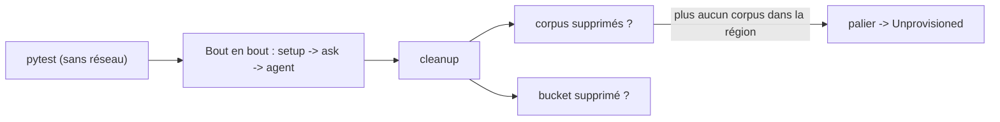

# Tests, coûts et nettoyage vérifié

> [!NOTE]
> Dans cette leçon, vous allez lancer les tests sans clé, refaire le test de bout en bout, estimer ce qu'il coûte, puis **supprimer le corpus, le bucket et la base Spanner** en vérifiant que plus rien n'existe.



## 1. Les tests sans clé

[test_rag_engine_lab.py](../files/test_rag_engine_lab.py) vérifie la logique du lab sans appeler Google :

| Test | Ce qu'il protège |
|---|---|
| `test_chunking_valide_et_refuse…` | un découpage incohérent est refusé avant l'API |
| `test_format_contexts…` | l'affichage des passages (nom de fichier, distance arrondie) |
| `test_cited_sources_ne_garde_que…` | on ne cite **que** les morceaux de `grounding_supports` |
| `test_l_agent_ajoute_l_outil_retrieval…` | l'agent ADK envoie bien le corpus et `top_k=4` à Gemini |

Le dernier test appelle la vraie méthode `process_llm_request` d'ADK sur une requête vide : aucun réseau, mais on vérifie le contrat réel entre ADK et Gemini.

```bash title="terminal"
python -m pytest -q
```

## 2. Le test de bout en bout

```bash title="terminal"
python rag_engine_lab.py setup
python rag_engine_lab.py ask "Quel est le plafond d'un repas d'affaires à Lyon ?"
RAG_CORPUS=<nom affiché par setup> python agent.py "Puis-je coller un document C3 dans un chatbot IA ?"
python rag_engine_lab.py cleanup
```

Ou tout d'un coup, avec nettoyage **même en cas d'erreur** (`try/finally`) : `python rag_engine_lab.py all "votre question"`.

## 3. Ce que ça coûte

| Poste | Facturation | Pour ce lab |
|---|---|---|
| RagManagedDb `Basic` | à l'heure, tant que le palier n'est pas `Unprovisioned` | ordre de grandeur 0,12 €/h (≈ 90 €/mois selon le cours voisin) ; allumée **6 minutes** ici |
| Parsing par défaut, découpage fixe | gratuits (page de facturation RAG Engine) | 0 € |
| Embeddings à l'import | au volume de texte | 4 petits fichiers : négligeable |
| Gemini 2.5 Flash | aux jetons lus et écrits | une dizaine de questions : quelques centimes au plus |
| Bucket Cloud Storage | au Go stocké | quelques Ko, supprimé |

> [!WARNING]
> Le piège classique : supprimer le corpus et croire que tout est arrêté. **L'instance Spanner reste** et continue d'être facturée. Seul le passage du palier à `Unprovisioned` la supprime, et il efface **toutes** les données RAG du projet dans la région. Le lab ne le fait donc **que s'il ne reste aucun corpus**.

## 4. Le nettoyage

```python title="files/rag_engine_lab.py"
def cleanup() -> None:
    for c in rag.list_corpora():
        if c.display_name.startswith(PREFIX):
            rag.delete_corpus(name=c.name)
    bucket = storage.Client(project=PROJECT).bucket(BUCKET)
    if bucket.exists():
        bucket.delete(force=True)
    for _ in range(12):  # la suppression met quelques secondes à apparaître dans la liste
        restants = [c.display_name for c in rag.list_corpora()]
        if not any(n.startswith(PREFIX) for n in restants):
            break
        time.sleep(10)
    if not restants:
        print("palier RagManagedDb :", set_tier("unprovisioned"))
    else:
        print("ATTENTION : d'autres corpus existent, la base RagManagedDb reste active :", restants)
```

La boucle d'attente vient d'un vrai incident du test : juste après `delete_corpus`, `list_corpora` montrait encore le corpus, et la première version du lab a refusé de couper la base. Quelques secondes plus tard, la liste était vide.

Vérification indépendante, en ligne de commande :

```bash title="terminal"
TOKEN=$(gcloud auth application-default print-access-token)
curl -s -H "Authorization: Bearer $TOKEN" \
  "https://europe-west4-aiplatform.googleapis.com/v1/projects/<projet>/locations/europe-west4/ragCorpora"
curl -s -H "Authorization: Bearer $TOKEN" \
  "https://europe-west4-aiplatform.googleapis.com/v1/projects/<projet>/locations/europe-west4/ragEngineConfig"
gcloud storage buckets list --project <projet> --format="value(name)" | grep lab-rag-engine
```

```quiz
question: "Vous avez supprimé le corpus du lab, mais un collègue a un autre corpus dans la même région. Que fait cleanup ?"
options:
  - "Il passe le palier en Unprovisioned, ce qui efface aussi le corpus du collègue"
  - "Il laisse la base active et affiche un avertissement avec la liste des corpus restants"
  - "Il supprime tous les corpus de la région"
answer: 1
explanation: "Unprovisioned efface toutes les données RAG du projet dans la région. Le lab ne coupe la base que s'il ne reste plus aucun corpus."
```

```quiz
question: "Quelles commandes prouvent qu'il ne reste rien de facturable après le lab ?"
options:
  - "Liste des corpus vide, ragEngineConfig en unprovisioned, aucun bucket lab-rag-engine"
  - "Le message « Successfully deleted the RagCorpus »"
  - "L'absence d'erreur dans le terminal"
answer: 0
explanation: "Un message de succès ne prouve pas l'état final (on l'a vu avec la liste encore remplie). On relit l'état réel des trois ressources."
```

## Exercice : un budget d'alerte

Proposez deux garde-fous pour qu'un lecteur qui oublie `cleanup` ne paie pas un mois de Spanner.

<details>
<summary>Voir la solution</summary>

1. Une **alerte budgétaire** du compte de facturation (par exemple à 5 €) : elle prévient, sans rien arrêter.
2. Une tâche planifiée (Cloud Scheduler + Cloud Run job, ou simple `cron` sur votre poste) qui appelle `python rag_engine_lab.py cleanup` chaque soir.

On peut aussi marquer l'heure de création dans la description du corpus et supprimer ceux qui ont plus de 24 h. Le label `formation-lab=rag-engine` du bucket permet de retrouver les restes dans la console.

</details>

## Résultat obtenu

Tests et nettoyage réels du 2026-10-15 :

```text
$ python -m pytest -v
test_rag_engine_lab.py::test_chunking_valide_et_refuse_un_chevauchement_trop_grand PASSED [ 25%]
test_rag_engine_lab.py::test_format_contexts_garde_le_nom_du_fichier PASSED [ 50%]
test_rag_engine_lab.py::test_cited_sources_ne_garde_que_les_morceaux_cites PASSED [ 75%]
test_rag_engine_lab.py::test_l_agent_ajoute_l_outil_retrieval_natif_a_la_requete PASSED [100%]
4 passed in 1.69s

$ python rag_engine_lab.py cleanup
corpus supprimé : projects/<projet>/locations/europe-west4/ragCorpora/6917529027641081856
bucket supprimé : lab-rag-engine-<projet>
palier RagManagedDb : basic -> unprovisioned
vérification : corpus du lab restants = [] | bucket existe = False

$ curl …/ragCorpora           ->  {}
$ curl …/ragEngineConfig      ->  "ragManagedDbConfig": { "unprovisioned": {}, "spanner": { "unprovisioned": {} } }
$ gcloud storage buckets list … | grep -c lab-rag-engine   ->  0
```

Base allumée à 16 h 32, coupée à 16 h 38 : six minutes de palier `Basic`.

## Je sais faire

- [ ] Lancer les tests sans clé et dire ce que chacun protège
- [ ] Estimer le coût d'un test RAG Engine et identifier le poste fixe
- [ ] Supprimer corpus, bucket et base Spanner sans effacer les données d'un collègue
- [ ] Prouver par des commandes qu'il ne reste rien
