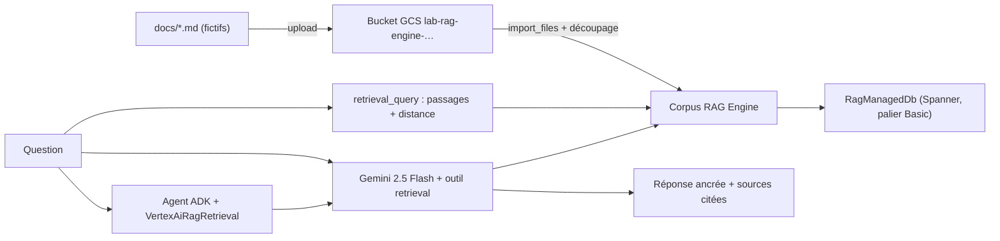

Vous avez quelques documents internes et vous voulez un assistant qui y répond **avec ses sources**, sans écrire ni base vectorielle ni découpeur de texte. **Vertex AI RAG Engine** est le service managé de Google Cloud qui fait ce travail : il lit vos fichiers, les découpe, calcule les embeddings, les range dans une base vectorielle et sait retrouver les bons passages.

Dans ce lab, vous construisez de bout en bout l'assistant documentaire d'une société **fictive**, Nimbus Conseil (télétravail, notes de frais, sécurité, accueil), puis vous **supprimez tout** et vérifiez que rien ne reste facturé.

## Pour qui ?

- Développeurs Python qui connaissent le principe du RAG (sinon : la leçon 1 le rappelle en 5 minutes).
- Vous avez un projet Google Cloud avec facturation, et `gcloud` installé.
- Pas besoin d'avoir déjà utilisé ADK : l'agent fait 20 lignes.

## Ce que vous construisez

## Prérequis

- Python 3.10 ou plus récent, `pip install -r files/requirements.txt`.
- Identifiants **ADC** (Application Default Credentials, les identifiants que les bibliothèques Google lisent automatiquement) : `gcloud auth application-default login`.
- APIs activées : Vertex AI (`aiplatform.googleapis.com`), Cloud Storage, Cloud Resource Manager.
- Une région où RAG Engine est **disponible** : on utilise `europe-west4` (voir leçon 1).

## Programme

| Module | Leçon | Durée |
|---|---|---|
| 1. Cas d'usage et architecture | [Le cas d'usage, les briques et la région](./01-cas-usage-et-architecture/01-cas-usage-et-architecture.md) | 30 min |
| 2. Construire pas à pas | [Bucket, base vectorielle, corpus et découpage](./02-construire-pas-a-pas/01-corpus-depuis-cloud-storage.md) | 40 min |
| | [Recherche, génération ancrée et agent ADK](./02-construire-pas-a-pas/02-recherche-ancree-et-agent-adk.md) | 40 min |
| 3. Tester et exploiter | [Tests, coûts et nettoyage vérifié](./03-tester-et-exploiter/01-tests-couts-nettoyage.md) | 40 min |

## En local ou sur GCP ?

| | En local | Sur GCP (ce lab) |
|---|---|---|
| Tests unitaires `pytest` | Oui, sans clé ni réseau | — |
| Corpus, recherche, réponse ancrée, agent | — | Oui : Vertex AI + ADC |
| Coût | 0 € | quelques centimes si vous nettoyez dans l'heure (leçon 4) |

Le code complet est dans [files/](./files/) : [rag_engine_lab.py](./files/rag_engine_lab.py), [agent.py](./files/agent.py), [test_rag_engine_lab.py](./files/test_rag_engine_lab.py) et les documents d'exemple de `files/docs/`.

> [!TIP]
> Vous voulez synchroniser un **dossier Google Drive** plutôt qu'un bucket ? Le cours [RAG sur vos documents Google Drive](../../../01-ia-generative/03-rag-documents-google-drive/README.md) reprend la même brique RAG Engine avec une synchro automatique, une interface et un déploiement Cloud Run.
