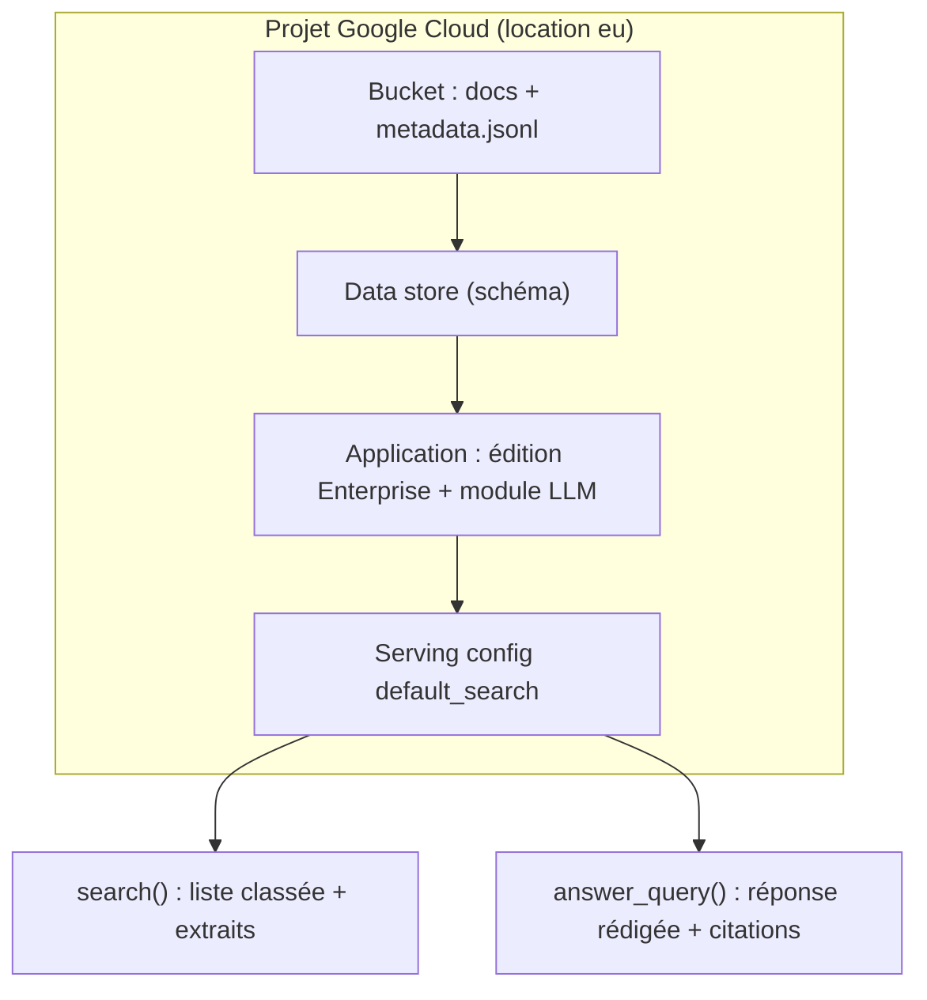

# Vertex AI Search, RAG Engine et Gemini Enterprise

> [!NOTE]
> Dans cette leçon, vous allez situer Vertex AI Search par rapport à RAG Engine et à Gemini Enterprise, apprendre son vocabulaire (data store, application, serving config) et voir pourquoi un **piège de version** de document justifie les métadonnées.

## Le besoin

Même société fictive que le lab RAG Engine, avec une difficulté en plus : il existe **deux versions** de la politique de télétravail. La v2 (2024, 2 jours) a été remplacée par la v3 (2026, 3 jours). Un moteur de recherche « naïf » trouve les deux, et la réponse risque de mélanger les règles. Il faut pouvoir **filtrer** : « seulement les documents de 2026 », « seulement la catégorie RH ».

## Le vocabulaire

| Terme | Ce que c'est | Dans le lab |
|---|---|---|
| **Data store** (magasin de données) | l'index qui contient vos documents | `lab-vais-docs` |
| **Document** | un fichier + ses métadonnées (`structData`) | 5 `.txt` décrits dans `metadata.jsonl` |
| **Schéma** | la description des métadonnées : lesquelles sont filtrables, renvoyées, servent de titre | `titre`, `categorie`, `annee` |
| **Application** (*engine*) | ce qu'on interroge ; regroupe un ou plusieurs data stores et fixe l'édition | `lab-vais-app` |
| **Serving config** | le point d'entrée de requête d'une application | `…/servingConfigs/default_search` |
| **Agent de service** | compte technique Google qui lit vos buckets pendant l'import | `service-<numéro>@gcp-sa-discoveryengine…` |



## Trois façons de faire du RAG managé chez Google

| | RAG Engine | Vertex AI Search | Gemini Enterprise |
|---|---|---|---|
| Ce qu'on obtient | des passages, un outil pour Gemini | un moteur complet + réponses citées | une application prête pour les salariés |
| Qui code | vous (modèle, prompt, agent) | vous (appels API), moins de réglages | personne : interface fournie |
| Filtres sur métadonnées | oui (`metadata_filter`, selon le backend) | oui, avec un schéma | via les data stores branchés |
| Droits par utilisateur | non dans ce montage | oui avec ACL (non utilisé ici) | oui (Workspace, Entra ID) |
| Licence par utilisateur | non | non | **oui** |

Gemini Enterprise range ses sources dans des **data stores** du même type que celui de ce lab : un data store créé ici pourrait être rattaché à une application Gemini Enterprise (leçon 4).

> [!TIP]
> Le cours [RAG sur vos documents Google Drive](../../../01-ia-generative/03-rag-documents-google-drive/README.md) déploie Gemini Enterprise de bout en bout (Drive, SharePoint, OneDrive). Ce lab-ci vous montre le moteur **sous** l'interface.

## Où le créer ?

Vertex AI Search n'a **pas de région seule** comme `europe-west1` : seulement `global`, `eu` ou `us`. On choisit `eu` (données dans l'Union européenne), ce qui impose le point d'accès `eu-discoveryengine.googleapis.com`. Le bucket, lui, est en `europe-west1`.

```quiz
question: "Pourquoi le lab crée-t-il le data store dans « eu » et pas dans « europe-west1 » ?"
options:
  - "Par erreur : europe-west1 serait moins cher"
  - "Parce que Vertex AI Search ne propose que les multi-régions global, eu et us"
  - "Parce que le bucket est en eu"
answer: 1
explanation: "La page des emplacements de Vertex AI Search ne liste que global, us et eu. Le bucket peut être dans une région européenne ordinaire."
```

```quiz
question: "Les deux politiques de télétravail (2024 et 2026) sont dans le data store. Quel élément permet de n'utiliser que la version en vigueur ?"
options:
  - "Un champ annee déclaré indexable dans le schéma, puis le filtre annee >= 2026"
  - "Le nom du fichier"
  - "Une consigne dans le prompt : « ignore les vieux documents »"
answer: 0
explanation: "Le filtre s'applique avant la génération : le document 2024 n'est même pas lu. Une consigne dans le prompt n'est pas une garantie."
```

## Exercice : choisir la brique

Pour chacun des trois besoins, choisissez RAG Engine, Vertex AI Search ou Gemini Enterprise : (a) un agent ADK maison qui combine recherche et appels à votre API de réservation ; (b) 300 salariés qui veulent « un Google interne » sur Drive avec leurs droits ; (c) un site intranet avec une barre de recherche, des facettes par catégorie et un résumé en tête.

<details>
<summary>Voir la solution</summary>

- (a) **RAG Engine** (ou Vertex AI Search comme outil) : l'agent est à vous, vous voulez des passages à combiner avec d'autres outils.
- (b) **Gemini Enterprise** : interface fournie, connecteurs Drive, droits par utilisateur ; prévoir les licences.
- (c) **Vertex AI Search** : recherche classée, facettes (`dynamicFacetable` dans le schéma), extraits et réponse citée par l'API, intégrés dans votre propre page.

</details>

## Résultat obtenu

Création réelle du 2026-10-15 (numéro de projet masqué) : les noms complets montrent la hiérarchie projet → `locations/eu` → collection → data store / application.

```text
data store : projects/<numéro-projet>/locations/eu/collections/default_collection/dataStores/lab-vais-docs
application : projects/<numéro-projet>/locations/eu/collections/default_collection/engines/lab-vais-app (346 s)
```

## Je sais faire

- [ ] Définir data store, document, schéma, application et serving config
- [ ] Choisir entre RAG Engine, Vertex AI Search et Gemini Enterprise
- [ ] Choisir la bonne location (`eu`) et le point d'accès correspondant
