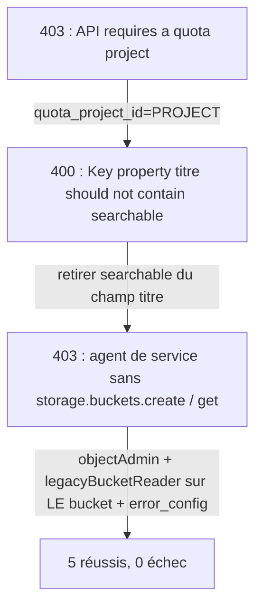

# Data store, schéma et import depuis GCS

> [!NOTE]
> Dans cette leçon, vous allez décrire vos documents dans un fichier JSONL, créer le data store avec un schéma qui rend `categorie` et `annee` filtrables, et réussir l'import après avoir traversé les **trois erreurs** réellement rencontrées en construisant le lab.

## 1. Décrire les documents : metadata.jsonl

Un document **non structuré** (PDF, HTML, texte…) peut porter des métadonnées. On les déclare dans un fichier **JSONL** (un objet JSON par ligne) :

```python title="files/vais_lab.py"
METADATA = {
    "politique-teletravail": {"titre": "Politique de télétravail (v3)", "categorie": "rh", "annee": 2026},
    "politique-teletravail-2024": {"titre": "Politique de télétravail (v2, ancienne)", "categorie": "rh", "annee": 2024},
    ...
}

def jsonl_lines(bucket: str, names: list[str]) -> str:
    return "\n".join(json.dumps({
        "id": n, "structData": METADATA[n],
        "content": {"mimeType": "text/plain", "uri": f"gs://{bucket}/docs/{n}.txt"},
    }, ensure_ascii=False) for n in names)
```

```json title="gs://lab-vais-<projet>/metadata.jsonl (une ligne)"
{"id": "notes-de-frais", "structData": {"titre": "Procédure notes de frais", "categorie": "finance", "annee": 2026}, "content": {"mimeType": "text/plain", "uri": "gs://lab-vais-<projet>/docs/notes-de-frais.txt"}}
```

## 2. Le schéma, déclaré à la création

```python title="files/vais_lab.py"
SCHEMA = {
    "$schema": "https://json-schema.org/draft/2020-12/schema", "type": "object",
    "properties": {
        "titre": {"type": "string", "retrievable": True, "keyPropertyMapping": "title"},
        "categorie": {"type": "string", "retrievable": True, "indexable": True, "dynamicFacetable": True},
        "annee": {"type": "number", "retrievable": True, "indexable": True},
    },
}
```

| Annotation | Effet |
|---|---|
| `indexable` | le champ est **filtrable** (`categorie: ANY("rh")`, `annee >= 2026`) |
| `retrievable` | le champ est renvoyé dans les résultats |
| `dynamicFacetable` | le champ peut servir de **facette** (compteurs par valeur dans une interface) |
| `keyPropertyMapping: "title"` | le champ devient le titre du document |

```python title="files/vais_lab.py"
OPTS = ClientOptions(api_endpoint=f"{LOCATION}-discoveryengine.googleapis.com", quota_project_id=PROJECT)

ds = ds_client.create_data_store(
    parent=COLLECTION, data_store_id=DATA_STORE_ID,
    data_store=de.DataStore(
        display_name=DATA_STORE_ID, industry_vertical=de.IndustryVertical.GENERIC,
        solution_types=[de.SolutionType.SOLUTION_TYPE_SEARCH],
        content_config=de.DataStore.ContentConfig.CONTENT_REQUIRED,   # documents avec contenu (fichiers)
        starting_schema=de.Schema(json_schema=json.dumps(SCHEMA)))).result(timeout=600)
```

## 3. L'import, et les trois erreurs vérifiées

```python title="files/vais_lab.py"
op = de.DocumentServiceClient(client_options=OPTS).import_documents(de.ImportDocumentsRequest(
    parent=f"{DATA_STORE}/branches/default_branch",
    gcs_source=de.GcsSource(input_uris=[uri], data_schema="document"),   # « document » = notre JSONL
    error_config=de.ImportErrorConfig(gcs_prefix=f"gs://{BUCKET}/import-errors/"),
    reconciliation_mode=de.ImportDocumentsRequest.ReconciliationMode.INCREMENTAL))
```



| Erreur réelle (2026-10-15) | Cause | Correction dans le lab |
|---|---|---|
| `403 … requires a quota project` | avec des identifiants ADC **utilisateur**, cette API veut savoir quel projet compter | `quota_project_id=PROJECT` dans `ClientOptions` |
| `400 … Key property titre should not contain searchable or indexable annotation` | un champ clé (`title`) n'accepte pas ces annotations | `titre` : seulement `retrievable` + `keyPropertyMapping` |
| `403 … does not have storage.buckets.create` puis `storage.buckets.get` | l'agent de service veut écrire son rapport d'erreurs et lire le bucket | `error_config` vers **notre** bucket, rôles `objectAdmin` et `legacyBucketReader` **sur ce bucket** |

> [!TIP]
> Le cours voisin sur Gemini Enterprise a résolu la même erreur en donnant le rôle `roles/discoveryengine.serviceAgent` au niveau du projet. Ici on préfère des droits limités à un seul bucket temporaire, qui disparaissent avec lui.

```quiz
question: "Que se passe-t-il si categorie n'est pas « indexable » dans le schéma ?"
options:
  - "La recherche marche, mais le filtre categorie: ANY(\"rh\") est refusé ou inopérant"
  - "L'import échoue"
  - "La catégorie devient le titre"
answer: 0
explanation: "indexable rend un champ utilisable dans les filtres. Sans lui, la donnée est stockée mais on ne peut pas filtrer dessus."
```

```quiz
question: "Pourquoi le mode de réconciliation INCREMENTAL ?"
options:
  - "Il ajoute et met à jour les documents du fichier sans supprimer ceux qui n'y sont pas"
  - "Il supprime tous les documents absents du fichier"
  - "Il est obligatoire pour les fichiers texte"
answer: 0
explanation: "INCREMENTAL ajoute ou remplace. FULL rend le data store identique au fichier, en supprimant ce qui n'y figure plus : utile pour une synchro, dangereux par erreur."
```

## Exercice : ajouter un document

Ajoutez une « Charte de déconnexion » (catégorie `rh`, 2026) au data store **sans tout réimporter**. Que modifiez-vous ?

<details>
<summary>Voir la solution</summary>

1. Créez `files/docs/charte-deconnexion.txt`.
2. Ajoutez `"charte-deconnexion": {"titre": "Charte de déconnexion", "categorie": "rh", "annee": 2026}` à `METADATA`.
3. Relancez `python vais_lab.py setup` : le data store et l'application existants sont réutilisés (`get_data_store`, `get_engine`), le JSONL est réécrit et l'import `INCREMENTAL` ajoute le nouveau document ; les 5 autres sont remplacés à l'identique.

</details>

## Résultat obtenu

Exécution réelle du 2026-10-15, après les trois corrections (numéro de projet masqué) :

```text
$ python vais_lab.py setup
bucket : gs://lab-vais-<projet>/metadata.jsonl
data store : projects/<numéro-projet>/locations/eu/collections/default_collection/dataStores/lab-vais-docs
import : 5 réussis, 0 échecs []
application : projects/<numéro-projet>/locations/eu/collections/default_collection/engines/lab-vais-app (346 s)
```

## Je sais faire

- [ ] Écrire un `metadata.jsonl` pour des documents non structurés
- [ ] Déclarer un schéma avec champs filtrables, renvoyés et titre
- [ ] Créer un data store en `eu` avec le bon point d'accès et un projet de quota
- [ ] Diagnostiquer les erreurs de droits de l'agent de service pendant un import
