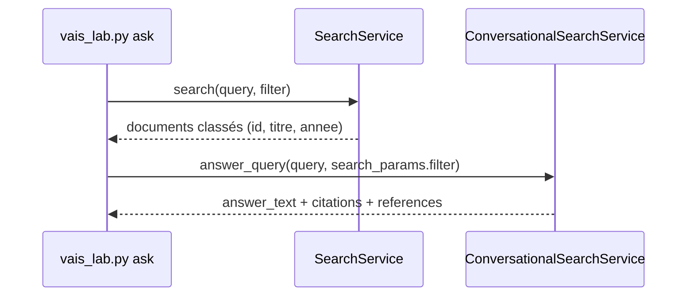

# Application, réponses citées et filtres

> [!NOTE]
> Dans cette leçon, vous allez créer l'application de recherche, l'interroger de deux façons (`search` pour la liste classée, `answer_query` pour la réponse rédigée avec citations), filtrer sur les métadonnées et lire correctement les citations.

## 1. L'application (engine)

```python title="files/vais_lab.py"
eng = eng_client.create_engine(
    parent=COLLECTION, engine_id=ENGINE_ID,
    engine=de.Engine(
        display_name=ENGINE_ID, solution_type=de.SolutionType.SOLUTION_TYPE_SEARCH,
        industry_vertical=de.IndustryVertical.GENERIC, data_store_ids=[DATA_STORE_ID],
        search_engine_config=de.Engine.SearchEngineConfig(
            search_tier=de.SearchTier.SEARCH_TIER_ENTERPRISE,
            search_add_ons=[de.SearchAddOn.SEARCH_ADD_ON_LLM]))).result(timeout=600)
```

| Réglage | Ce qu'il apporte |
|---|---|
| `SEARCH_TIER_STANDARD` | recherche classée, extraits |
| `SEARCH_TIER_ENTERPRISE` | + recherche sémantique avancée, extraits plus riches |
| `SEARCH_ADD_ON_LLM` | + **réponses générées** (résumé) avec citations |

Les deux derniers sont facturés à la requête : on ne les active que parce que le lab veut des réponses rédigées.

## 2. Deux appels, deux usages



```python title="files/vais_lab.py"
def answer_request(query: str, filtre: str = "") -> de.AnswerQueryRequest:
    R = de.AnswerQueryRequest
    return R(
        serving_config=f"{ENGINE}/servingConfigs/default_search", query=de.Query(text=query),
        search_spec=R.SearchSpec(search_params=R.SearchSpec.SearchParams(max_return_results=3, filter=filtre)),
        answer_generation_spec=R.AnswerGenerationSpec(
            include_citations=True, answer_language_code="fr",
            ignore_non_answer_seeking_query=True, ignore_adversarial_query=True, ignore_low_relevant_content=True))
```

Les options `ignore_*` font **refuser** la génération dans certains cas (question hors sujet, tentative de détournement, contenu peu pertinent). Le motif revient dans `answer_skipped_reasons`.

> [!WARNING]
> On a d'abord essayé le résumé de `search()` (`summary_spec`) : juste après la création de l'application, il revenait **vide** (`"summary": {}`) sans aucun motif, alors que `answer_query` répondait déjà. Environ trois minutes après la création de l’application, le résumé de `search()` fonctionnait aussi. Si votre résumé est vide sur une application neuve : attendez quelques minutes avant de chercher un bug.

## 3. Lire les citations

Chaque citation donne une plage de caractères de la réponse (`start_index`, `end_index`) et des `reference_id` vers `answer.references`. Sur nos fichiers `.txt`, les références sont des **morceaux** (`chunk_info`) : le titre est dans `chunk_info.document_metadata.title`, pas dans `unstructured_document_info.title` (vide, vérifié).

```python title="files/vais_lab.py"
def ref_title(ref) -> str:
    if ref.chunk_info.content:
        meta = ref.chunk_info.document_metadata
        return meta.title or meta.uri.rsplit("/", 1)[-1]
    info = ref.unstructured_document_info
    return info.title or info.uri.rsplit("/", 1)[-1]

def parse_answer(ans) -> dict:
    titres = [ref_title(r) for r in ans.references]
    citations = [{"passage": ans.answer_text[c.start_index:c.end_index].strip()[:80],
                  "sources": sorted({titres[int(x.reference_id)] for x in c.sources if int(x.reference_id) < len(titres)})}
                 for c in ans.citations]
    return {"reponse": ans.answer_text, "citations": citations,
            "sources": list(dict.fromkeys(t for c in citations for t in c["sources"])), ...}
```

Comme dans le lab RAG Engine, `references` contient tout ce qui a été lu ; on n'affiche comme sources que les documents **cités**.

## 4. Les filtres

| Filtre | Effet |
|---|---|
| `annee >= 2026` | seulement les versions récentes |
| `categorie: ANY("rh")` | seulement la catégorie RH |
| `categorie: ANY("rh", "finance") AND annee >= 2025` | combinaison |

Pour une interface, ne laissez jamais l'utilisateur taper un filtre : construisez-le à partir de valeurs contrôlées.

```python title="files/vais_lab.py"
def build_filter(categorie: str | None = None, annee_min: int | None = None) -> str:
    parts = []
    if categorie:
        if not categorie.isalnum():
            raise ValueError(f"catégorie invalide : {categorie!r}")
        parts.append(f'categorie: ANY("{categorie}")')
    if annee_min is not None:
        parts.append(f"annee >= {int(annee_min)}")
    return " AND ".join(parts)
```

```quiz
question: "Sans filtre, la réponse sur le télétravail mentionne la v3 ET l'ancienne v2. Avec annee >= 2026, que se passe-t-il ?"
options:
  - "Le document 2024 n'est plus candidat : la réponse ne parle que de la v3"
  - "La réponse cite toujours la v2 mais l'indique comme ancienne"
  - "La requête échoue car annee est un nombre"
answer: 0
explanation: "Le filtre s'applique à la recherche, avant la génération. Résultat réel : un seul document trouvé, politique-teletravail."
```

```quiz
question: "Question sur l'hôtel à Paris avec le filtre categorie: ANY(\"rh\") : que renvoie answer_query ?"
options:
  - "Le plafond de 160 €"
  - "Pas de réponse générée, avec un motif dans answer_skipped_reasons"
  - "Une erreur 400"
answer: 1
explanation: "Les notes de frais sont en catégorie finance : aucun document RH ne répond. Résultat réel : « Impossible de générer un résumé… » et le motif OUT_OF_DOMAIN_QUERY_IGNORED."
```

## Exercice : facettes

Le schéma déclare `categorie` comme `dynamicFacetable`. Écrivez la modification de `search_request` qui demande le nombre de documents par catégorie.

<details>
<summary>Voir la solution</summary>

```python
de.SearchRequest(
    serving_config=..., query=query, page_size=5, filter=filtre,
    facet_specs=[de.SearchRequest.FacetSpec(facet_key=de.SearchRequest.FacetSpec.FacetKey(key="categorie"))],
)
```

La réponse contient alors `resp.facets[0].values` : chaque valeur (`rh`, `finance`…) avec son `count`. Une interface affiche ces compteurs à côté des résultats, et un clic ajoute `categorie: ANY("…")` au filtre via `build_filter`.

</details>

## Résultat obtenu

Exécutions réelles du 2026-10-15 (location `eu`) :

```text
$ python vais_lab.py wait
   1 s : 5 documents trouvés

== Combien de jours de télétravail par semaine ? | filtre: (aucun)
DOCS ['politique-teletravail', 'politique-teletravail-2024', 'onboarding']
REPONSE Selon la politique de télétravail actuellement en vigueur (Version 3, applicable à partir du 1er mars 2026) […]
  *(Pour rappel, l'ancienne version de la politique […] limitait le télétravail à 2 jours par semaine […])*

== Combien de jours de télétravail par semaine ? | filtre: annee >= 2026
DOCS ['politique-teletravail']
SOURCES ['Politique de télétravail (v3)']       (4 citations)

== Que faire si j'ai cliqué sur un e-mail suspect ? | filtre: categorie: ANY("securite")
REPONSE […] signaler l'incident dans l'heure qui suit […] securite@nimbus.example ou en appelant le poste 4444 […]
SOURCES ['Charte de sécurité informatique']

== Quel est le plafond d'un hôtel à Paris ? | filtre: categorie: ANY("rh")
"documents": [], "ignoree": ["OUT_OF_DOMAIN_QUERY_IGNORED"]

== Quel est le budget formation par salarié ?
"ignoree": ["NO_RELEVANT_CONTENT"]
```

## Je sais faire

- [ ] Choisir l'édition et le module LLM d'une application
- [ ] Appeler `search` et `answer_query`, et savoir lequel sert à quoi
- [ ] Extraire les sources réellement citées d'une réponse
- [ ] Construire un filtre sûr sur des métadonnées indexables
