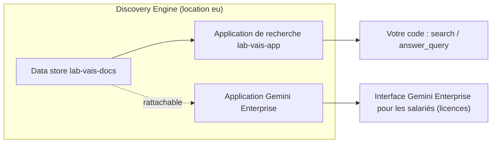

# Tests, Gemini Enterprise, coûts et nettoyage

> [!NOTE]
> Dans cette leçon, vous allez lancer les tests sans réseau, comprendre comment ce data store se brancherait dans Gemini Enterprise, estimer les coûts, puis supprimer application, data store et bucket **dans le bon ordre** en vérifiant chaque suppression.

## 1. Les tests sans clé

| Test de [test_vais_lab.py](../files/test_vais_lab.py) | Ce qu'il protège |
|---|---|
| `test_jsonl_une_ligne_par_document…` | le format du JSONL : `id`, `structData`, `content.uri` |
| `test_tous_les_documents_ont_un_fichier` | chaque entrée de `METADATA` a son `.txt` |
| `test_build_filter` | la syntaxe des filtres et le refus d'une tentative d'injection |
| `test_requetes_visent_l_application…` | `search` et `answer_query` portent le même filtre et visent la bonne serving config |
| `test_parse_answer_ne_garde_que…` | seuls les documents **cités** deviennent des sources |

Les tests construisent de vrais objets `discoveryengine_v1` (`de.Answer`, `de.Answer.Citation`…) sans les envoyer : on vérifie le code contre les types réels de la bibliothèque.

## 2. Le lien avec Gemini Enterprise



- Gemini Enterprise range les sources de ses connecteurs (Cloud Storage, Drive, SharePoint…) dans des **data stores** ; l'import depuis Cloud Storage fait partie de ses sources documentées.
- Un même data store peut donc servir à la fois votre application de recherche (API) et une application Gemini Enterprise (interface), sans dupliquer l'index.
- Ce qui change avec Gemini Enterprise : l'identité de chaque utilisateur, les **licences** par personne, les connecteurs fédérés et l'interface de conversation.

On ne l'a **pas** créée ici (licences nécessaires). Le cours [RAG sur vos documents Google Drive](../../../01-ia-generative/03-rag-documents-google-drive/README.md) le fait en vrai, sous-projet « Gemini Enterprise natif ».

## 3. Les coûts

| Poste | Facturation (voir la page de tarifs) | Pour ce lab |
|---|---|---|
| Requêtes de l'édition Enterprise | par tranche de 1 000 requêtes | une quinzaine de requêtes |
| Module LLM (réponses générées) | par tranche de 1 000 requêtes, en plus | une dizaine de réponses |
| Stockage de l'index | au Go par mois, au-delà d'un quota gratuit | quelques Ko, supprimé après 10 minutes |
| Bucket Cloud Storage | au Go par mois | quelques Ko, supprimé |

Ordre de grandeur pour ce lab : quelques centimes. Pas de coût fixe à l'heure comme la base Spanner de RAG Engine, mais l'index reste facturé tant que le data store existe.

## 4. Le nettoyage

```python title="files/vais_lab.py"
# L'application d'abord : un data store rattaché à une application ne peut pas être supprimé.
for label, delete, get, name in [("application", engines.delete_engine, engines.get_engine, ENGINE),
                                 ("data store", stores.delete_data_store, stores.get_data_store, DATA_STORE)]:
    try:
        delete(name=name)  # opération longue : on ne lit pas son résultat (vide, le SDK le refuse — vérifié)
    except NotFound:
        print(label, "déjà absent(e)")
        continue
    for _ in range(90):    # on attend que la ressource ait vraiment disparu
        try:
            get(name=name)
            time.sleep(10)
        except NotFound:
            print(label, "supprimé(e)")
            break
```

> [!WARNING]
> Première version du nettoyage : `delete_engine(...).result()` a levé `Unexpected state: Long-running operation had neither response nor error set`, alors que l'application était bien supprimée. On vérifie donc la disparition avec `get_*` au lieu de lire le résultat de l'opération.

> [!TIP]
> Selon le cours voisin sur Gemini Enterprise, un identifiant de data store supprimé peut rester **bloqué plusieurs heures**. Si `setup` refuse de recréer `lab-vais-docs` juste après un nettoyage, changez `DATA_STORE_ID` ou patientez.

Vérification indépendante :

```bash title="terminal"
TOKEN=$(gcloud auth application-default print-access-token)
for r in dataStores engines; do
  curl -s -H "Authorization: Bearer $TOKEN" -H "x-goog-user-project: <projet>" \
    "https://eu-discoveryengine.googleapis.com/v1/projects/<projet>/locations/eu/collections/default_collection/$r"
done
gcloud storage ls --project <projet> | grep lab-vais
```

```quiz
question: "Pourquoi supprimer l'application avant le data store ?"
options:
  - "Pour des raisons alphabétiques"
  - "Un data store encore rattaché à une application ne peut pas être supprimé"
  - "Supprimer le data store supprime aussi le bucket"
answer: 1
explanation: "L'application référence le data store par data_store_ids. On détache en supprimant l'application, puis on supprime le data store et enfin le bucket."
```

```quiz
question: "La suppression renvoie une erreur « neither response nor error set ». Que conclure ?"
options:
  - "Que la suppression a échoué"
  - "Rien : on vérifie l'état réel avec get_engine / get_data_store, qui doivent renvoyer NotFound"
  - "Qu'il faut supprimer le projet"
answer: 1
explanation: "Le message vient du SDK qui ne sait pas lire une réponse vide. Seul l'état relu fait foi."
```

## Exercice : nettoyer ce qu'on aurait oublié

Un lecteur a lancé `setup` trois fois avec des préfixes différents et ne se souvient plus des noms. Comment retrouver et supprimer tout ce qui vient du lab ?

<details>
<summary>Voir la solution</summary>

- Applications et data stores : `list_engines` / `list_data_stores` sur `default_collection`, en filtrant les noms qui commencent par `lab-` (c'est ce que fait la ligne de vérification de `cleanup`).
- Buckets : ils portent le label `formation-lab=vertex-ai-search` :

```bash
gcloud storage buckets list --project <projet> --filter="labels.formation-lab=vertex-ai-search" --format="value(name)"
```

Puis on supprime dans l'ordre application → data store → bucket.

</details>

## Résultat obtenu

Tests et nettoyage réels du 2026-10-15 :

```text
$ python -m pytest -v
test_vais_lab.py::test_jsonl_une_ligne_par_document_avec_metadonnees_et_lien_gcs PASSED [ 20%]
test_vais_lab.py::test_tous_les_documents_ont_un_fichier PASSED          [ 40%]
test_vais_lab.py::test_build_filter PASSED                               [ 60%]
test_vais_lab.py::test_requetes_visent_l_application_et_portent_le_filtre PASSED [ 80%]
test_vais_lab.py::test_parse_answer_ne_garde_que_les_sources_citees PASSED [100%]
5 passed in 0.43s

$ python vais_lab.py cleanup        (2e passage : l'application avait été supprimée au 1er, qui a levé l'erreur du SDK)
application déjà absent(e)
data store supprimé(e)
bucket supprimé : lab-vais-<projet>
vérification : applications = [] | data stores = [] | bucket existe = False

$ curl …/dataStores  ->  {}
$ curl …/engines     ->  {}
```

Data store créé à 16 h 41, tout supprimé à 16 h 50.

## Je sais faire

- [ ] Tester le code Discovery Engine sans réseau avec les vrais types
- [ ] Expliquer comment un data store se partage avec Gemini Enterprise
- [ ] Citer les postes de coût de Vertex AI Search
- [ ] Supprimer application, data store et bucket dans l'ordre et le prouver
