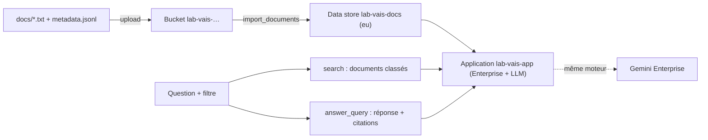

**Vertex AI Search** est le moteur de recherche d'entreprise de Google Cloud (son API s'appelle **Discovery Engine**). Là où RAG Engine vous donne des briques (corpus, passages, outil pour Gemini), Vertex AI Search vous donne un **moteur complet** : index, classement, extraits, filtres, et une réponse générée avec ses citations. C'est aussi le moteur sur lequel s'appuie **Gemini Enterprise**.

Dans ce lab, vous créez **tout par l'API Python** (pas de console) pour la société fictive Nimbus Conseil : un data store de 5 documents avec métadonnées, une application de recherche, des requêtes avec réponse citée et filtres, puis la suppression vérifiée de chaque ressource.

## Pour qui ?

- Développeurs Python à l'aise avec Google Cloud (`gcloud`, IAM de base).
- Vous savez ce qu'est le RAG ; idéalement vous avez fait le lab [Vertex AI RAG Engine](../01-vertex-ai-rag-engine/index.md).

## Ce que vous construisez

## Prérequis

- Python 3.10+, `pip install -r files/requirements.txt` (dont `google-cloud-discoveryengine`).
- `gcloud auth application-default login` et l'API `discoveryengine.googleapis.com` activée.
- Un projet avec facturation. Vertex AI Search n'existe qu'en **multi-région** (`global`, `eu`, `us`) : on prend `eu`.

## Programme

| Module | Leçon | Durée |
|---|---|---|
| 1. Cas d'usage et architecture | [Vertex AI Search, RAG Engine et Gemini Enterprise](./01-cas-usage-et-architecture/01-cas-usage-et-architecture.md) | 30 min |
| 2. Construire pas à pas | [Data store, schéma et import depuis GCS](./02-construire-pas-a-pas/01-data-store-et-import.md) | 40 min |
| | [Application, réponses citées et filtres](./02-construire-pas-a-pas/02-application-reponses-filtres.md) | 40 min |
| 3. Tester et exploiter | [Tests, Gemini Enterprise, coûts et nettoyage](./03-tester-et-exploiter/01-tests-gemini-enterprise-nettoyage.md) | 40 min |

## En local ou sur GCP ?

| | En local | Sur GCP (ce lab) |
|---|---|---|
| `pytest` (JSONL, filtres, analyse des réponses) | Oui, sans réseau | — |
| Data store, application, requêtes | — | Oui, ADC + projet de quota |
| Durée | secondes | ≈ 6 min de création, puis l'index répond tout de suite |

Code complet : [vais_lab.py](./files/vais_lab.py), [test_vais_lab.py](./files/test_vais_lab.py), documents fictifs dans `files/docs/`.
