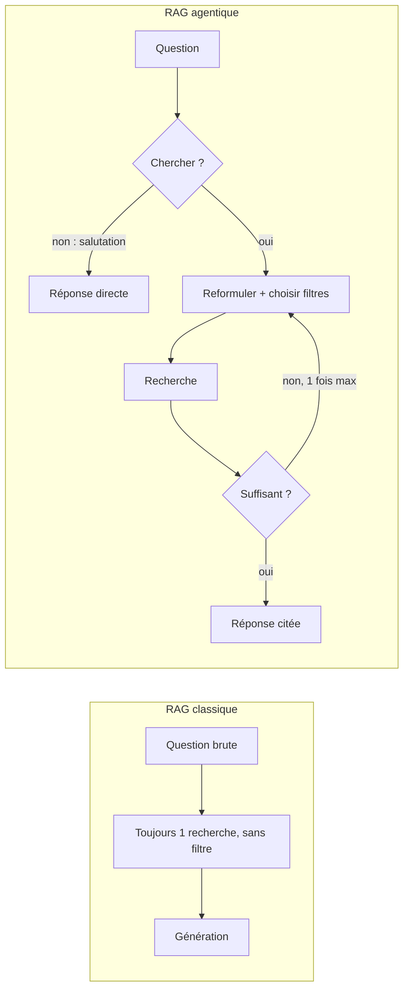

# Du RAG classique au RAG agentique

> [!NOTE]
> Dans cette leçon, vous allez voir sur des exemples réels ce qu'un agent fait mieux qu'un pipeline RAG fixe, pourquoi BigQuery est un bon choix de base vectorielle pour un petit volume, et quelles décisions on laisse (ou pas) au modèle.

## Le problème du pipeline fixe



Trois questions réelles montrent la différence :

| Question | Pipeline fixe | Ce que l'agent a fait (2026-10-15) |
|---|---|---|
| « Bonjour ! Tu sers à quoi ? » | une recherche inutile | aucune recherche |
| « Je viens d'arriver, combien de jours de télétravail ? » | trouve v2 **et** v3, risque de mélange | `requete='télétravail jours semaine'`, `categorie='rh'`, `annee_min=2026` |
| « Avant 2026, combien de jours… ? » | idem | `annee_min=0` : il garde l'historique et cite la v2 |

## Pourquoi BigQuery ?

Une **base vectorielle** stocke des embeddings et retrouve les plus proches d'un vecteur donné. BigQuery le fait avec la fonction `VECTOR_SEARCH`, dans une table ordinaire :

| Critère | BigQuery | Base vectorielle dédiée |
|---|---|---|
| Filtres sur métadonnées | SQL complet (`WHERE`, jointures) | selon le produit |
| Données déjà là | souvent : vos tables métier sont dans BigQuery | à synchroniser |
| Coût au repos | stockage seul ; pas de serveur allumé | souvent un service à l'heure |
| Latence | quelques secondes par requête (vu : 2,5 à 3 s, embedding compris) | souvent plus faible |
| Petit volume | parfait, **sans index** (recherche exacte) | surdimensionné |

> [!TIP]
> Ce lab est un bon choix pour un assistant interne, des analyses ou des volumes modestes. Pour un chatbot public très sollicité qui doit répondre en quelques centaines de millisecondes, une base vectorielle dédiée reste préférable.

## Ce qu'on laisse au modèle, ce qu'on garde dans le code

| Décision | Qui | Pourquoi |
|---|---|---|
| Chercher ou non | modèle | dépend du sens de la question |
| Reformuler en mots-clés | modèle | il comprend la question |
| Choisir `categorie` et `annee_min` | modèle, **dans une liste fermée** | le code refuse toute autre catégorie |
| Construire le SQL | **code** | paramètres BigQuery : pas d'injection possible |
| Nombre maximal de recherches | **code** | la consigne seule n'a pas suffi (leçon 4) |
| Octets lus par requête | **code** | `maximum_bytes_billed` |

```quiz
question: "Qu'est-ce qui distingue un RAG agentique d'un RAG classique ?"
options:
  - "Il utilise un plus gros modèle"
  - "Le modèle décide s'il faut chercher, avec quelle requête et quels filtres, et peut relancer une recherche"
  - "Il n'utilise pas d'embeddings"
answer: 1
explanation: "La recherche devient un outil que l'agent appelle quand il le juge utile, avec les arguments qu'il choisit."
```

```quiz
question: "Pourquoi le SQL est-il construit par le code et pas par le modèle ?"
options:
  - "Parce que le modèle ne connaît pas SQL"
  - "Pour garder le contrôle : valeurs passées en paramètres, liste fermée de catégories, plafond d'octets lus"
  - "Parce que BigQuery refuse le SQL généré"
answer: 1
explanation: "Laisser un modèle écrire du SQL ouvre la porte aux requêtes coûteuses ou dangereuses. Il choisit des valeurs, le code les vérifie et les passe en paramètres."
```

## Exercice : vos propres filtres

Nimbus Conseil veut aussi filtrer par **pays** (France, Belgique) et par **public** (tous, managers). Écrivez la nouvelle signature de l'outil et la règle à ajouter à l'instruction.

<details>
<summary>Voir la solution</summary>

```python
def rechercher_documents(requete: str, tool_context: ToolContext, categorie: str = "",
                         annee_min: int = 0, pays: str = "", public: str = "") -> dict:
    """...
        pays: "fr" ou "be" si la question le précise, sinon "".
        public: "managers" si la question concerne les managers, sinon "".
    """
```

Instruction : « Si l'utilisateur ne précise pas son pays, ne filtre pas sur le pays et signale les différences entre pays. » Côté code : deux colonnes `pays` et `public` dans la table, deux listes fermées dans `build_query`, et des paramètres `@pays`, `@public`.

</details>

## Résultat obtenu

Extrait réel du 2026-10-15 : l'agent décide de ne pas chercher, puis de chercher avec des filtres différents selon la question.

```text
== Bonjour ! Tu sers à quoi ?
Bonjour ! Je suis l'assistant documentaire de Nimbus Conseil. Je peux rechercher des informations dans les documents internes de l'entreprise.

== Avant 2026, combien de jours de télétravail étaient autorisés ?
  OUTIL rechercher_documents {'requete': 'jours télétravail', 'categorie': 'rh', 'annee_min': 0}
Avant le 1er mars 2026, jusqu'à 2 jours de télétravail par semaine étaient autorisés (Politique de télétravail (v2, ancienne)).
```

## Je sais faire

- [ ] Expliquer ce qu'un agent apporte à un pipeline RAG
- [ ] Dire quand BigQuery convient comme base vectorielle
- [ ] Répartir les décisions entre le modèle et le code
