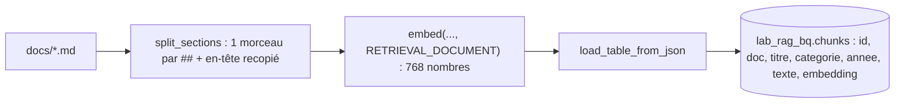

# Morceaux et embeddings dans BigQuery

> [!NOTE]
> Dans cette leçon, vous allez découper les documents par section, calculer leurs embeddings avec Vertex AI en `europe-west1`, et charger le tout dans une table BigQuery d'un dataset temporaire `lab_rag_bq` étiqueté et à expiration automatique. C'est `python bq_rag.py load`.



## 1. Découper par section

Nos documents sont en Markdown avec des sections `##` courtes. Le découpage le plus simple et le plus sûr : **une section = un morceau**, en recopiant l'en-tête du document (titre + version) dans chaque morceau.

```python title="files/bq_rag.py"
def split_sections(markdown: str) -> list[str]:
    parts = re.split(r"\n(?=## )", markdown.strip())
    head, sections = parts[0], parts[1:]
    return [f"{head}\n\n{s}" for s in sections] or [head]
```

Pourquoi recopier l'en-tête ? Sans lui, le morceau « Jusqu'à 2 jours de télétravail par semaine » ne dit pas qu'il vient de l'**ancienne** version. Avec lui, l'embedding et le modèle voient « ANCIENNE VERSION, Version 2 ».

## 2. Calculer les embeddings

```python title="files/bq_rag.py"
EMBEDDING_MODEL = os.environ.get("EMBEDDING_MODEL", "gemini-embedding-001")
DIMS = 768

@functools.cache  # un seul client : un client temporaire est fermé avant la requête (vérifié)
def _genai():
    return genai.Client(vertexai=True, project=PROJECT, location=LOCATION, http_options=types.HttpOptions(
        retry_options=types.HttpRetryOptions(attempts=5, initial_delay=2)))

def embed(texts: list[str], task: str) -> list[list[float]]:
    r = _genai().models.embed_content(model=EMBEDDING_MODEL, contents=texts, config=types.EmbedContentConfig(
        task_type=task, output_dimensionality=DIMS))
    return [e.values for e in r.embeddings]
```

| Choix | Pourquoi |
|---|---|
| `gemini-embedding-001` | disponible en `europe-west1` (vérifié) ; `gemini-embedding-2` y renvoie 404 |
| `output_dimensionality=768` | 4 fois moins de stockage et de lecture que les 3 072 dimensions natives |
| `task_type` | `RETRIEVAL_DOCUMENT` pour les morceaux, `RETRIEVAL_QUERY` pour la question |
| un appel pour la liste | vérifié : un vecteur **par texte**, identique à un appel par texte |

> [!WARNING]
> Ce qui est vrai pour `gemini-embedding-001` ne l'est pas pour tous les modèles. Un autre rédacteur a vérifié que `gemini-embedding-2` **agrège** une liste en un seul vecteur et ignore `task_type`. Testez toujours : `len(r.embeddings) == len(texts)`.

Les vecteurs réduits à 768 dimensions ne sont **pas** normalisés (norme mesurée : 0,59). Ce n'est pas gênant ici : la distance **cosinus** ne dépend pas de la longueur des vecteurs.

Premier essai réel, raté : `_genai().models.embed_content(...)` sans cache levait `RuntimeError: Cannot send a request, as the client has been closed`. Le client créé dans l'expression était libéré avant la fin de la requête ; `functools.cache` le garde en vie.

## 3. Le dataset et la table

```python title="files/bq_rag.py"
ds = bigquery.Dataset(f"{PROJECT}.{DATASET}")
ds.location, ds.labels = LOCATION, {"formation-lab": "rag-bigquery"}
ds.default_table_expiration_ms = 24 * 3600 * 1000  # filet de sécurité : les tables expirent après 24 h
bq.create_dataset(ds, exists_ok=True)
...
schema = [bigquery.SchemaField(n, t, mode=m) for n, t, m in [
    ("id", "STRING", "REQUIRED"), ("doc", "STRING", "REQUIRED"), ("titre", "STRING", "NULLABLE"),
    ("categorie", "STRING", "NULLABLE"), ("annee", "INT64", "NULLABLE"), ("texte", "STRING", "NULLABLE"),
    ("embedding", "FLOAT64", "REPEATED")]]
job = bq.load_table_from_json(rows, TABLE, job_config=bigquery.LoadJobConfig(
    schema=schema, write_disposition="WRITE_TRUNCATE"))
```

- `embedding` est une colonne `ARRAY<FLOAT64>` (mode `REPEATED`) : c'est le format attendu par `VECTOR_SEARCH`.
- `default_table_expiration_ms` : si vous oubliez le nettoyage, la table disparaît d'elle-même après 24 h (le dataset vide reste, sans coût).
- Un **job de chargement** (`load`) est gratuit, contrairement à l'insertion en flux (*streaming*).

```quiz
question: "Pourquoi recopier l'en-tête du document dans chaque morceau ?"
options:
  - "Pour remplir la table plus vite"
  - "Pour qu'un morceau isolé garde son contexte (document, version), utile à l'embedding et au modèle"
  - "Parce que BigQuery l'exige"
answer: 1
explanation: "Le morceau « 2 jours par semaine » seul ne dit pas qu'il vient de l'ancienne politique. Avec l'en-tête, le modèle peut le signaler."
```

```quiz
question: "Vous passez à un modèle d'embedding qui renvoie 3 072 dimensions. Que devez-vous refaire ?"
options:
  - "Rien"
  - "Recalculer tous les embeddings de la table avec le même modèle et la même dimension que les questions"
  - "Seulement changer DIMS dans le code"
answer: 1
explanation: "Question et documents doivent être plongés dans le même espace : même modèle, même dimension. Sinon VECTOR_SEARCH compare des choses incomparables (ou échoue sur la longueur)."
```

## Exercice : découper un long document

La charte de sécurité grossit et une section fait maintenant 3 pages. Adaptez `split_sections` pour couper une section trop longue en morceaux d'environ 1 500 caractères, en gardant l'en-tête.

<details>
<summary>Voir la solution</summary>

```python
def split_sections(markdown: str, max_chars: int = 1500) -> list[str]:
    parts = re.split(r"\n(?=## )", markdown.strip())
    head, sections = parts[0], parts[1:] or [""]
    out = []
    for s in sections:
        paras, cur = s.split("\n\n"), ""
        for p in paras:
            if cur and len(cur) + len(p) > max_chars:
                out.append(f"{head}\n\n{cur}")
                cur = ""
            cur = f"{cur}\n\n{p}" if cur else p
        out.append(f"{head}\n\n{cur}".strip())
    return out
```

On coupe aux paragraphes (`\n\n`) pour ne pas trancher une phrase. Ajoutez un test : aucun morceau ne dépasse `max_chars + len(head)` sauf un paragraphe unique plus long.

</details>

## Résultat obtenu

Exécution réelle du 2026-10-15 (`europe-west1`) :

```text
$ python bq_rag.py load
table <projet>.lab_rag_bq.chunks : 19 morceaux de 768 dimensions
(5.7 s)
```

5 documents, 19 sections, un seul appel d'embedding.

## Je sais faire

- [ ] Découper un Markdown par section en gardant le contexte
- [ ] Calculer des embeddings Vertex AI en lot, avec la bonne tâche et une dimension réduite
- [ ] Créer un dataset étiqueté qui expire tout seul
- [ ] Charger une colonne `ARRAY<FLOAT64>` avec un job de chargement
