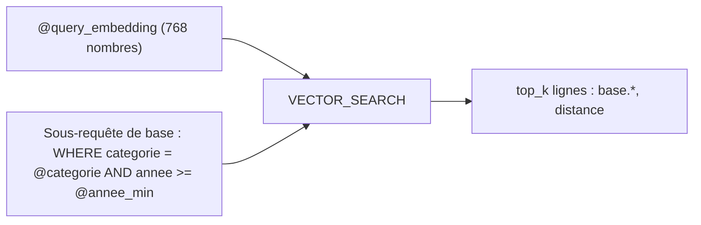

# VECTOR_SEARCH, filtres SQL et index

> [!NOTE]
> Dans cette leçon, vous allez écrire la requête `VECTOR_SEARCH` du lab, y ajouter des filtres SQL **paramétrés** (sans injection possible), plafonner les octets lus, et savoir à partir de quand un **index vectoriel** devient utile.

## 1. La requête

`VECTOR_SEARCH(table_de_base, 'colonne', table_requête, top_k, distance_type)` compare chaque vecteur de la requête à ceux de la table et renvoie les `top_k` plus proches.

```python title="files/bq_rag.py"
def build_query(categorie=None, annee_min=None, top_k=4) -> tuple[str, dict]:
    where, params = [], {}
    if categorie:
        if categorie not in CATEGORIES:                     # ("rh", "finance", "securite")
            raise ValueError(f"catégorie inconnue : {categorie!r} (attendu : {', '.join(CATEGORIES)})")
        where.append("categorie = @categorie")
        params["categorie"] = categorie
    if annee_min:
        where.append("annee >= @annee_min")
        params["annee_min"] = int(annee_min)
    base = f"(SELECT * FROM `{TABLE}`" + (f" WHERE {' AND '.join(where)})" if where else ")")
    sql = f"""
SELECT base.doc, base.titre, base.annee, base.texte, distance
FROM VECTOR_SEARCH(
  {base}, 'embedding',
  (SELECT @query_embedding AS embedding),
  top_k => {int(top_k)}, distance_type => 'COSINE')
ORDER BY distance"""
    return sql, params
```

Le résultat expose deux structures, `query` et `base` (la ligne trouvée), et la colonne `distance`. Avec `COSINE`, 0 = même direction, plus c'est petit plus c'est proche.



## 2. Les paramètres, pas la concaténation

```python title="files/bq_rag.py"
qp = [bigquery.ArrayQueryParameter("query_embedding", "FLOAT64", embed([requete], "RETRIEVAL_QUERY")[0])]
qp += [bigquery.ScalarQueryParameter(k, "INT64" if isinstance(v, int) else "STRING", v) for k, v in params.items()]
job = bigquery.Client(project=PROJECT, location=LOCATION).query(sql, job_config=bigquery.QueryJobConfig(
    query_parameters=qp, maximum_bytes_billed=MAX_BYTES))   # 100 Mo : au-delà, BigQuery refuse
```

Les valeurs (`'rh'`, `2026`, le vecteur) voyagent **à côté** du SQL : même si le modèle invente `rh' OR 1=1 --`, ce texte ne peut pas devenir du SQL. Et ici il n'arrive même pas jusqu'à BigQuery : la liste fermée `CATEGORIES` le refuse avant.

> [!TIP]
> `maximum_bytes_billed` est le garde-fou de coût le plus simple de BigQuery : une requête qui lirait plus que la limite échoue **sans être facturée**. Pour estimer avant d'exécuter : `bq query --dry_run`.

## 3. Pré-filtre ou post-filtre ?

| Où est le `WHERE` | Effet |
|---|---|
| dans la **sous-requête de base** (notre cas) | on cherche les `top_k` **parmi** les lignes filtrées : on obtient toujours `top_k` résultats s'il y en a assez |
| après `VECTOR_SEARCH` | on cherche les `top_k` dans toute la table, **puis** on filtre : on peut en obtenir moins, voire zéro |

## 4. Faut-il un index vectoriel ?

Sans index, `VECTOR_SEARCH` fait une recherche **exacte** (*brute force*) : il compare la requête à toutes les lignes. Pour 19 morceaux, c'est instantané et parfaitement exact.

| Situation | Recommandation |
|---|---|
| table < 10 Mo | pas d'index : la doc indique qu'il **n'est pas rempli** et que la recherche repasse en force brute |
| des centaines de milliers de lignes, requêtes fréquentes | `CREATE VECTOR INDEX … OPTIONS(index_type = 'IVF')` |
| lots de centaines de vecteurs de requête | `TreeAH`, optimisé pour les requêtes par lots |
| filtres fréquents avec index | déclarer les colonnes filtrées dans `STORING`, sinon le filtre devient un post-filtre |

```sql title="exemple (non exécuté dans ce lab)"
CREATE VECTOR INDEX chunks_idx ON lab_rag_bq.chunks(embedding)
STORING (categorie, annee)
OPTIONS (index_type = 'IVF', distance_type = 'COSINE');
```

Un index rend la recherche **approchée** (le rappel peut être inférieur à 100 %) et son stockage est facturé tant qu'il existe. À 19 lignes, il n'apporterait que des inconvénients.

```quiz
question: "Avec un pré-filtre categorie = 'finance' et top_k = 4, combien de lignes reçoit-on si la catégorie compte 4 morceaux ou plus ?"
options:
  - "4, toutes de la catégorie finance"
  - "Entre 0 et 4 selon la distance"
  - "4, de n'importe quelle catégorie"
answer: 0
explanation: "Le filtre est appliqué dans la table de base : VECTOR_SEARCH ne voit que les lignes finance et en renvoie les 4 plus proches. Résultat réel : 4 extraits de la Procédure notes de frais."
```

```quiz
question: "Quand créer un index vectoriel sur la table du lab ?"
options:
  - "Tout de suite : c'est toujours plus rapide"
  - "Pas à 19 lignes : sous 10 Mo l'index n'est pas rempli ; on le crée quand le volume et la fréquence des requêtes le justifient"
  - "Jamais : BigQuery n'en propose pas"
answer: 1
explanation: "Sous 10 Mo, BigQuery revient à la force brute. Un index se justifie à grand volume ; il rend la recherche approchée et son stockage est facturé."
```

## Exercice : un filtre « hors ancienne version »

Ajoutez à `build_query` un paramètre `exclure_doc` (identifiant d'un document à exclure, par exemple `politique-teletravail-2024`) sans ouvrir de faille d'injection.

<details>
<summary>Voir la solution</summary>

```python
if exclure_doc:
    if exclure_doc not in METADATA:
        raise ValueError(f"document inconnu : {exclure_doc!r}")
    where.append("doc != @exclure_doc")
    params["exclure_doc"] = exclure_doc
```

Deux protections : la valeur doit exister dans la liste connue (`METADATA`), et elle passe en paramètre `@exclure_doc` (le code existant transforme toute valeur texte en `ScalarQueryParameter` de type `STRING`). Ajoutez un test qui vérifie `"doc != @exclure_doc" in sql`.

</details>

## Résultat obtenu

Exécutions réelles du 2026-10-15 :

```text
$ python bq_rag.py search "nombre de jours de télétravail par semaine"
  [BigQuery] 124107 octets lus, filtre=aucun
  0.227  Politique de télétravail (v3) (2026) : - Pendant les 4 premières semaines d'un nouvel arrivant, …
  0.237  Politique de télétravail (v2, ancienne) (2024) : - Le lundi et le jeudi sont des jours de présence obligatoire.
  …
$ python bq_rag.py search "nombre de jours de télétravail par semaine" rh 2026
  [BigQuery] 124227 octets lus, filtre={'categorie': 'rh', 'annee_min': 2026}
  0.227  Politique de télétravail (v3) (2026) : - Pendant les 4 premières semaines d'un nouvel arrivant, …
  0.254  Politique de télétravail (v3) (2026) : Les alternants et stagiaires peuvent télétravailler 1 jour …
$ bq query --dry_run 'SELECT doc, texte FROM `<projet>.lab_rag_bq.chunks` WHERE categorie = "rh"'
Query successfully validated. […] running this query will process 6772 bytes of data.
```

Sans filtre, la v2 de 2024 arrive en 2e position ; avec le filtre, elle disparaît.

## Je sais faire

- [ ] Écrire un `VECTOR_SEARCH` avec distance cosinus et `top_k`
- [ ] Passer filtres et vecteur en paramètres de requête
- [ ] Distinguer pré-filtre et post-filtre
- [ ] Décider quand créer un index vectoriel et lequel
