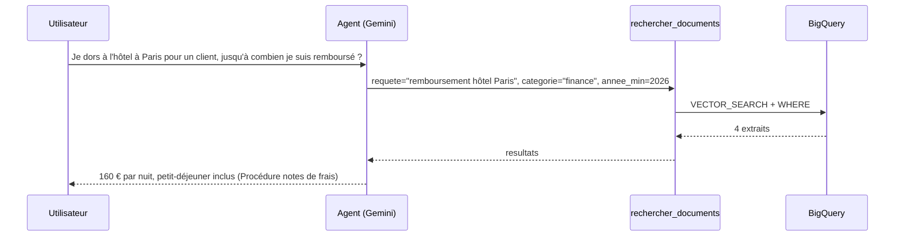

# L'agent ADK qui décide

> [!NOTE]
> Dans cette leçon, vous allez écrire l'outil `rechercher_documents` et l'agent ADK qui l'utilise : quand chercher, comment reformuler, quels filtres choisir. Puis vous ajouterez un **budget de recherches** dans le code, parce que la consigne seule n'a pas suffi.

## 1. L'outil : une fonction Python bien décrite

ADK construit la déclaration de l'outil (ce que le modèle voit) à partir de la **signature** et de la **docstring**. Chaque mot compte : c'est le seul mode d'emploi du modèle.

```python title="files/agent.py"
MAX_RECHERCHES = 2  # par question : la consigne seule ne suffit pas (vu : 3 recherches pour une info absente)

def rechercher_documents(requete: str, tool_context: ToolContext, categorie: str = "", annee_min: int = 0) -> dict:
    """Recherche sémantique dans les documents internes de Nimbus Conseil (table BigQuery).

    Args:
        requete: mots-clés précis reformulés à partir de la question (pas la question brute).
        categorie: "rh", "finance" ou "securite" si le domaine est évident, sinon "" (toutes).
        annee_min: année minimale du document (ex. 2026 pour la version en vigueur), 0 = pas de filtre.
    """
    n = tool_context.state.get("temp:recherches", 0) + 1  # « temp: » = remis à zéro à chaque question
    tool_context.state["temp:recherches"] = n
    if n > MAX_RECHERCHES:
        return {"erreur": f"Limite de {MAX_RECHERCHES} recherches atteinte : réponds avec ce que tu as."}
    try:
        rows = bq_rag.search(requete, categorie or None, annee_min or None)
    except ValueError as e:  # catégorie inventée par le modèle : on lui explique, il corrigera
        return {"erreur": str(e)}
    return {"resultats": [{k: r[k] for k in ("titre", "annee", "distance", "texte")} for r in rows]}
```

| Détail | Pourquoi |
|---|---|
| `tool_context: ToolContext` | reconnu par ADK et **caché au modèle** (testé : le schéma ne montre que `requete`, `categorie`, `annee_min`) |
| `"temp:recherches"` | l'état préfixé `temp:` ne vit que le temps d'une invocation, donc d'une question |
| erreurs renvoyées en `dict` | le modèle lit l'erreur et corrige, la conversation ne casse pas |
| `distance` renvoyée | le modèle peut juger qu'un extrait lointain ne répond pas |

## 2. L'agent

```python title="files/agent.py"
root_agent = Agent(
    name="assistant_rag_bigquery",
    model=Gemini(model=MODEL, retry_options=types.HttpRetryOptions(attempts=5, initial_delay=2)),
    instruction="""Tu es l'assistant documentaire de Nimbus Conseil (société fictive). Réponds en français, brièvement.

1. Salutation, question sur toi ou calcul simple : réponds SANS chercher.
2. Sinon appelle rechercher_documents avec une requête reformulée en mots-clés, et des filtres :
   - categorie si le domaine est clair (télétravail, accueil -> rh ; frais, remboursement -> finance ;
     mots de passe, incident -> securite) ;
   - annee_min=2026 quand on demande la règle actuelle (par défaut), 0 si on demande l'historique.
3. Si les extraits ne suffisent pas, refais AU PLUS une recherche (autres mots, ou sans filtre).
4. Réponds uniquement avec les extraits, cite le titre du document entre parenthèses.
   Si l'information n'y est pas, dis-le sans inventer.""",
    tools=[rechercher_documents],
)
```



## 3. Pourquoi un budget dans le code

Première version, sans compteur, question « Quel est le budget formation annuel ? » (absente des documents) :

```text
  OUTIL rechercher_documents {'annee_min': 2026, 'categorie': 'finance', 'requete': 'budget formation annuel'}
  OUTIL rechercher_documents {'categorie': 'rh', 'annee_min': 2026, 'requete': 'budget formation annuel'}
  OUTIL rechercher_documents {'annee_min': 2026, 'categorie': '', 'requete': 'formation budget'}
```

Trois recherches alors que la consigne en autorisait deux. Ce n'est pas grave à 3, mais un agent qui « cherche encore » sur une information absente peut boucler longtemps. La règle passe donc **dans le code** : la 3e recherche reçoit une erreur, et le modèle conclut.

> [!WARNING]
> Une consigne est une **intention**, pas une garantie. Toute limite qui protège un coût ou une ressource (nombre d'appels, octets lus, catégories autorisées) doit être appliquée dans le code de l'outil.

```quiz
question: "Pourquoi le compteur utilise-t-il la clé « temp:recherches » plutôt que « recherches » ?"
options:
  - "Les clés sans préfixe sont interdites"
  - "temp: n'existe que pendant l'invocation en cours : le compteur repart de zéro à chaque question"
  - "temp: est partagé par tous les utilisateurs"
answer: 1
explanation: "Sans préfixe, la clé vivrait toute la session : après deux questions, l'agent ne pourrait plus jamais chercher. temp: est le bon périmètre pour un budget par question."
```

```quiz
question: "Le modèle appelle rechercher_documents avec categorie=\"juridique\". Que se passe-t-il ?"
options:
  - "BigQuery exécute une requête sans résultat"
  - "L'outil renvoie {\"erreur\": \"catégorie inconnue … (attendu : rh, finance, securite)\"} et le modèle peut réessayer"
  - "L'agent plante"
answer: 1
explanation: "build_query lève ValueError avant tout appel à BigQuery, l'outil la transforme en message lisible pour le modèle (testé dans test_bq_rag.py)."
```

## Exercice : chercher dans deux catégories

« Je pars en déplacement : que dois-je savoir sur les frais et sur la sécurité de mon ordinateur ? » couvre deux catégories. Proposez deux solutions et leurs inconvénients.

<details>
<summary>Voir la solution</summary>

1. **Deux appels** (un par catégorie) : rien à changer, la consigne autorise 2 recherches. Inconvénient : le budget est consommé, plus de relance possible.
2. **Un paramètre `categories: list[str]`** : dans `build_query`, `categorie IN UNNEST(@categories)` avec un `ArrayQueryParameter("categories", "STRING", …)`, chaque valeur vérifiée dans `CATEGORIES`. Inconvénient : les `top_k` résultats peuvent tous venir de la même catégorie ; augmentez `top_k` ou faites un `top_k` par catégorie.

</details>

## Résultat obtenu

Exécutions réelles du 2026-10-15 (`gemini-2.5-flash`, `europe-west1`), avec le budget de recherches :

```text
== Je viens d'arriver, combien de jours de télétravail ai-je droit cette semaine ?
  OUTIL rechercher_documents {'categorie': 'rh', 'annee_min': 2026, 'requete': 'télétravail jours semaine'}
Pendant les 4 premières semaines d'un nouvel arrivant, le télétravail est limité à 1 jour par semaine. (Politique de télétravail (v3))

== Quel est le budget formation annuel ?
  OUTIL rechercher_documents {'requete': 'budget formation annuel', 'annee_min': 2026, 'categorie': 'finance'}
Je n'ai pas trouvé d'information concernant le budget formation annuel dans les documents disponibles.

== Quel est le plafond d'un repas d'affaires à Lyon, et puis-je prendre un taxi à 23 h ?
  OUTIL rechercher_documents {'categorie': 'finance', 'requete': 'plafond repas affaires Lyon', 'annee_min': 2026}
Le plafond pour un repas d'affaires en région (dont Lyon) est de 28 € par personne. (Procédure notes de frais)
Oui, vous pouvez prendre un taxi à 23h, car l'utilisation est autorisée entre 22h et 6h. (Procédure notes de frais)
```

## Je sais faire

- [ ] Écrire un outil ADK dont la docstring guide le choix des arguments
- [ ] Cacher `ToolContext` au modèle et l'utiliser pour l'état
- [ ] Imposer un budget de recherches par question avec `temp:`
- [ ] Renvoyer les erreurs au modèle plutôt que de lever une exception
