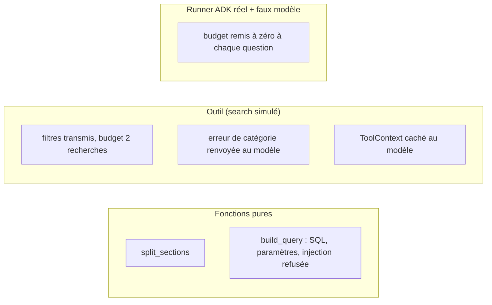

# Tester, évaluer, chiffrer et nettoyer

> [!NOTE]
> Dans cette leçon, vous allez lancer les 8 tests sans clé (dont un qui fait tourner le **vrai** runner ADK avec un faux modèle), évaluer les décisions de l'agent sur un petit jeu de questions, chiffrer le lab et supprimer le dataset en le vérifiant.

## 1. Tester sans clé



Le test le plus utile est le dernier : un `FauxModele` (sous-classe de `BaseLlm` d'ADK) demande 3 recherches par question. On fait tourner le **vrai** `InMemoryRunner` et on vérifie que l'outil répond `resultats, resultats, erreur` à **chaque** question. On teste ainsi le comportement d'ADK (portée `temp:`), pas seulement notre fonction.

```python title="files/test_bq_rag.py (extrait)"
class FauxModele(BaseLlm):
    async def generate_content_async(self, llm_request, stream=False):
        debut = max(i for i, c in enumerate(llm_request.contents)
                    if c.role == "user" and any(p.text for p in c.parts))
        n = sum(1 for c in llm_request.contents[debut:] for p in c.parts if p.function_response)
        part = (types.Part(function_call=types.FunctionCall(name="rechercher_documents", args={"requete": f"q{n}"}))
                if n < 3 else types.Part(text="fin"))
        yield LlmResponse(content=types.Content(role="model", parts=[part]))
```

## 2. Évaluer les décisions de l'agent

Pour un RAG agentique, on évalue **les décisions** autant que les réponses. Un petit jeu de référence, exécuté le 2026-10-15 :

| Question | Attendu | Observé | OK ? |
|---|---|---|---|
| Bonjour ! Tu sers à quoi ? | pas de recherche | pas de recherche | oui |
| Je viens d'arriver, combien de jours de télétravail ? | `rh`, 2026 ; « 1 jour » | `rh`, 2026 ; « 1 jour par semaine » | oui |
| Avant 2026, combien de jours ? | pas de filtre d'année ; « 2 jours » (v2) | `rh`, `annee_min=0` ; « 2 jours » | oui |
| Hôtel à Paris, remboursement ? | `finance` ; « 160 € » | `finance`, 2026 ; « 160 € par nuit » | oui |
| Budget formation annuel ? | « pas trouvé », ≤ 2 recherches | 1 recherche, « pas trouvé » (3 avant le budget) | oui |

> [!TIP]
> Automatisez ce tableau : pour chaque question, enregistrez les `function_call` de l'agent (nom + arguments) et la réponse, puis vérifiez des règles simples (catégorie attendue, nombre d'appels, présence d'un mot-clé comme « 160 »). C'est plus stable qu'une comparaison mot à mot de la réponse.

## 3. Ce que ça coûte

| Poste | Mesure réelle | Ordre de grandeur |
|---|---|---|
| Stockage BigQuery | 19 lignes de 768 nombres | négligeable (quelques centaines de Ko) |
| Requêtes `VECTOR_SEARCH` | ≈ 124 000 octets lus par recherche ; 0 octet pour une requête identique relancée (cache) | facturé au volume lu, avec un minimum par requête ; une vingtaine de recherches : bien moins d'un centime |
| Embeddings | 1 appel au chargement + 1 par recherche | quelques centimes au plus |
| Gemini 2.5 Flash | une dizaine de questions | quelques centimes |
| Garde-fou | `maximum_bytes_billed = 100 Mo` | une requête trop large échoue sans être facturée |

> [!WARNING]
> Les embeddings partagent un **quota par minute** : on a reçu un `429 … global_embed_content_requests_per_minute_per_base_model` pendant les essais. Le client du lab réessaie 5 fois avec attente croissante (`HttpRetryOptions`).

## 4. Nettoyer

```python title="files/bq_rag.py"
def cleanup() -> None:
    bq = bigquery.Client(project=PROJECT, location=LOCATION)
    bq.delete_dataset(f"{PROJECT}.{DATASET}", delete_contents=True, not_found_ok=True)
    try:
        bq.get_dataset(f"{PROJECT}.{DATASET}")
        print("ATTENTION : le dataset existe encore")
    except NotFound:
        print(f"dataset {DATASET} supprimé (vérifié : get_dataset -> NotFound)")
```

Vérification indépendante : `bq ls --project_id <projet> | grep lab_rag_bq` ne doit rien afficher.

```quiz
question: "Pourquoi tester avec le vrai InMemoryRunner et un faux modèle, plutôt qu'appeler l'outil directement ?"
options:
  - "Pour aller plus vite"
  - "Pour vérifier le comportement d'ADK lui-même (portée temp:, enchaînement des appels), sans clé ni coût"
  - "Parce que l'outil ne peut pas être appelé directement"
answer: 1
explanation: "Appeler l'outil avec un dict teste notre code ; le runner réel prouve que temp: est bien remis à zéro entre deux questions dans ADK 2.10."
```

```quiz
question: "Une requête VECTOR_SEARCH relancée à l'identique a lu 0 octet. Pourquoi ?"
options:
  - "La table était vide"
  - "BigQuery a servi le résultat depuis son cache de requêtes"
  - "Le filtre a tout exclu"
answer: 1
explanation: "Même SQL, mêmes paramètres, table inchangée : BigQuery renvoie le résultat en cache, sans lecture ni facturation."
```

## Exercice : une règle d'évaluation

Écrivez une fonction `verifier(appels, reponse, attendu)` qui contrôle une ligne du tableau d'évaluation, où `appels` est la liste des `dict(function_call.args)` observés et `attendu` un dict comme `{"categorie": "finance", "max_appels": 2, "contient": "160"}`.

<details>
<summary>Voir la solution</summary>

```python
def verifier(appels: list[dict], reponse: str, attendu: dict) -> list[str]:
    erreurs = []
    if len(appels) > attendu.get("max_appels", 2):
        erreurs.append(f"{len(appels)} recherches")
    if "categorie" in attendu and not any(a.get("categorie") == attendu["categorie"] for a in appels):
        erreurs.append(f"catégorie {attendu['categorie']} jamais utilisée")
    if attendu.get("sans_recherche") and appels:
        erreurs.append("recherche inutile")
    if "contient" in attendu and attendu["contient"] not in reponse:
        erreurs.append(f"« {attendu['contient']} » absent de la réponse")
    return erreurs
```

Une liste vide = ligne réussie. Collectez les `function_call` dans `ask()` (comme `agent.py` le fait déjà pour l'affichage) et lancez ce contrôle sur tout le jeu de questions après chaque changement de consigne.

</details>

## Résultat obtenu

Tests et nettoyage réels du 2026-10-15 :

```text
$ python -m pytest -v
test_bq_rag.py::test_split_sections_recopie_l_en_tete_dans_chaque_morceau PASSED [ 12%]
test_bq_rag.py::test_tous_les_documents_sont_decoupes PASSED             [ 25%]
test_bq_rag.py::test_build_query_sans_filtre PASSED                      [ 37%]
test_bq_rag.py::test_build_query_filtres_passes_en_parametres PASSED     [ 50%]
test_bq_rag.py::test_outil_transmet_les_filtres_et_limite_le_nombre_de_recherches PASSED [ 62%]
test_bq_rag.py::test_outil_renvoie_l_erreur_de_categorie_au_modele PASSED [ 75%]
test_bq_rag.py::test_le_parametre_tool_context_est_cache_au_modele PASSED [ 87%]
test_bq_rag.py::test_budget_remis_a_zero_a_chaque_question_dans_le_vrai_runner PASSED [100%]
8 passed in 1.34s

$ python bq_rag.py cleanup
dataset lab_rag_bq supprimé (vérifié : get_dataset -> NotFound)
$ bq ls --project_id <projet> | grep -c lab_rag_bq
0
```

## Je sais faire

- [ ] Tester un agent ADK sans clé avec un faux modèle dans le vrai runner
- [ ] Évaluer les décisions d'un agent (appels, filtres) en plus de ses réponses
- [ ] Mesurer et plafonner les octets lus par BigQuery
- [ ] Supprimer le dataset et prouver qu'il n'existe plus
