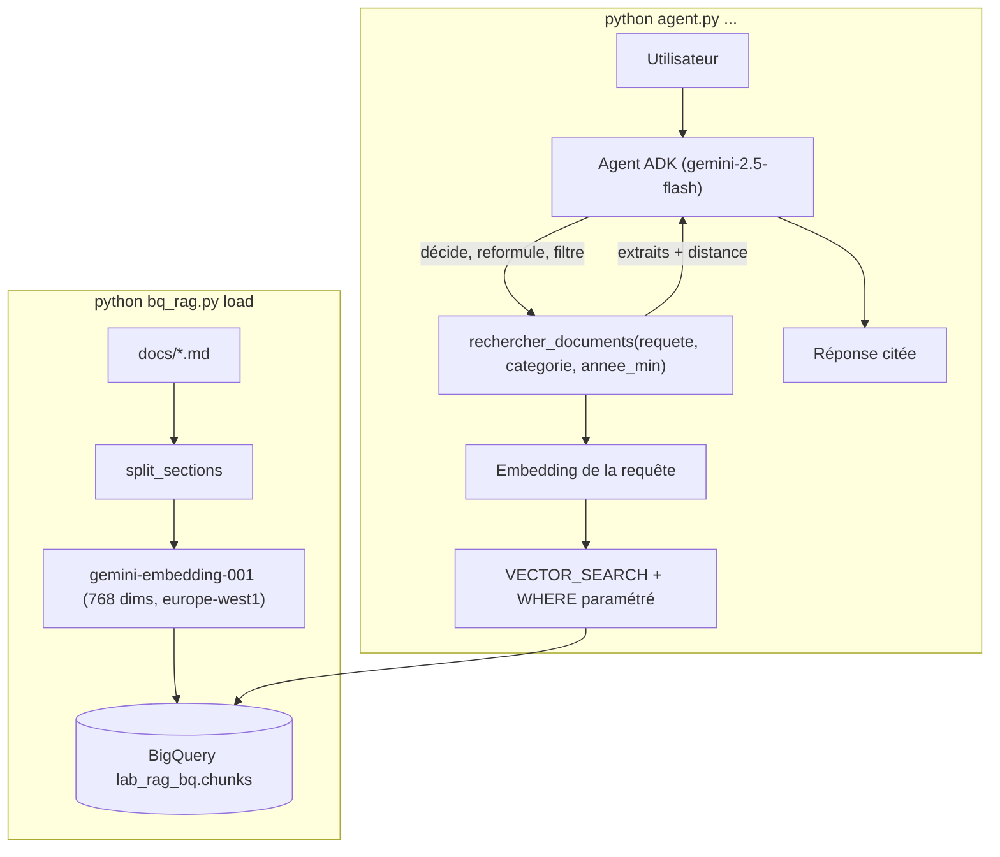

Dans un RAG « classique », chaque question déclenche **la même** recherche avec **le texte brut** de la question. Un **RAG agentique** confie ces choix à un agent : faut-il chercher ? avec quels mots ? dans quelle catégorie ? faut-il réessayer autrement ? Ce lab le construit avec deux briques que beaucoup d'équipes ont déjà : **BigQuery** pour stocker et chercher, **ADK** pour l'agent.

Fil rouge : l'assistant documentaire de la société **fictive** Nimbus Conseil, avec un piège volontaire (deux versions de la politique de télétravail, 2024 et 2026) que seuls les filtres SQL résolvent proprement.

## Pour qui ?

- Développeurs Python à l'aise avec SQL et les embeddings.
- Vous avez déjà écrit un agent ADK avec un outil (sinon : [Construire un agent IA de A à Z](../../../01-ia-generative/07-construire-un-agent-ia/index.md)).
- Projet Google Cloud avec BigQuery et Vertex AI activés.

## Architecture

## Prérequis

- Python 3.10+, `pip install -r files/requirements.txt`, `gcloud auth application-default login`.
- Région **`europe-west1`** pour le dataset et pour les modèles (vérifié : `gemini-2.5-flash` et `gemini-embedding-001` y répondent ; `gemini-embedding-2` y renvoie 404).

## Programme

| Module | Leçon | Durée |
|---|---|---|
| 1. Cas d'usage et architecture | [Du RAG classique au RAG agentique](./01-cas-usage-et-architecture/01-rag-agentique-et-architecture.md) | 25 min |
| 2. Construire pas à pas | [Morceaux et embeddings dans BigQuery](./02-construire-pas-a-pas/01-embeddings-dans-bigquery.md) | 35 min |
| | [VECTOR_SEARCH, filtres SQL et index](./02-construire-pas-a-pas/02-vector-search-et-filtres.md) | 40 min |
| | [L'agent ADK qui décide](./02-construire-pas-a-pas/03-agent-adk-qui-decide.md) | 40 min |
| 3. Tester et exploiter | [Tester, évaluer, chiffrer et nettoyer](./03-tester-et-exploiter/01-tester-evaluer-nettoyer.md) | 40 min |

## En local ou sur GCP ?

| | En local | Sur GCP (ce lab) |
|---|---|---|
| `pytest` (découpage, SQL, outil, budget de recherches) | Oui, sans réseau | — |
| Embeddings, table, VECTOR_SEARCH, agent | — | Oui, Vertex AI + BigQuery |
| Coût | 0 € | quelques centimes (≈ 120 Ko lus par recherche) |

Code : [bq_rag.py](./files/bq_rag.py), [agent.py](./files/agent.py), [test_bq_rag.py](./files/test_bq_rag.py), documents fictifs dans `files/docs/`.
