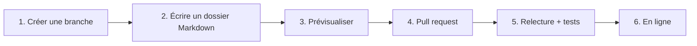

Ce site est construit à partir de simples dossiers Markdown, dans un dépôt GitHub public. **Tout le monde peut proposer un contenu** : il suffit d'ouvrir une *pull request*, qui est relue puis publiée automatiquement.



## Ce que vous pouvez proposer

| Vous avez… | Vous créez… |
|---|---|
| un parcours en plusieurs étapes | une **formation** : un dossier, une leçon par fichier |
| un sujet précis | un **article** : un fichier `.md` |
| une vidéo YouTube à recommander | une **vidéo** : un fichier avec `type: video` |
| un dépôt GitHub ou un outil | un **lien** : un fichier avec `type: link` |
| une compétence pour Gemini Enterprise | un **skill** : un dossier avec `SKILL.md` |

## Les règles en bref

- Du contenu **exact**, avec des **références réelles**.
- **Interactif** : un schéma, deux quiz et un exercice par leçon.
- **Aucune donnée sensible** : ni secret, ni nom de client, ni donnée personnelle.
- Une pull request = un sujet.

```quiz
question: "Où écrit-on une nouvelle formation ?"
options:
  - "Directement sur la branche main"
  - "Dans une branche dédiée, puis une pull request"
  - "Dans une issue GitHub"
answer: 1
explanation: "main est protégée : tout passe par une branche et une pull request, relue et testée avant publication."
```

Toutes les étapes, les modèles de fichiers et la syntaxe des quiz sont dans le [guide de contribution](https://github.com/YatchiYa/formation-plateform/blob/main/CONTRIBUTING.md).
