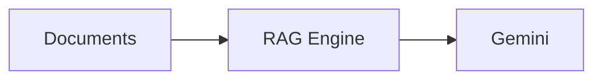

# Écrire du contenu

Tout le catalogue vit dans `content/`. **Les dossiers sont la structure** : pas de base de données, pas de configuration, pas de rebuild. Vous créez un dossier, vous y mettez du Markdown, la page existe quelques secondes plus tard.

## L'essentiel en 30 secondes

```text
content/
├── 01-ia-generative/                 ← thématique (dossier qui contient d'autres dossiers)
│   ├── index.md                      ← titre, icône, description de la thématique
│   ├── 01-rag-gcp/                   ← formation (dossier qui contient des leçons)
│   │   ├── index.md                  ← présentation de la formation + métadonnées
│   │   ├── images/  files/           ← vos fichiers (jamais transformés en pages)
│   │   ├── 01-fondamentaux/          ← module
│   │   │   ├── 01-introduction.md    ← leçon
│   │   │   └── 02-embeddings.md
│   │   └── 02-mise-en-oeuvre/
│   └── 02-checklist/index.md         ← article (dossier avec seulement index.md)
└── notes-rapides.md                  ← article (un simple fichier .md suffit)
```

URL obtenue : `/fr/ia-generative/rag-gcp/fondamentaux/introduction`.

## Règles de nommage

| Vous écrivez | Ce que ça donne |
|---|---|
| `01-mon-dossier` | slug `mon-dossier`, affiché en 1ᵉʳ. Le préfixe numérique sert **uniquement à l'ordre**. |
| `mon-dossier` (sans numéro) | rangé après les éléments numérotés, par ordre alphabétique |
| `index.md` ou `README.md` | métadonnées + introduction du dossier |
| `intro.en.md`, `index.ar.md`… | traduction (`fr` = fichier sans suffixe) |
| `images/`, `files/`, `assets/` | dossiers réservés : contiennent des fichiers, ne deviennent jamais des pages |
| `_brouillons/`, `.cache/` | ignorés (tout ce qui commence par `_` ou `.`) |

> Les URLs `/explore` et `/me` sont réservées par la plateforme : n'appelez pas une thématique racine `explore` ou `me`.

## Importer un dépôt existant tel quel

Un dépôt de code avec un `README.md` et des docs se publie **sans rien réécrire** :

- `README.md` (ou `index.md`, ou `SKILL.md`) sert de page d'accueil du dossier.
- Dans une formation, chaque sous-dossier est un **module** et **tous** les `.md` qu'il contient, à n'importe quelle profondeur (`docs/phase2/01-x.md`, `terraform/docs/…`), deviennent des leçons dans l'ordre naturel (1, 2, … 10). Le `README.md` d'un sous-dossier devient une leçon nommée d'après ce dossier.
- Les liens relatifs entre fichiers continuent de marcher, **même si un dépôt a été rangé ailleurs** : un lien `../01-mon-projet/README.md` qui ne pointe plus nulle part est retrouvé par la fin de son chemin.
- Un lien vers un dossier de code (`terraform/`, `scripts/`) ouvre la liste de ses fichiers ; les fichiers de code (`.py`, `.tf`, `.sh`, `.yaml`, `Dockerfile`…) s'ouvrent en texte lisible.
- Le bouton **Tout télécharger (.zip)** donne le dépôt complet.

Les dépôts de `~/Bureau/trash` sont importés par `scripts/import-repos.py` (voir plus bas).

## Quel type de page ?

Le type est **deviné** ; `type:` dans le `index.md` le force si besoin.

| Le dossier contient… | Type | Affichage |
|---|---|---|
| des `.md` autres que `index.md` | **formation** | sommaire, progression, leçon par leçon, précédent/suivant |
| uniquement des sous-dossiers de leçons **et** un `index.md` avec `level`, `duration`, `cover` ou `references` | **formation à modules** | idem, groupé par module |
| d'autres dossiers | **thématique** | liste des contenus, sous-thématiques, téléchargement .zip |
| seulement `index.md` | **article** | lecture longue avec sommaire latéral |
| `type: slides` dans le frontmatter | **présentation** | diaporama plein écran, clavier, vue document |

Valeurs possibles de `type:` : `category`, `course`, `article`, `slides`, `skill`, `video`, `link`.

## Les 6 formats que voit le lecteur

Chaque contenu a un format, avec sa couleur, son icône et sa page dédiée. Explorer et les pages de thématique les regroupent par format.

| Format | Comment le créer | Sa page |
|---|---|---|
| **Formation** | un dossier avec des leçons | programme, progression, reprise |
| **Article** | `index.md` seul, ou un `.md` dans une thématique | lecture avec sommaire |
| **Présentation** | `type: slides` | diaporama |
| **Vidéo** | `type: video` + `video: <url YouTube/Vimeo ou ./fichier.mp4>` | grand lecteur + vos notes |
| **Lien** | `type: link` + `url: <https://…>` | carte « Ouvrir la ressource » (GitHub reconnu) + vos notes |
| **Skill** | un dossier avec `SKILL.md` (standard Agent Skills) | encart « Utiliser ce skill » : téléchargements, étapes d'import, phrases déclencheuses |

Ajouter une vidéo = **un seul fichier** dans n'importe quelle thématique :

```markdown
---
type: video
title: Introducing Agent Development Kit
video: https://www.youtube.com/watch?v=zgrOwow_uTQ
level: beginner
tags: [adk, agents]
description: Pourquoi ADK existe.
---

## Ce que j'en retiens
- …
```

Ajouter un dépôt GitHub ou un article externe :

```markdown
---
type: link
title: google/adk-python
url: https://github.com/google/adk-python
tags: [adk, python]
description: Le code source officiel d'ADK.
---

Pourquoi je le recommande…
```

Pour un skill, la description du `SKILL.md` est découpée automatiquement : la partie « ce que fait le skill » devient la description, et la liste après `Triggers -` devient les phrases déclencheuses. Les fichiers `.zip` et `.md` placés dans son dossier `files/` sont proposés au téléchargement.
Dans un dossier `type: category`, les fichiers `.md` posés à côté des sous-dossiers deviennent des articles.

## Frontmatter

Tout est optionnel. Sans `title`, le premier `# Titre` du fichier est utilisé, puis le nom du dossier.

```yaml
---
title: Construire un RAG sur GCP
description: Une phrase qui donne envie.
icon: "🧠"                 # thématiques
cover: ./images/cover.svg  # image d'en-tête d'une formation
tags: [rag, gcp, vertex-ai]
level: intermediate        # beginner | intermediate | advanced
duration: 4h               # texte libre ; sinon temps de lecture calculé
date: 2026-09-01
updated: 2026-10-01        # sert au tri « Derniers contenus »
authors: [Youcef]
access: premium            # public (défaut) | premium
draft: true                # caché partout (pages, recherche, listes)
order: 2                   # remplace le préfixe numérique
type: slides               # force le type
references:
  - title: awesome-llm-apps
    url: https://github.com/Shubhamsaboo/awesome-llm-apps
    note: Collection d'applications LLM
  - https://arxiv.org/abs/2005.11401   # une URL seule fonctionne aussi
---
```

Les références sont affichées en cartes avec une icône selon la source (GitHub, vidéo, article scientifique, documentation, article).

Une traduction (`index.en.md`) hérite des métadonnées de l'original : elle n'a besoin que de `title` et `description`.

## Markdown pris en charge

### Texte et structure
GitHub Flavored Markdown complet : tableaux, listes de tâches `- [x]`, notes de bas de page `[^1]`, ~~barré~~, liens automatiques. HTML brut autorisé.

### Encadrés
```markdown
> [!NOTE]
> Information utile.

> [!TIP]  > [!IMPORTANT]  > [!WARNING]  > [!CAUTION]
```

### Code
````markdown
```python title="embed.py"
print("coloration syntaxique, bouton Copier, titre optionnel")
```
````
Plus de 200 langages (bash, python, hcl, yaml, json, sql, ts…). Thème clair/sombre automatique.

### Diagrammes et graphiques (Mermaid)
````markdown

````
`flowchart`, `sequenceDiagram`, `gantt`, `mindmap`, `pie`, `xychart-beta` (barres + courbes), `quadrantChart`, `timeline`… Les couleurs suivent le thème du site. **Mettez entre guillemets** les libellés qui contiennent des parenthèses ou de la ponctuation. Une erreur de syntaxe s'affiche à la place du diagramme, sans casser la page.

### Mathématiques
`$\cos(\theta)$` en ligne, `$$ ... $$` en bloc (KaTeX).

### Médias et documents
Syntaxe image, chemin **relatif au fichier .md** :

| Vous écrivez | Résultat |
|---|---|
| `` | image cliquable (zoom plein écran), légende = texte alternatif |
| `` | lecteur vidéo (mp4, webm, mov), avance rapide possible |
| `` | lecteur audio |
| `` | PDF lisible dans la page + carte de téléchargement |
| `` | aperçu du document Word dans la page + téléchargement |
| `` | carte de téléchargement ; si `deck.pdf` existe à côté, il est affiché aussi |
| URL YouTube ou Vimeo seule sur sa ligne | lecteur intégré (youtube-nocookie) |
| `[voir la leçon 2](./02-embeddings.md)` | lien interne réécrit vers la bonne URL et la bonne langue |

> [!TIP]
> Pour un PowerPoint, exportez aussi un PDF du même nom (`soffice --headless --convert-to pdf deck.pptx`) : il sera lisible directement dans la page.

### Fichiers téléchargeables
Tout fichier « document » (pdf, docx, pptx, xlsx, csv, zip, ipynb, mp4, py, tf, yaml…) posé dans le dossier d'une formation/article ou dans son `files/` apparaît automatiquement dans **Ressources**. Chaque thématique, formation et article propose aussi **Tout télécharger (.zip)** : le dossier exactement tel que vous l'avez écrit.

### Présentations
Avec `type: slides`, le contenu est découpé à chaque ligne contenant uniquement `---` (hors blocs de code). Navigation : flèches, Espace, Début/Fin, `F` pour le plein écran ; bouton pour basculer en vue document.

## Checklist avant de publier

1. Le dossier a un préfixe numérique si l'ordre compte.
2. `index.md` a au moins `title` et `description`.
3. Les chemins des images/fichiers sont relatifs au `.md` (`../files/x.pdf` depuis un module).
4. `draft: true` tant que ce n'est pas prêt.
5. Ouvrez la page : un diagramme Mermaid invalide s'affiche en rouge.

## Réimporter les dépôts du poste

```bash
python3 scripts/import-repos.py            # source par défaut : le dossier parent (~/Bureau/trash)
python3 scripts/import-repos.py --src /chemin/vers/mes/repos
```

Le script recopie chaque dépôt vers sa thématique (tableaux `THEMES`, `PROJECTS` et `SKILL_DOMAINS` en tête du fichier : titre, description, niveau, durée, tags, titres des modules), ajoute le frontmatter au `README.md`, extrait les liens externes en **références**, et range les 160 skills par métier avec leur `.zip` et leur `.md` prêts à importer.

Il **ne copie jamais** : `.env`, `*.tfstate`, `*.tfvars` (sauf `.example`), clés `.pem`/`.key`, fichiers `credential*`/`client_secret*`, `venv`, `node_modules`, `.terraform`, `.git`. Après la copie, il cherche des secrets (clés Google `AIza…`, jetons `ya29.`, clés privées, jetons GitHub/Slack/Anthropic/OpenAI) et **s'arrête** s'il en trouve.

Ajouter un dépôt : une ligne de plus dans `PROJECTS`, puis relancer le script.
