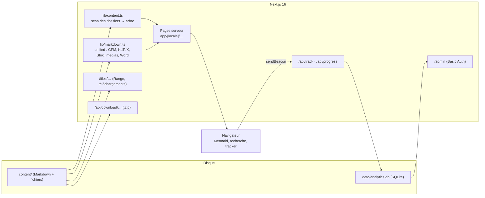

# Architecture

## Principes

- **Le système de fichiers est la base de données du contenu.** `getTree()` relit `content/` au plus toutes les `CONTENT_CACHE_MS` (quelques ms pour des centaines de fichiers). Le rendu Markdown est mis en cache par contenu de fichier.
- **Rendu côté serveur**, JavaScript client limité à l'interactif : Mermaid (chargé à la demande), recherche, progression, diaporama, tracker.
- **Un seul point de contrôle d'accès** : `canRead()` dans `lib/viewer.ts`.
- **Aucun service externe** : polices auto-hébergées par Next, analytics maison, pas de CDN tiers.

## Où modifier quoi

| Besoin | Fichier |
|---|---|
| Règles dossiers → pages, frontmatter | `lib/content.ts` |
| Rendu Markdown, nouveaux types d'embed | `lib/markdown.ts` (`rehypeContent`) |
| Textes de l'interface, nouvelle langue | `lib/i18n.ts` (+ `:lang()` des encadrés dans `globals.css`) |
| Pages thématique / formation / leçon / article | `components/views.tsx` |
| Composants interactifs de lecture | `components/reader.tsx` |
| En-tête, recherche, tracker | `components/client.tsx` |
| Requêtes du tableau de bord | `lib/stats.ts` |
| Schéma SQLite | `lib/db.ts` |
| Redirection de langue, cookie visiteur, auth admin | `proxy.ts` |
| Design (tokens, clair/sombre, RTL) | `app/globals.css` |

## Arbre de contenu

Chaque nœud a un `kind` : `category`, `course`, `module`, `lesson`, `article`. Les URLs sont les slugs des dossiers sans préfixe numérique. Les `docs` d'un nœud sont indexés par langue ; `localized(node, locale)` renvoie la traduction ou l'original.

## Sécurité

- `/files/` refuse toute sortie de `content/` et les fichiers cachés ; les SVG sont servis avec une CSP qui bloque les scripts.
- `/admin` et `/api/admin` : Basic Auth, désactivés si `ADMIN_PASSWORD` est absent.
- Le contenu Markdown (HTML brut, documents Word) est considéré comme **écrit par vous** : n'ouvrez pas `content/` à des contributions non relues.
- Le conteneur tourne en utilisateur non-root, contenu monté en lecture seule.

## Limites connues (choix assumés)

- SQLite : parfait pour une instance ; passer à Postgres pour plusieurs réplicas (`lib/db.ts`, `lib/stats.ts`, `lib/track.ts`).
- Recherche : balayage linéaire côté client, très bien jusqu'à quelques milliers de pages ; ensuite MiniSearch ou un index serveur.
- Zip en mémoire : très bien jusqu'à quelques centaines de Mo par dossier.
