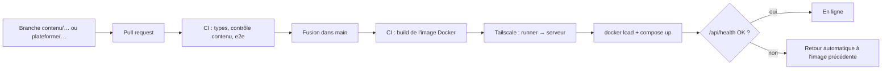

# Git, CI/CD & déploiement

Production : **https://formation.caeky.com**, sur le serveur `gpn-saas-prod` (Docker + nginx), joignable par Tailscale (`100.110.83.13`).

## Le circuit



- **Pull request** : `build-and-test` (types, aucun nom de client ni secret dans `content/`, build de production, ~35 tests de bout en bout dont « zéro lien cassé »).
- **main** : même chose, puis `deploy` (environnement GitHub `production`).
- L'image est construite **par la CI**, jamais sur le serveur (mémoire partagée avec d'autres applications), puis transférée par SSH via Tailscale.
- Le conteneur écoute sur `127.0.0.1:3090`, limité à 768 Mo de RAM ; nginx fait le TLS et le proxy.

## Branche `main` protégée

- Sur GitHub : `scripts/protect-main.sh YatchiYa/formation-plateform` (après `gh auth login`). Crée une *ruleset* : PR obligatoire, 1 approbation du propriétaire (`.github/CODEOWNERS`), CI verte, historique linéaire, ni suppression ni force-push. **Le propriétaire (admin) peut contourner.**
- En local : les hooks `.githooks/` refusent commit et push sur `main`. Le propriétaire les désactive une fois pour toutes : `git config formation.mainAllowed true`.

## Configurer la CI/CD (une seule fois)

Dans GitHub › *Settings* › *Secrets and variables* › *Actions* :

| Secret | Valeur |
|---|---|
| `TS_AUTHKEY` | Clé Tailscale *réutilisable* et *éphémère*, tag `tag:ci` (admin.tailscale.com › Settings › Keys) |
| `DEPLOY_SSH_KEY` | La clé privée `~/.ssh/formation_deploy` (sa clé publique est déjà autorisée sur le serveur) |

Variables facultatives : `DEPLOY_HOST` (défaut `100.110.83.13`), `DEPLOY_USER` (défaut `gpnops`).

> [!IMPORTANT]
> Si l'ACL Tailscale filtre par tag, autorisez `tag:ci` à joindre `gpn-saas-prod:22`.

## Déployer à la main (depuis un poste sur le tailnet)

```bash
DEPLOY_HOST=100.110.83.13 DEPLOY_SSH_OPTS="-i ~/.ssh/formation_deploy" scripts/deploy.sh
```

Le script : build → transfert → bascule → contrôle de santé → retour arrière automatique si échec. Il garde l'image courante et la précédente.

**Revenir à la version précédente à la main** :
```bash
ssh gpnops@100.110.83.13 'cd apps/formation && docker images atelier-formation'   # repérer le tag
ssh gpnops@100.110.83.13 'cd apps/formation && IMAGE_TAG=<tag> docker compose up -d && echo <tag> > .current-tag'
```

## Sur le serveur

| Élément | Emplacement |
|---|---|
| Application | `~/apps/formation/` (`docker-compose.yml`, `.env`, `.current-tag`) |
| Secrets | `~/apps/formation/.env` (`ADMIN_PASSWORD`…), jamais dans git |
| Données (stats, progression) | volume Docker `formation_formation-data` |
| nginx | `/etc/nginx/sites-available/formation.caeky.com.conf` |
| Certificat | Let's Encrypt via `certbot --nginx`, renouvelé automatiquement |

Sauvegarde des statistiques :
```bash
ssh gpnops@100.110.83.13 "docker exec formation-web node -e \"new (require('node:sqlite').DatabaseSync)('/data/analytics.db').exec(\\\"VACUUM INTO '/data/backup.db'\\\")\" && docker cp formation-web:/data/backup.db ."
```

## DNS

`formation.caeky.com` → enregistrement **A** vers `176.163.183.160` (l'IP publique du serveur), chez LWS (zone `caeky.com`).
